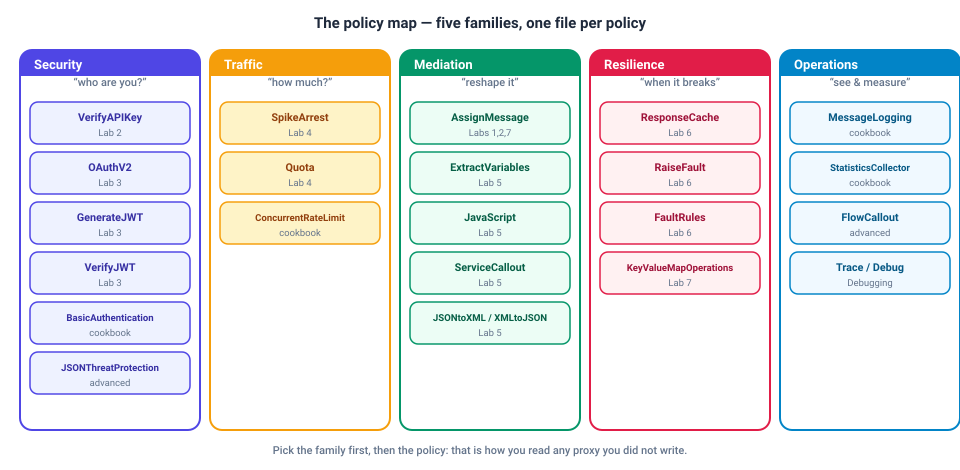
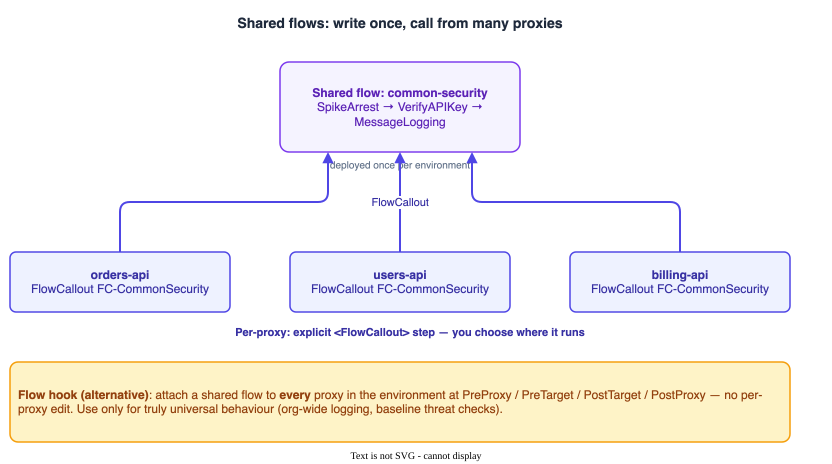
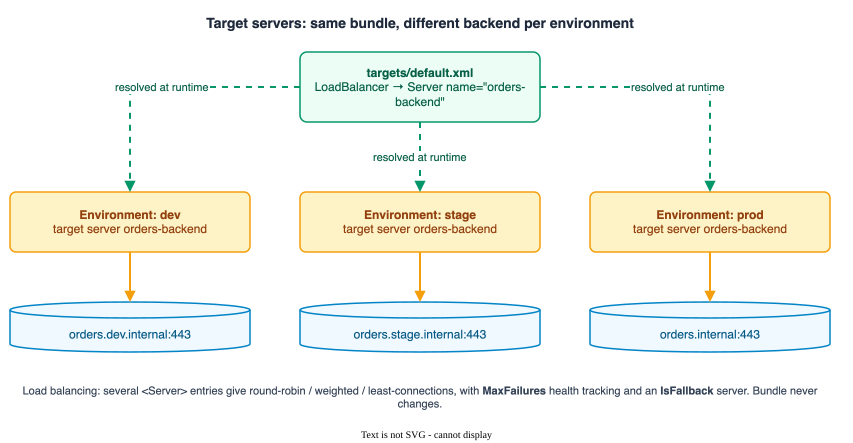
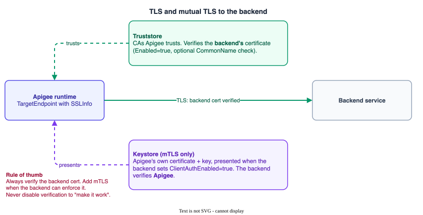
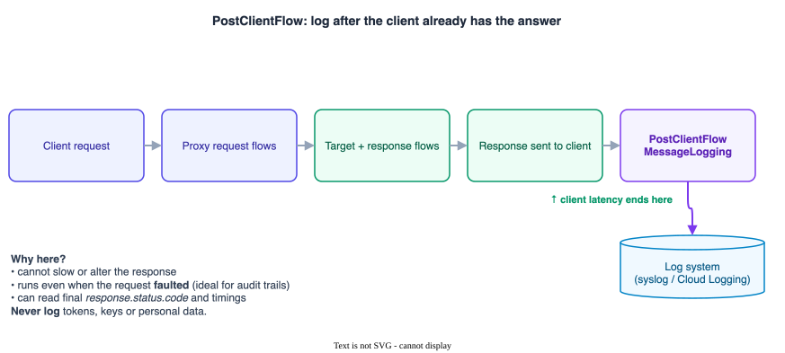
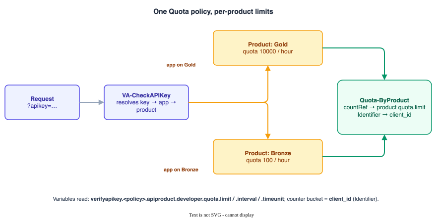
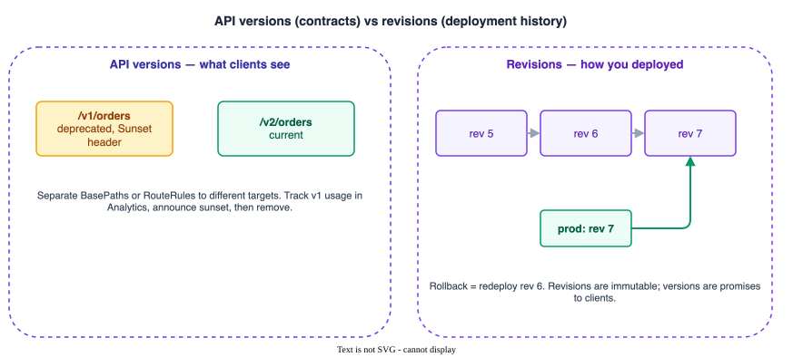

# Advanced Topics

The labs cover the core policy set. This page maps the rest of what you need
to know to run Apigee in production, with enough detail to know *when* to
reach for each tool. Each section ends with a one-line "when".



## 1. Shared flows and flow hooks



A **shared flow** is a reusable sequence of policies (a mini-proxy with no
endpoints). Instead of copying `SpikeArrest + VerifyAPIKey + logging` into
twenty proxies:

```xml title="apiproxy/policies/FC-CommonSecurity.xml"
<FlowCallout name="FC-CommonSecurity"> <!-- (1)! -->
  <SharedFlowBundle>common-security</SharedFlowBundle> <!-- (2)! -->
</FlowCallout>
```

1. A policy of type `FlowCallout` — attach it as a step like any other.
2. The name of the deployed shared flow. It runs inline and shares the
   caller's flow variables.

A **flow hook** attaches a shared flow to *every* proxy in an environment at
fixed points (`PreProxy`, `PreTarget`, `PostTarget`, `PostProxy`) — ideal for
org-wide logging or a baseline threat check, with no per-proxy edit.

```bash
apigeecli sharedflows create bundle -o "$APIGEE_ORG" -e "$APIGEE_ENV" -n common-security -f sharedflowbundle -t "$TOKEN"
apigeecli flowhooks attach -o "$APIGEE_ORG" -e "$APIGEE_ENV" -n PreProxy -s common-security -t "$TOKEN"
```

*When:* the same policy sequence appears in more than one proxy.

## 2. Input validation and threat protection

Policies that reject hostile payloads before they reach your code:

| Policy | Blocks |
|---|---|
| `JSONThreatProtection` | huge/deeply nested JSON (`ArrayElementCount`, `ContainerDepth`, `StringValueLength`) |
| `XMLThreatProtection` | XML bombs, XXE-style abuse, deep nesting |
| `RegularExpressionProtection` | SQL/script injection patterns in params, headers, body |
| `OASValidation` | requests not conforming to your OpenAPI spec |

```xml
<JSONThreatProtection name="JTP-Orders">
  <ArrayElementCount>20</ArrayElementCount>  <!-- (1)! -->
  <ContainerDepth>5</ContainerDepth> <!-- (2)! -->
  <ObjectEntryCount>20</ObjectEntryCount>
  <StringValueLength>500</StringValueLength> <!-- (3)! -->
  <Source>request</Source>
</JSONThreatProtection>
```

1. Max items in any array.
2. Max nesting depth — stops "billion laughs"-style payloads.
3. Max length of any string — bounds memory use.

*When:* any proxy that accepts a body. Put it before `ExtractVariables` and
any JavaScript that parses the payload.

## 3. Backend connectivity





- **Target servers** (`LoadBalancer > Server`) decouple host/port from the
  bundle (see [Deploy & CI/CD](deploy-cicd.md)); the load balancer also gives
  weighted/round-robin and health checks (`MaxFailures`, `IsFallback`).
- **TLS to the backend:** use `<SSLInfo><Enabled>true</Enabled>` with a
  truststore to verify the backend cert; add a keystore and
  `<ClientAuthEnabled>true</ClientAuthEnabled>` for **mutual TLS**.
- **Timeouts:** `connect.timeout.millis`, `io.timeout.millis` properties on the
  `HTTPTargetConnection`. Defaults are generous — set them deliberately.
- **Keep the secret out of the proxy:** let backends authenticate Apigee with
  a Google-signed ID token (`<Authentication><GoogleIDToken>`) when the target
  is Cloud Run/Functions.

```xml
<HTTPTargetConnection>
  <LoadBalancer><Server name="orders-backend"/></LoadBalancer>
  <Properties>
    <Property name="connect.timeout.millis">3000</Property> <!-- (1)! -->
    <Property name="io.timeout.millis">10000</Property> <!-- (2)! -->
  </Properties>
  <SSLInfo><Enabled>true</Enabled></SSLInfo> <!-- (3)! -->
</HTTPTargetConnection>
```

1. Give up connecting after 3 s.
2. Give up waiting for backend data after 10 s → 504-style fault.
3. Verify the backend's TLS certificate.

*When:* every non-lab proxy.

## 4. Observability: logging, analytics, monitoring



| Need | Tool |
|---|---|
| Ship request records to your log system | `MessageLogging` in the **PostClientFlow** (runs after the response is sent, so it can't slow or alter it) |
| Business metrics (order value, tenant) | `StatisticsCollector` → custom analytics dimensions |
| Traffic, latency, error rates per proxy/app/product | built-in **Analytics** dashboards & custom reports |
| Alerting | Cloud Monitoring on Apigee metrics; Apigee alerts |
| Per-request troubleshooting | **Debug** sessions (not for production traffic volumes) |

```xml
<PostClientFlow>
  <Response>
    <Step><Name>ML-Log</Name></Step> <!-- (1)! -->
  </Response>
</PostClientFlow>
```

1. Runs after the client already has the response. Logs even when the request
   faulted; ideal for audit trails.

Never log secrets, tokens, or full payloads containing personal data.

*When:* before any traffic that matters.

## 5. API products in depth



Products are your **access-control and packaging** unit:

- **Operations / paths:** limit a product to `GET /orders/**` and so on; one
  app can then hold a read-only product and a write product.
- **Scopes:** OAuth scopes a product grants (`orders:read`); enforce with
  `OAuthV2`/conditions on `oauthv2accesstoken.*.scope`.
- **Quota on the product:** referenced from the `Quota` policy via
  `countRef`/`intervalRef`/`timeUnitRef`, giving *per-product* limits with one
  policy.
- **Approval type** (`auto`/`manual`) and **custom attributes** (metadata you can
  read in flows).
- Apps can hold several products; limits apply per the product the key was
  presented against.

```xml
<Quota name="Quota-ByProduct">
  <Allow countRef="verifyapikey.VA-CheckAPIKey.apiproduct.developer.quota.limit"/>
  <Interval ref="verifyapikey.VA-CheckAPIKey.apiproduct.developer.quota.interval"/>
  <TimeUnit ref="verifyapikey.VA-CheckAPIKey.apiproduct.developer.quota.timeunit"/>
  <Identifier ref="verifyapikey.VA-CheckAPIKey.client_id"/>
</Quota>
```

## 6. Versioning and lifecycle



- **Path versioning:** `/v1/orders`, `/v2/orders` — separate BasePaths or
  RouteRules to different targets; simplest for clients.
- **Revisions ≠ API versions.** Revisions are your *deployment history*;
  versions are *client contracts*. A revision can be rolled back by
  redeploying the previous one.
- **Deprecation:** keep v1 alive, add a `Deprecation`/`Sunset` header from an
  `AssignMessage`, and track usage in Analytics before removing it.

## 7. Security hardening checklist

- [ ] Authentication on every non-public path; **no** `continueOnError=true` on gates.
- [ ] API keys sent in headers, not URLs; stripped before the target.
- [ ] `SpikeArrest` globally; `Quota` per app; `ConcurrentRateLimit` for fragile backends.
- [ ] JSON/XML threat protection before parsing.
- [ ] Secrets only in encrypted KVMs / `private.` variables — never in the bundle.
- [ ] Asymmetric JWT algorithms (RS256/ES256) with JWKS, algorithm pinned.
- [ ] TLS to backends verified; mTLS where the backend supports it.
- [ ] Error responses normalised, no stack traces or internal hostnames.
- [ ] CORS origin allowlist, no `*` with credentials.
- [ ] Pipeline service account has least privilege; no user tokens in CI.
- [ ] Logging excludes secrets and personal data.

## 8. Production readiness checklist

- [ ] Timeouts set on target and callouts.
- [ ] Cache keys reviewed for tenant isolation.
- [ ] KVM expiry (`ExpiryTimeInSecs`) understood.
- [ ] `apigeelint` clean; proxies reviewed.
- [ ] Revision promoted, not rebuilt, between environments.
- [ ] Dashboards and alerts exist *before* launch.
- [ ] Rollback plan: the last good revision number is written down.

## Go deeper

[OAuth grants](deep-dives/oauth-grants.md) ·
[Cache policies](deep-dives/cache-policies.md) ·
[Access control & routing](deep-dives/access-routing.md) ·
[OpenAPI-first](deep-dives/openapi-first.md) ·
[Testing](deep-dives/testing.md) ·
[Platform & operations](deep-dives/platform-ops.md) ·
[OWASP mapping](deep-dives/owasp.md)

## Check yourself

??? question "1. Ten proxies need the same API key + logging sequence. What do you build, and how does it differ from a flow hook?"
    A **shared flow** called with `FlowCallout` from each proxy; a **flow hook**
    would instead apply it automatically to *all* proxies in the env — use it only
    when truly universal.

??? question "2. Why log in the PostClientFlow?"
    It runs after the response is sent, so logging latency or failures cannot
    affect the client, and it executes even for faulted requests.

??? question "3. How can one `Quota` policy enforce different limits for a Gold and a Bronze product?"
    Reference the product's quota attributes with `countRef` / `intervalRef` /
    `timeUnitRef` instead of hard-coding numbers.
