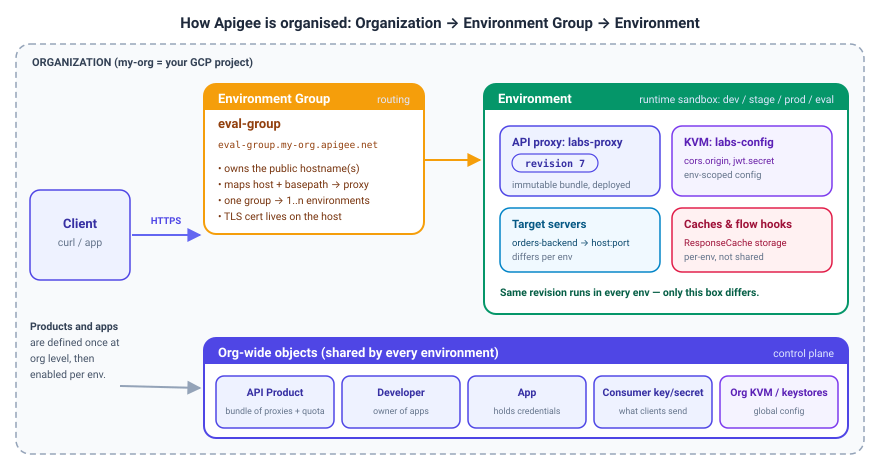
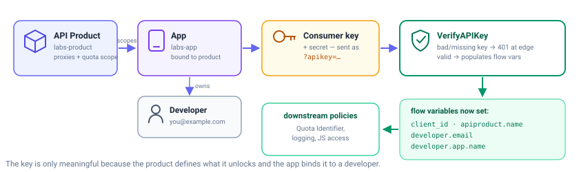
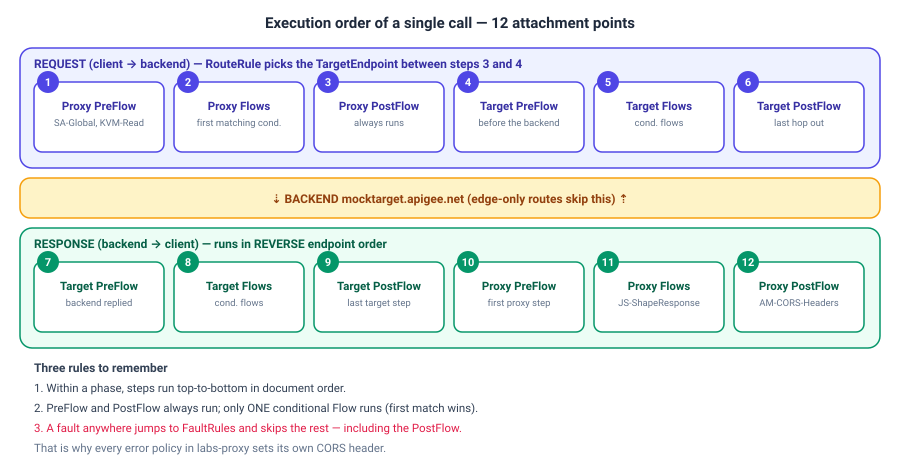

# Core Concepts

Read this page once, slowly. Almost every "why did that happen?" in the labs
traces back to one of the ideas below.

!!! abstract "How to study this page"
    1. Read each section's **one-line takeaway** first.
    2. Cover the answer under each **Recall** box and say it out loud before
       you open it. Retrieving an answer beats re-reading it.
    3. Come back after Lab 4 and re-test yourself — spacing your practice is
       what moves this from "I saw it" to "I know it".

## 1. The big picture: who owns what



| Object | Scope | What it is | Why you care |
|---|---|---|---|
| **Organization** | whole account | Top-level container; in Apigee X it maps 1:1 to a GCP project | `-o $APIGEE_ORG` in every `apigeecli` call |
| **Environment** | org | A runtime sandbox (`dev`, `stage`, `prod`, `eval`) where revisions are *deployed* | Config (KVMs, target servers) differs per env; the bundle does not |
| **Environment group** | org | A set of hostnames mapped to one or more environments | It's why `curl https://eval-group.my-org.apigee.net/...` finds your proxy |
| **API proxy** | org (deployed per env) | The bundle you write — a facade for a backend | The thing you build in every lab |
| **Revision** | per proxy | One immutable snapshot of the bundle | Deploy, roll back and promote *revisions* |
| **API product** | org | A named bundle of proxies/paths + quota + scopes | What you "sell" or grant to developers |
| **Developer** | org | The person/team who owns apps | Appears as `developer.email` in flow variables |
| **App** | org | Holds credentials (consumer key + secret) and is attached to products | The thing a request *authenticates as* |

!!! tip "Takeaway"
    Proxies are deployed **per environment**; products, developers and apps
    are defined **once per organization**.

??? question "Recall: your request returned `Unable to identify proxy for host`. Which object is wrong?"
    The **environment group** hostname (or the proxy's `BasePath`) — Apigee
    couldn't route host + path to any deployed proxy. The proxy code is
    probably fine.

## 2. Who is calling? Product → Developer → App → Credential



A key is just a random string. It means something only because Apigee can
walk **key → app → product(s) → proxy + path + quota**. That walk is what
`VerifyAPIKey` performs, and its results become flow variables
(`developer.email`, `apiproduct.name`, ...).

- A key can be valid yet **still rejected** if the app's products don't cover
  the proxy/environment being called (`InvalidApiKeyForGivenResource`).
- Revoking an app, a key or a product takes effect on the next call — no
  redeploy.

??? question "Recall: name three things a valid key gives the proxy besides 'yes, it's valid'."
    The developer identity (`developer.email`), the app (`developer.app.name`)
    and the product (`apiproduct.name`) — plus the key itself in
    `verifyapikey.<policy>.client_id`, which is what `Quota` uses to count per
    app.

## 3. Anatomy of one policy file

Every policy is a small XML file with the same skeleton. Learn the skeleton
once; every policy in the cookbook is a variation on it.

```xml
<AssignMessage async="false" continueOnError="false" enabled="true" name="AM-Hello"> <!-- (1)! -->
  <DisplayName>AM-Hello</DisplayName> <!-- (2)! -->
  <Set> <!-- (3)! -->
    <Payload contentType="application/json">
      {"message": "hello from apigee", "path": "{proxy.pathsuffix}"} <!-- (4)! -->
    </Payload>
    <StatusCode>200</StatusCode>
  </Set>
  <IgnoreUnresolvedVariables>true</IgnoreUnresolvedVariables> <!-- (5)! -->
  <AssignTo createNew="false" type="response">response</AssignTo> <!-- (6)! -->
</AssignMessage>
```

1. **Root element = policy type** (`AssignMessage`). The attributes are common
   to *all* policies: `name` must equal the file name and the `<Step><Name>`;
   `enabled="false"` turns the policy into a no-op without deleting it;
   `continueOnError="true"` lets the flow carry on even if this policy fails
   (default `false` → the flow jumps to fault handling); `async` is legacy —
   leave it `false`.
2. Human-readable label shown in the UI and Trace. Purely cosmetic.
3. The **operation** block. AssignMessage can `Set`, `Copy`, `Add`, `Remove`
   or `AssignVariable`; other policies have their own verbs (`Operation`,
   `Get`, `Rate`, ...).
4. `{variable}` inside curly braces is **interpolated at runtime** from the
   flow-variable bag. Unresolved variables become empty strings *only if* #5
   is `true`; otherwise they fail the policy.
5. Safety valve. `false` (default for most policies) = a missing variable is
   a fault; `true` = silently substitute empty. Prefer `false` while
   developing so typos surface immediately.
6. **Which message to modify.** `type="response"` + `createNew="false"` means
   "edit the existing response object". Without `AssignTo`, AssignMessage
   edits whichever message is *current* at the flow position where it runs.

!!! tip "Takeaway"
    `name` ties file ↔ step. `continueOnError`/`enabled` control failure and
    switching. `{braces}` read variables. `AssignTo` picks the message.

??? question "Recall: a policy references `{kvm.cors.origin}` but the KVM read was skipped. What happens with `IgnoreUnresolvedVariables` = `false` vs `true`?"
    `false` → the policy faults (and your FaultRules run). `true` → the header
    is set to an empty value and the request continues silently — easier to
    miss, which is why the labs only use `true` in *error* policies where a
    second failure would hide the first.

## 4. Flow variables — the shared notebook

Every transaction gets its own variable bag. Policies **write** to it,
conditions and later policies **read** from it, and nothing outlives the
request.

| Family | Examples | Writable? |
|---|---|---|
| `request.*` / `response.*` | `request.verb`, `request.header.x-apikey`, `request.queryparam.apikey`, `response.status.code`, `response.content` | yes (via policies/JS) |
| `proxy.*` | `proxy.pathsuffix`, `proxy.basepath`, `proxy.name` | read-only |
| `target.*` | `target.url`, `target.name` | partly |
| `system.*` | `system.timestamp`, `system.uuid` | read-only |
| `apiproxy.*` | `apiproxy.name`, `apiproxy.revision` | read-only |
| `fault.*` / `error.*` | `fault.name`, `error.status.code` | only inside fault handling |
| **policy-produced** | `verifyapikey.<name>.client_id`, `ratelimit.<name>.used.count`, `jwt.<name>.decoded.claim.sub`, `responsecache.<name>.cachehit` | read-only, named after the *policy* |
| **yours** | anything you `AssignVariable`, `ExtractVariables`, KVM `assignTo` | yes |

Two naming rules explain most surprises:

1. **Policy-produced variables embed the policy's `name`.** Rename
   `Quota-PerApp` and `ratelimit.Quota-PerApp.used.count` becomes
   `ratelimit.<NewName>.used.count` — anything referencing the old name now
   resolves to nothing.
2. **Variables prefixed `private.` are masked in Trace** and are *required*
   for signing keys (that's why the labs write the JWT secret to
   `private.jwt.secret`).

??? question "Recall: where does `urirequest.orderId` come from, and why that exact name?"
    From `EV-ExtractPath`. For `URIPath` patterns, `ExtractVariables` names the
    variable `urirequest.<placeholder>` (no `VariablePrefix` set), so
    `/orders/{orderId}` yields `urirequest.orderId`. Set `<VariablePrefix>` and
    it becomes `<prefix>.orderId` instead — which is exactly what
    `EV-ExtractBody` does with `extracted`.

## 5. Conditions — the `if` of Apigee

Conditions appear on `<Flow>`, `<Step>`, `<RouteRule>` and `<FaultRule>`.

| Operator | Meaning | Example |
|---|---|---|
| `=`, `!=` | equals / not equals (case-sensitive) | `request.verb = "GET"` |
| `Matches` / `~` | glob-ish: `*` wildcard | `fault.name Matches "*Token*"` |
| `MatchesPath` / `~/` | path glob: `*` = one segment, `**` = any depth | `proxy.pathsuffix MatchesPath "/orders/**"` |
| `JavaRegex` / `~~` | full Java regex | `request.content ~~ "(?s).*customerId.*"` |
| `Equals`, `StartsWith`, `Includes`... | text/collection helpers | `request.header.accept Includes "json"` |
| `Exists` | variable is set | `request.header.x-no-cache Exists` |
| `and`, `or`, `!`, `( )` | boolean logic | `(a) and !(b)` |
| `<`, `<=`, `>`, `>=` | numeric compare | `response.status.code >= 500` |

Path-matching cheat sheet (what `MatchesPath` accepts):

| Pattern | `/orders` | `/orders/42` | `/orders/42/items` |
|---|:-:|:-:|:-:|
| `"/orders"` | yes | no | no |
| `"/orders/*"` | no | yes | no |
| `"/orders/**"` | no | yes | yes |
| `"/**"` | yes | yes | yes |

!!! warning "Case and quoting traps"
    - `=` is **case-sensitive**: `request.verb = "get"` never matches.
    - A condition on an *unset* variable doesn't raise an error — comparisons
      like `=` simply come out **false** (and `!=` comes out true), so the
      flow silently takes a different branch. Check spelling in Trace.
    - In XML, escape `<`, `>`, `&` inside conditions (`&lt;`, `&gt;`, `&amp;`).

??? question "Recall: why does the labs `get-orders` flow not also fire for `/orders/42`?"
    Its condition uses `MatchesPath "/orders"` — an *exact* path. The separate
    `get-order-by-id` flow uses `"/orders/**"`. Because flows are evaluated top
    to bottom and the **first match wins**, ordering also matters when
    patterns overlap.

## 6. The request lifecycle in one picture



Memorize the shape: **in through the proxy, in through the target, out through
the target, out through the proxy.** Detailed attachment rules live in
[Proxy Anatomy](proxy-anatomy.md).

## 7. Errors in one paragraph

When any policy fails (and `continueOnError` is `false`), Apigee stops the
normal flow, sets `fault.name`, and evaluates the endpoint's `<FaultRules>`
**top to bottom — first matching rule wins**. If none match,
`<DefaultFaultRule>` runs. Normal PostFlows are **skipped**, so anything you
need on *every* response (like CORS headers) must also be added in the error
policies. Lab 6 makes this concrete.

## 8. Immutable revisions and environment-specific config

A deployed revision never changes. What *can* change without redeploying:
KVM values, target servers, product quotas, app credentials. What can't:
anything in the bundle. Rule of thumb: **if it differs between dev and prod,
it must not live in the bundle.** See
[Deploy & CI/CD](deploy-cicd.md).

## Self-test: the whole page in six questions

??? question "1. Which object do you rename if you want a different public hostname?"
    The **environment group** (its hostname list). Proxies and environments
    don't own hostnames.

??? question "2. You add `<Step><Name>VA-Check</Name></Step>` and get `Could not find policy`. Likely cause?"
    No `policies/VA-Check.xml` — or the file's `name` attribute differs from the
    step name. The three names must match exactly.

??? question "3. `Quota` returns 429 on the very first call. First suspect?"
    The `Identifier` variable is empty (e.g. quota ran before `VerifyAPIKey`),
    so all callers share one bucket. See [Lab 4](labs/traffic-management.md).

??? question "4. Where would you put a value that must differ between stage and prod?"
    In an environment-scoped KVM (secrets: encrypted KVM) or a target server —
    never in the bundle.

??? question "5. A policy faults. Does the PostFlow still run?"
    No — fault handling replaces the normal flow. Handle response decoration in
    the fault policies too.

??? question "6. `request.verb = "get"` never matches. Why?"
    Conditions are case-sensitive; the verb is uppercase (`"GET"`).
