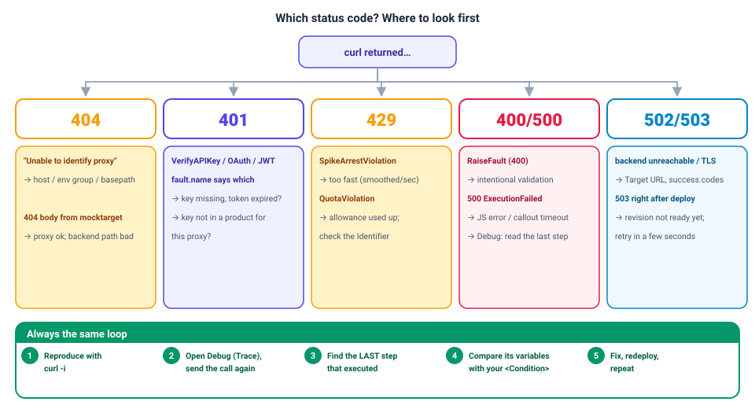

# Debugging & Troubleshooting

Debugging Apigee is a skill with a short, repeatable method. Learn the method
once and you can fix proxies you have never seen.

!!! abstract "By the end you can..."
    - Capture a transaction in **Debug** (formerly Trace) and read it.
    - Map any HTTP status to the first place to look.
    - Tell "my condition didn't match" from "my policy failed" from "the
      backend failed".

## The method



1. **Reproduce** with `curl -i` (headers matter — `-i` shows them).
2. **Capture** in the Debug tool: *API Proxies → labs-proxy → Debug → Start
   debug session*, pick environment + revision, send the call again.
3. **Find the last step that executed.** Everything after it never ran.
4. **Inspect variables** at that step and compare with the `<Condition>`
   or `ref` you wrote.
5. **Fix, redeploy, repeat.** Change one thing at a time.

## Reading a Debug transaction

A capture is an ordered list of *phases*; each phase lists the policies that
ran with their status:

| What you see | Meaning |
|---|---|
| `Request received from client` | raw request as it arrived — check verb, path, headers |
| `Flow Info` / flow name | which conditional flow matched (**none listed = none matched**) |
| policy icon, green tick | policy executed successfully |
| policy icon, red | policy failed → fault handling starts next |
| `Request sent to target` | what the backend actually received (verify stripped keys here!) |
| `Response received from target` | the backend's raw answer |
| `Error` / `FaultRule` phase | which rule matched and what it executed |

Click any step to see **variables read/written**, **properties** and
**output** (anything you `print()` in JS).

!!! tip "Masking"
    Variables prefixed `private.` appear masked in Debug, and a debug
    session's data masks configured fields. Don't paste debug output with
    real tokens into tickets.

## First-hour failure catalogue

| Symptom | Likely cause | How to confirm | Fix |
|---|---|---|---|
| `Unable to identify proxy for host: ... and url: ...` | host not in env group, proxy not deployed to that env, or BasePath mismatch | `apis listdeploy`; check env-group hostnames | attach env, fix BasePath, redeploy |
| 404 from *the backend* (body from mocktarget) | no proxy flow matched or you forwarded to a wrong path | Debug: "Request sent to target" URL | adjust condition / target URL |
| `401 FailedToResolveAPIKey` | key variable empty (wrong param/header name) | variables panel: `request.queryparam.apikey` | match `ref` to what clients send |
| `401 InvalidApiKey` | key unknown/revoked | `apigeecli apps get` | recreate/attach app |
| `401 InvalidApiKeyForGivenResource` | app's product doesn't cover this proxy/env | product → proxies/envs | add proxy/env to product |
| `401 TokenExpired` / `InvalidSignature` | JWT expired / wrong secret | decoded claims in Debug | mint fresh; check secret equality |
| `401 InsufficientKeyLength` | HS256 secret < 32 bytes | KVM value length | use ≥ 32-byte secret |
| `429 SpikeArrestViolation` | too many calls too fast (global!) | `fault.name` in body | slow down / raise rate |
| `429 QuotaViolation` | per-app allowance used | `ratelimit.*.used.count` | wait for reset / raise `Allow` |
| `500` with `fault.name = ExecutionFailed` | JS error or callout failure | step output | read exception text |
| `500` fallback body, you expected a 400 | `DefaultFaultRule` overwrote your `RaiseFault` | Error phase shows both rules ran | add condition / drop `AlwaysEnforce` |
| `502`/`503` from backend | backend down, TLS or DNS issue | Debug: target response phase | test backend directly with curl |
| Policy "didn't run" | enclosing Flow condition false, or step `<Condition>` false | no Flow Info for it | print variables, fix condition |
| Variable resolves empty | typo, set later than read, or wrong policy name in var | Debug variable list at that step | reorder / fix name |
| Deploy ok but old behaviour | KVM cache (300 s), response cache (TTL), or env deployed an older revision | `apis listdeploy` revision no. | wait / bust cache / redeploy |

## Practice: break it on purpose

Each of these is a 2-minute exercise that teaches you to *recognise* a
failure. For each, **predict the status and `fault.name` first**.

1. Rename `<Step><Name>VA-CheckAPIKey</Name>` to `VA-CheckAPIKe` and import.
   (Expected: import/deploy rejection — a configuration error, not a runtime one.)
2. Change `VA-CheckAPIKey`'s `ref` to `request.header.apikey`, keep calling
   with `?apikey=`. (401 `FailedToResolveAPIKey`.)
3. Put `Quota-PerApp` above `VA-CheckAPIKey`. (Shared bucket / empty
   identifier — see Lab 4.)
4. Shorten `jwt.secret` to 10 characters. (`InsufficientKeyLength`.)
5. Point `SC-FetchIP` to `https://does-not-exist.invalid`. (500
   `ExecutionFailed`; look at the Error phase.)
6. Remove the `Condition` from the `DefaultFaultRule` and call the
   `RaiseFault` endpoint. (400 becomes 500.)

## Useful commands

```bash
# Which revision is live where?
apigeecli apis listdeploy -o "$APIGEE_ORG" -n labs-proxy -t "$TOKEN"

# Full request/response headers + timing breakdown
curl -sS -o /dev/null -D - -w "\nconnect=%{time_connect}s ttfb=%{time_starttransfer}s total=%{time_total}s\n" \
  "https://$APIGEE_HOST/labs/hello"

# Static analysis of the bundle
apigeelint -s examples/labs-proxy/apiproxy -f table.js

# Is the backend itself healthy? (bypass Apigee)
curl -i https://mocktarget.apigee.net/
```

## Check yourself

??? question "1. Debug shows `VA-CheckAPIKey` red and nothing after it. Did `Quota-PerApp` run?"
    No. A failed policy (with `continueOnError=false`) diverts to fault handling;
    later steps in the flow never execute.

??? question "2. How do you prove the backend never saw the API key?"
    Open the **Request sent to target** phase in Debug and inspect the URL and
    headers.

??? question "3. A client reports `403`. Where might it come from, given this bundle only produces 400/401/429/500?"
    Not from the bundle's own policies — suspect Google Cloud IAM/org policy
    (for management calls), the backend itself, or a Cloud Armor/WAF rule in
    front of Apigee.
