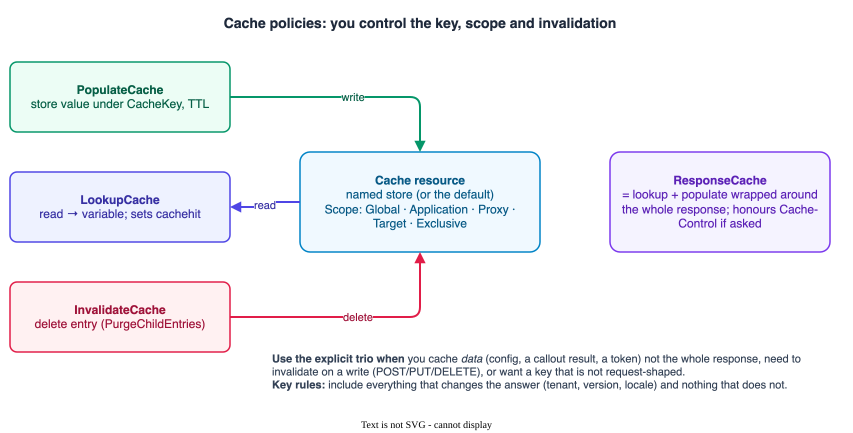

# Deep Dive — Cache Policies

[Lab 6](../labs/caching-faults.md) used `ResponseCache`, which caches a whole
response. This page covers caching *data* with explicit control over key,
scope and invalidation.

!!! abstract "By the end you can..."
    - Choose between `ResponseCache` and `PopulateCache`/`LookupCache`.
    - Design a cache key that is both effective and tenant-safe.
    - Invalidate on writes so clients don't read stale data.



## The trio

```xml
<PopulateCache name="PC-Config"> <!-- (1)! -->
  <CacheResource>labs-cache</CacheResource> <!-- (2)! -->
  <Scope>Exclusive</Scope> <!-- (3)! -->
  <CacheKey>
    <Prefix>cfg</Prefix>
    <KeyFragment ref="request.queryparam.tenant"/> <!-- (4)! -->
  </CacheKey>
  <ExpirySettings><TimeoutInSec>300</TimeoutInSec></ExpirySettings> <!-- (5)! -->
  <Source>ipResponse.content</Source> <!-- (6)! -->
</PopulateCache>

<LookupCache name="LC-Config">
  <CacheResource>labs-cache</CacheResource>
  <Scope>Exclusive</Scope>
  <CacheKey>
    <Prefix>cfg</Prefix>
    <KeyFragment ref="request.queryparam.tenant"/>
  </CacheKey>
  <AssignTo>cached.config</AssignTo> <!-- (7)! -->
</LookupCache>

<InvalidateCache name="IC-Config">
  <CacheResource>labs-cache</CacheResource>
  <Scope>Exclusive</Scope>
  <CacheKey>
    <Prefix>cfg</Prefix>
    <KeyFragment ref="request.queryparam.tenant"/>
  </CacheKey>
  <PurgeChildEntries>false</PurgeChildEntries> <!-- (8)! -->
</InvalidateCache>
```

1. Store a value. Usually runs **after** you obtained the value on a miss.
2. Which cache. Omit to use the environment's default cache; create named
   caches for separate sizing/TTL.
3. How the key is namespaced: `Global` (everything), `Application`, `Proxy`,
   `Target`, or `Exclusive` (this proxy + this endpoint — safest default).
4. **Key = prefix + fragments.** Include every input that changes the value
   (tenant, locale, version).
5. Time to live. Always set one.
6. The variable whose content is stored — here the callout's body from
   Lab 5.
7. Where a hit is delivered: into a variable you then use. A miss leaves it
   empty — test with `lookupcache.LC-Config.cachehit`.
8. Delete just this entry (or `true` to purge entries sharing the prefix).

### The standard pattern

```xml
<Step><Name>LC-Config</Name></Step>
<Step>
  <Condition>lookupcache.LC-Config.cachehit = false</Condition> <!-- (1)! -->
  <Name>SC-FetchConfig</Name>
</Step>
<Step>
  <Condition>lookupcache.LC-Config.cachehit = false</Condition>
  <Name>PC-Config</Name> <!-- (2)! -->
</Step>
```

1. Only call the slow service on a miss.
2. And only store after fetching it.

## Which to use?

| Need | Use |
|---|---|
| Cache the whole backend response for identical requests | `ResponseCache` |
| Cache a callout result, token, config, or lookup | `PopulateCache` + `LookupCache` |
| Remove a stale entry after `PUT`/`DELETE` | `InvalidateCache` |
| Key not derived from the request (e.g. a user id from a JWT claim) | explicit trio |

## Cache key design checklist

- [ ] Includes the **tenant/app** identity if the value differs by tenant.
- [ ] Includes API **version** and **locale/format** if responses vary by them.
- [ ] Excludes volatile noise (timestamps, request ids) that defeats hits.
- [ ] Never includes secrets in the key (keys can show up in diagnostics).
- [ ] TTL ≤ how stale the business can tolerate.
- [ ] Writes invalidate the matching read key.

!!! warning "Cache is per environment, not guaranteed"
    Entries can be evicted at any time (memory pressure, restarts). Treat the
    cache as an optimisation: a miss must always still work.

## Experiments

1. Cache the `SC-FetchIP` result with the trio and compare latency of call 1
   vs call 2 in Debug.
2. Add `InvalidateCache` to a `POST /orders` flow and prove a following `GET`
   is a miss.
3. Change the key to omit `tenant`, call with two tenants, and observe the
   leak. Then fix it.

## Check yourself

??? question "1. Why is `Exclusive` a safer default scope than `Global`?"
    `Global` shares keys across every proxy in the environment, so two proxies
    using the same key string can overwrite or read each other's data.

??? question "2. A write endpoint changes an order but `GET` still returns the old data for 60 s. Fix?"
    Invalidate the matching key on the write (`InvalidateCache`), or lower the TTL.

??? question "3. When is `ResponseCache` the wrong tool?"
    When only part of the response is cacheable, when the key isn't request-shaped,
    or when you must invalidate selectively.
