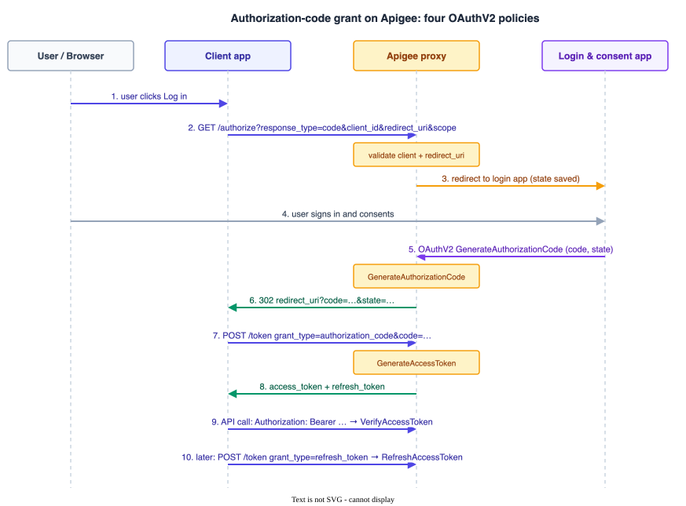

# Deep Dive — OAuth Grants, Scopes & Revocation

[Lab 3](../labs/oauth-jwt.md) used the **client-credentials** grant, which
authenticates an *app*. This page covers the grants that involve an *end user*,
plus scopes, refresh and revocation.

!!! abstract "By the end you can..."
    - Pick the right grant for a client type.
    - Name the OAuthV2 operation used at each step of the authorization-code flow.
    - Enforce scopes and refresh/revoke tokens.
    - Explain why a revoked token can still work for a few minutes.

## Which grant?

| Client | Grant | Notes |
|---|---|---|
| Server-to-server, no user | `client_credentials` | Lab 3 |
| Web/mobile/SPA acting for a user | `authorization_code` (with PKCE for public clients) | The recommended user-facing flow |
| Trusted first-party login screen only | `password` | Client sees the user's password — avoid for new designs |
| Browser-only legacy | `implicit` | Tokens in URLs; superseded by auth code + PKCE |
| Renew without re-login | `refresh_token` | Companion to the grants above |

Apigee's OAuthV2 policy supports authorization code, client credentials,
implicit and password, plus refresh. Prefer authorization code (+PKCE) for
anything with a user.

## The authorization-code flow on Apigee



Apigee provides the **OAuth endpoints**, not the login screen. You supply a
login/consent app that authenticates the user and then calls back to Apigee to
mint the code. In proxy terms, four separate policies, usually on four flows:

| Step | Flow | `<Operation>` |
|---|---|---|
| Start | `GET /authorize` | *(validate client + redirect URI, redirect to your login app)* |
| After consent | `/authorize` call from login app | `GenerateAuthorizationCode` |
| Exchange | `POST /token` (`grant_type=authorization_code`) | `GenerateAccessToken` |
| Renew | `POST /token` (`grant_type=refresh_token`) | `RefreshAccessToken` |
| Use | any protected flow | `VerifyAccessToken` |

```xml
<OAuthV2 name="OA-GenerateCode"> <!-- (1)! -->
  <Operation>GenerateAuthorizationCode</Operation>
  <ExpiresIn>600000</ExpiresIn> <!-- (2)! -->
  <ResponseType>request.queryparam.response_type</ResponseType> <!-- (3)! -->
  <ClientId>request.queryparam.client_id</ClientId>
  <RedirectUri>request.queryparam.redirect_uri</RedirectUri>
  <Scope>request.queryparam.scope</Scope> <!-- (4)! -->
  <State>request.queryparam.state</State> <!-- (5)! -->
  <GenerateResponse enabled="true"/>
</OAuthV2>
```

1. Runs in the call the **login app** makes after the user signed in.
2. Authorization codes are short-lived (here 10 minutes, in ms) and
   single-use.
3. Each element names the *variable* to read the value from, not a literal.
4. Scopes the client asked for. Apigee intersects them with what the app's
   products allow.
5. Opaque value the client sent; it must be echoed back unchanged so the
   client can detect cross-site request forgery.

```xml
<OAuthV2 name="OA-IssueTokens"> <!-- (1)! -->
  <Operation>GenerateAccessToken</Operation>
  <ExpiresIn>1800000</ExpiresIn> <!-- (2)! -->
  <RefreshTokenExpiresIn>86400000</RefreshTokenExpiresIn> <!-- (3)! -->
  <SupportedGrantTypes>
    <GrantType>authorization_code</GrantType>
    <GrantType>refresh_token</GrantType>
  </SupportedGrantTypes>
  <GenerateResponse enabled="true"/>
</OAuthV2>

<OAuthV2 name="OA-Refresh"> <!-- (4)! -->
  <Operation>RefreshAccessToken</Operation>
  <ReuseRefreshToken>false</ReuseRefreshToken> <!-- (5)! -->
  <GenerateResponse enabled="true"/>
</OAuthV2>
```

1. Exchange code for tokens. The client authenticates with its
   `client_id` + `client_secret` (Basic auth) here.
2. Access token lifetime: 30 minutes (ms). Keep short.
3. Refresh token lives longer (24 h, ms) so users aren't logged out.
4. A separate policy/flow for `grant_type=refresh_token`.
5. `false` = rotate: each refresh returns a *new* refresh token and retires
   the old one — limits replay of a stolen refresh token.

!!! tip "PKCE for public clients"
    Mobile apps and SPAs can't keep a secret. PKCE binds the code to the
    client that asked for it (`code_challenge` on `/authorize`,
    `code_verifier` on `/token`). Check the current OAuthV2 documentation for
    the PKCE configuration in your Apigee version, and require it for every
    public client.

## Scopes

Scopes are the *what* a token may do (`orders:read`, `orders:write`).

1. Define the scopes a **product** grants (product settings).
2. The client requests `scope=orders:read`; the token carries the granted
   subset.
3. Enforce in the proxy with a **verify-time** scope check or a condition on
   the scope variable.

```xml
<OAuthV2 name="OA-VerifyRead">
  <Operation>VerifyAccessToken</Operation>
  <Scope>orders:read</Scope> <!-- (1)! -->
</OAuthV2>
```

1. Fails with an insufficient-scope fault unless the token includes this
   scope. Put it on `GET` flows, and a different scope on `POST`/`DELETE`
   flows.

*Scope enforcement is function-level authorisation (OWASP API5).* It does
**not** protect individual objects — see [OWASP mapping](owasp.md).

## Revocation

```xml
<OAuthV2 name="OA-Revoke">
  <Operation>InvalidateToken</Operation> <!-- (1)! -->
</OAuthV2>
```

1. Revokes an access token. A matching `ValidateToken` operation re-approves
   one.

!!! warning "Revocation is not instant"
    Apigee caches OAuth tokens for about **three minutes**, so a revoked token
    may keep working for up to that long. If you need immediate cut-off, keep
    access tokens short-lived and revoke the **refresh** token (which stops
    renewal).

## Opaque vs JWT access tokens

Apigee can also issue **JWT access tokens** (the OAuthV2 policy has JWT
variants of the generate/verify operations) so resource servers can verify
locally. Same trade-offs as Lab 3: faster verification, no instant revocation.

## Experiments

1. Add the `authorization_code` grant type to a copy of `OA-IssueToken`, wire
   the four flows, and walk the flow with `curl -L` and a stub login page.
2. Request `scope=orders:read`, call a `POST` flow protected with
   `orders:write` — what status and `fault.name`?
3. Rotate refresh tokens (`ReuseRefreshToken=false`), reuse the *old* refresh
   token and observe the failure.
4. Revoke a token, then call immediately and again after 3+ minutes.

## Check yourself

??? question "1. A single-page app needs to call your API on behalf of a user. Grant? What protects the code in transit?"
    Authorization code with **PKCE**; PKCE binds the code to the client's
    one-time verifier so an intercepted code is useless.

??? question "2. Why does the login app, not Apigee, show the sign-in page?"
    Apigee is the OAuth *authorization server mechanics*; identity (users,
    passwords, MFA) belongs to your IdP/login app, which calls
    `GenerateAuthorizationCode` once the user is authenticated.

??? question "3. You revoked a token and it still worked 90 seconds later. Bug?"
    No — tokens are cached ~3 minutes. Shorten token lifetime or revoke the
    refresh token for fast cut-off.

??? question "4. What does `ReuseRefreshToken=false` buy you?"
    Refresh-token rotation: a stolen refresh token is single-use, and reuse of
    an old one is a detectable signal.
