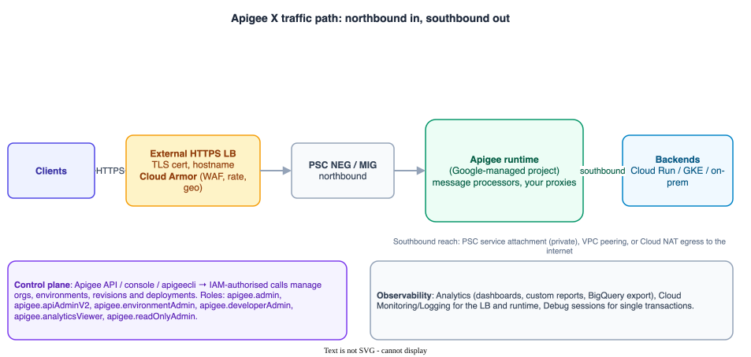

# Deep Dive — Platform, Networking & Operations

What surrounds the proxies: how traffic reaches Apigee, who may manage it, how
you observe it, and how it is provisioned. Details change between releases —
treat this as the map and confirm specifics in Google's current docs.

!!! abstract "By the end you can..."
    - Trace a request from the internet to your backend through Apigee X.
    - Explain Apigee X vs hybrid vs the legacy Edge product.
    - Name the IAM roles, observability tools and portal/monetization features
      you will meet.

## 1. Network path

- **Northbound (client → Apigee):** typically an **external HTTPS load
  balancer** you own, holding the TLS certificate and hostname, fronted by
  **Cloud Armor** (WAF, geo/IP rules, rate limiting). The LB reaches the
  Apigee runtime through a **PSC network endpoint group** (or managed instance
  group in older setups).
- **Environment group hostnames** must match what the LB serves.
- **Southbound (Apigee → backend):** private reach via **Private Service
  Connect service attachments**, VPC peering, or internet egress (optionally
  through Cloud NAT with a fixed IP you can allow-list).
- **Internal-only APIs:** use an *internal* load balancer; no public path.

## 2. X vs hybrid vs Edge

| | Apigee X | Apigee hybrid | Apigee Edge (legacy) |
|---|---|---|---|
| Runtime | Google-managed, in a Google project | **Your Kubernetes cluster** (GKE or other) | Google/Private Cloud |
| Management plane | Google | Google | Google |
| Choose when | default for cloud-native | data residency, on-prem backends, latency | migrating away |

The proxy bundles, policies and this guide's labs apply to X and hybrid
(*Edge* differs in provisioning, some policies and tooling).

## 3. Access management (IAM)

Management API access is governed by Google Cloud IAM. Common roles:

| Role | For |
|---|---|
| `roles/apigee.admin` | everything — keep to a few people |
| `roles/apigee.apiAdminV2` | create/deploy proxies |
| `roles/apigee.environmentAdmin` | manage a specific environment |
| `roles/apigee.developerAdmin` | manage developers/apps/products |
| `roles/apigee.analyticsViewer` | read dashboards |
| `roles/apigee.readOnlyAdmin` | view only |

CI/CD service accounts get the narrowest role that can import and deploy, ideally
scoped to specific environments. Use Workload Identity Federation instead of
key files where possible.

## 4. Observability

- **Analytics:** built-in dashboards (traffic, latency, errors by proxy/app/
  product/developer), **custom reports** on dimensions you add with
  `StatisticsCollector`, and **export to BigQuery** for your own analysis.
- **Monitoring:** Cloud Monitoring metrics for Apigee, the load balancer and
  runtime; alert on 5xx rate, latency percentiles and quota exhaustion.
- **Logging:** the `MessageLogging` policy sends records to **syslog**. For
  Cloud Logging, forward from your syslog/collector, or publish an event (for
  example to Pub/Sub) from a `ServiceCallout`/`PostClientFlow`, and let a
  consumer write it. LB request logs give you the gateway view for free.
- **Debug:** single-transaction inspection; masks configured fields; use
  sparingly on production.
- **Trace IDs:** forward a correlation header (e.g. `x-request-id`, or generate
  one from `system.uuid`) to the backend so logs can be joined end to end.

## 5. Developer experience

- **Integrated developer portal:** self-service docs, app registration, key
  creation. Backed by your products and OpenAPI specs.
- **API hub:** a catalogue of your APIs (including non-Apigee ones) with
  metadata, versions and governance.
- **Monetization:** rate plans and billing on top of products (usage-based or
  fixed fees) — products are the unit you charge for.
- **Advanced API Security:** abuse detection and security scoring over Apigee
  traffic, complementing in-proxy policies.

## 6. Provisioning as code

Typical split:

| What | Tool |
|---|---|
| Org, instance, environments, env groups, attachments, networking | **Terraform** (`google_apigee_*` resources) |
| Proxy/shared-flow bundles, KVMs, products, apps, target servers | `apigeecli`, the Apigee Maven/Node plugins, or `gcloud` in CI |
| Config that must differ per environment | files in Git + pipeline variables |

Keep environment-level configuration (KVM entries, target servers, products)
in version control and apply it from the pipeline, so a new environment is
reproducible.

## 7. Operating checklist

- [ ] Hostnames, certificates and LB health checks monitored.
- [ ] Cloud Armor policy reviewed (rate limits, geo, OWASP rules).
- [ ] Least-privilege IAM for humans and pipelines.
- [ ] Alerts on error rate, latency and quota/limit saturation.
- [ ] Analytics export to BigQuery if you need long retention.
- [ ] Runbook: how to roll back (previous revision), how to rotate secrets
      (encrypted KVM), how to block an abusive app (revoke key/app).
- [ ] Capacity and quota limits for the Apigee instance understood.

## Experiments

1. In the Apigee console, open **Analytics → API proxy performance** and find
   the 401s you generated in Lab 2.
2. Add `StatisticsCollector` to record `developer.app.name` and build a custom
   report grouped by it.
3. Draw your own organisation's real network path using the diagram above as a
   template and mark where TLS terminates.

## Check yourself

??? question "1. Where does TLS for `api.example.com` terminate in a typical Apigee X setup?"
    On the external HTTPS load balancer (which owns the certificate); traffic
    then travels to the Apigee runtime over Google's network.

??? question "2. When would you pick hybrid over X?"
    When the runtime must sit in your own Kubernetes environment (data
    residency, on-prem backends, strict latency).

??? question "3. Why use a service account with an environment-scoped role in CI?"
    So a compromised pipeline can deploy to one environment but cannot change
    org-wide settings or other environments.
