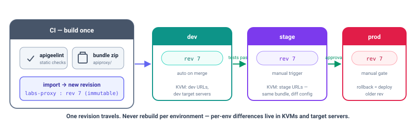
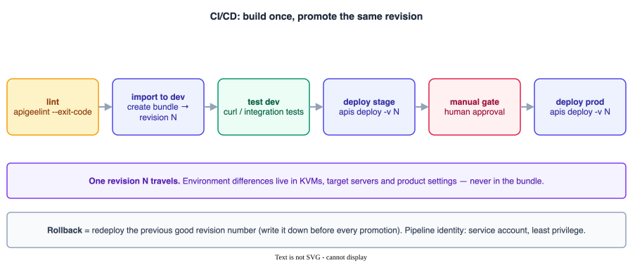

# Deploy & CI/CD

Labs used `--ovr` to redeploy in place. Real work promotes **immutable
revisions** through environments — this page shows both.

## Local deploy (what `deploy.sh` wraps)

```bash
export TOKEN=$(gcloud auth print-access-token)

apigeecli apis create bundle \
  -o "$APIGEE_ORG" \
  -e "$APIGEE_ENV" \
  --proxy-folder examples/labs-proxy/apiproxy \
  -n labs-proxy \
  -t "$TOKEN" \
  --ovr
```

| Flag | Meaning |
|---|---|
| `--proxy-folder` / `-p` | path to the `apiproxy/` bundle dir (or a zip) |
| `-n` | proxy name — becomes the API's identity in the org |
| `--ovr` | redeploy latest revision in place (dev loop) |
| `--wait` | block until the deployment reports ready |

Useful siblings:

```bash
apigeecli apis listdeploy -o "$APIGEE_ORG" -n labs-proxy -t "$TOKEN"   # where's it live?
apigeecli apis deploy      -o "$APIGEE_ORG" -e "$APIGEE_ENV" -n labs-proxy -v 3 -t "$TOKEN"  # pin a revision
apigeecli apis undeploy    -o "$APIGEE_ORG" -e "$APIGEE_ENV" -n labs-proxy -t "$TOKEN"
apigeecli apis delete      -o "$APIGEE_ORG" -n labs-proxy -t "$TOKEN"
```

## Promotion model





The discipline: **one revision travels; never rebuild per env.** Anything
that differs per environment belongs in KVMs, target servers, or environment
properties — not in the bundle.

## Lint before deploy

```bash
npm i -g apigeelint
apigeelint -s examples/labs-proxy/apiproxy -f table.js
```

Catches the classics: unused policies, missing `<AssignTo>`, unbounded
caches, `<Step>` names that don't match files.

## Pipeline sketch (GitLab CI)

```yaml
stages: [lint, deploy-dev, test, deploy-stage]  # (1)!

lint:
  image: node:22
  script:
    - npm i -g apigeelint
    - apigeelint -s apiproxy -f table.js --exit-code  # (2)!

deploy-dev:
  image: google/cloud-sdk:slim
  script:
    - echo "$GCP_SA_KEY" | gcloud auth activate-service-account --key-file=-  # (3)!
    - TOKEN=$(gcloud auth print-access-token)
    - apigeecli apis create bundle -o "$APIGEE_ORG" -e dev
        --proxy-folder apiproxy -n orders-api -t "$TOKEN" --wait  # (4)!
    - REV=$(apigeecli apis get -o "$APIGEE_ORG" -n orders-api -t "$TOKEN" | jq '.revision[-1]')  # (5)!
    - echo "REV=$REV" >> deploy.env
  artifacts:
    reports:
      dotenv: deploy.env  # (6)!

deploy-stage:
  image: google/cloud-sdk:slim
  needs: [deploy-dev]  # (7)!
  script:
    - apigeecli apis deploy -o "$APIGEE_ORG" -e stage -n orders-api -v "$REV" -t "$(gcloud auth print-access-token)"  # (8)!
  when: manual  # (9)!
```

1. Stages run in order; a failure stops the pipeline, so nothing broken
   reaches a later environment.
2. `--exit-code` makes lint findings fail the job (otherwise they only print).
3. Authenticate as a **service account** whose key is a protected CI variable.
   (Prefer workload identity federation over long-lived keys where available.)
4. Import the bundle as a new revision and deploy it to `dev`; `--wait` blocks
   until the runtime reports it ready so later test jobs hit the new code.
5. Capture the revision just created (`.revision[-1]` = latest) — this is the
   one artifact that will travel.
6. `dotenv` artifacts export `REV` to downstream jobs.
7. Only run after dev succeeded, and inherit its `REV`.
8. **Deploy the same revision** to stage with `-v` — no rebuild, no re-import.
9. A human gate before the next environment.

!!! tip "Service accounts, not user tokens"
    Pipelines authenticate as a service account with the **Apigee API Admin**
    role on the org — never a developer's `gcloud` token.

## Per-environment backends

Don't hardcode target URLs per env — use **target servers**:

```bash
apigeecli targetservers create -o "$APIGEE_ORG" -e dev   -t "$TOKEN" \
  -n orders-backend --host orders.dev.internal --port 443 --enable
apigeecli targetservers create -o "$APIGEE_ORG" -e prod  -t "$TOKEN" \
  -n orders-backend --host orders.internal      --port 443 --enable
```

```xml
<!-- targets/default.xml — same file, different resolution per env -->
<HTTPTargetConnection>
  <LoadBalancer>
    <Server name="orders-backend"/>
  </LoadBalancer>
</HTTPTargetConnection>
```

## Quick reference

| Task | Command |
|---|---|
| Deploy/redeploy bundle | `apigeecli apis create bundle --proxy-folder apiproxy -n NAME --ovr` |
| Pin revision to env | `apigeecli apis deploy -e ENV -n NAME -v REV` |
| Create product | `apigeecli products create --proxies NAME --envs ENV` |
| Seed KVM | `apigeecli kvms create` + `kvms entries create` |
| Export proxy | `apigeecli apis fetch -n NAME -v REV` (downloads zip) |
| Shared flows / SF deploys | `apigeecli sharedflows create bundle` |
