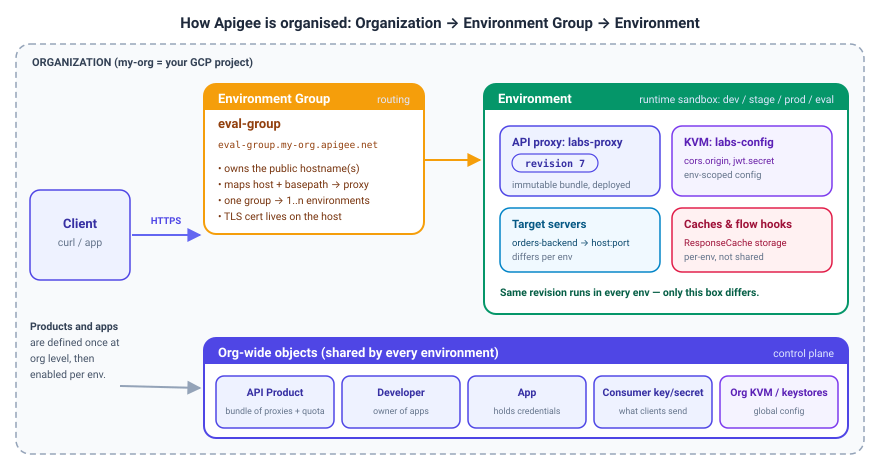

# Getting Started

This page takes you from zero to a deployed proxy. Total time: about an hour
(most of it waiting for the eval org to provision).

!!! abstract "By the end you can..."
    - Explain what the org, environment and environment group you just
      created are for.
    - Authenticate `apigeecli` and prove connectivity.
    - Deploy `labs-proxy` and see its first response in Trace.

## 1. Provision an Apigee evaluation org

1. Create or pick a GCP project at
   [console.cloud.google.com](https://console.cloud.google.com) and enable
   billing (the eval org itself is free).
2. Enable the Apigee API:

    ```bash
    gcloud services enable apigee.googleapis.com --project=$PROJECT_ID
    ```

3. Open **Apigee** in the console and click through the **evaluation
   provisioning wizard**. Provisioning takes 30–45 minutes; you get one
   environment (`eval`) in one environment group (`eval-group`) and a single
   region.

When it finishes, note three values — you'll use them constantly:

```bash
export APIGEE_ORG=my-org-name            # usually equals the GCP project ID
export APIGEE_ENV=eval
export APIGEE_HOST=eval-group.my-org-name.apigee.net   # from Provisioning → hostnames
```



Read the three exports above against this picture: `APIGEE_ORG` is the outer
box, `APIGEE_ENV` is the green box, and `APIGEE_HOST` is the hostname on the
amber box. Mixing them up is the #1 first-hour mistake.

!!! tip "Where's my hostname?"
    In the Apigee console: **Administration → Environments → Groups**.
    The hostname attached to `eval-group` is your public entrypoint.

## 2. Install the tooling

=== "apigeecli (required)"

    Google's CLI for Apigee — deploys proxies, creates apps/products,
    manages KVMs. Single binary.

    ```bash
    # macOS / Linux — grab the latest release
    curl -s https://raw.githubusercontent.com/apigee/apigeecli/main/downloadLatest.sh | bash

    # Authenticate via your gcloud login
    apigeecli token set -t "$(gcloud auth print-access-token)"
    ```

=== "Supporting cast"

    ```bash
    brew install jq curl          # you'll use these in every lab
    npm install -g apigeelint     # optional: static analysis for bundles
    ```

## 3. Verify connectivity

```bash
apigeecli organizations list -t "$(gcloud auth print-access-token)" # (1)!
# → my-org-name

apigeecli environments list -o $APIGEE_ORG -t "$(gcloud auth print-access-token)" # (2)!
# → eval
```

1. `apigeecli` is the command; `organizations list` is a noun + verb pair
   (same shape as `apis`, `products`, `kvms`...). `-t` passes an OAuth access
   token — `gcloud auth print-access-token` mints one from your login, and
   `$( )` substitutes its output in place. Seeing your org proves
   authentication **and** authorization work.
2. `-o` selects the organization (the outer box in the diagram). Seeing
   `eval` proves the environment exists and your org name is right.

!!! tip "Alias the token"
    Every `apigeecli` call needs `-t <token>`. Save yourself the typing:

    ```bash
    export TOKEN=$(gcloud auth print-access-token)
    apigeecli apis list -o $APIGEE_ORG -t "$TOKEN"
    ```

    Tokens expire after ~1 hour — just re-export.

## 4. Deploy the labs proxy

The repo ships a complete bundle under `examples/labs-proxy/`:

```bash
cd examples/labs-proxy
./deploy.sh
```

`deploy.sh` first seeds the `labs-config` KVM (see
[Lab 7](labs/cors-kvm.md)) and then wraps a single `apigeecli` call:

```bash
apigeecli apis create bundle \
  -o "$APIGEE_ORG" -e "$APIGEE_ENV" \ # (1)!
  --proxy-folder apiproxy -n labs-proxy \ # (2)!
  -t "$TOKEN" --ovr # (3)!
```

1. *Where* to put it: the organization, and the environment to **deploy**
   into. Without `-e` you'd only import a revision, not run it.
2. *What* to import: the folder that contains `proxies/`, `targets/` and
   `policies/`; `-n` becomes the proxy's name in the org.
3. `-t` authenticates; `--ovr` ("override") deploys the new revision over
   whichever one is currently live in that environment, so you can iterate
   without undeploying.

Under the hood: zip the folder → create **revision N+1** → deploy it to
`$APIGEE_ENV`. See [Proxy Anatomy](proxy-anatomy.md#the-bundle) for what is
inside that zip.

## 5. See it in action

```bash
curl -i "https://$APIGEE_HOST/labs/hello"
```

```http
HTTP/2 200
content-type: application/json

{"message": "hello from apigee", "path": "/hello"}
```

Then open **Apigee console → your proxy → Trace**, start a session, and run
the `curl` again. You'll watch the request pass through each policy — this is
the single most valuable debugging habit to build early.

## Troubleshooting the first deploy

| Symptom | Likely cause | Fix |
|---|---|---|
| `403 PERMISSION_DENIED` from apigeecli | Token expired or missing `Apigee Admin` role | Re-export `TOKEN`; check IAM on the project |
| `curl` returns `Unable to identify proxy for host` | Hostname wrong, or env group not attached | Re-check the env group hostname in the console |
| Deploy succeeds, curl 404s | Proxy base path mismatch | `labs-proxy` serves under `/labs` — check `proxies/default.xml` |
| `DNS resolution failed` on target | `mocktarget.apigee.net` unreachable from runtime | Swap target URL in `targets/default.xml` to `https://httpbin.org` |

## Check yourself

??? question "1. Which of `APIGEE_ORG`, `APIGEE_ENV`, `APIGEE_HOST` appears in the curl URL, and which in `apigeecli` flags?"
    `APIGEE_HOST` is the URL host; `APIGEE_ORG` (`-o`) and `APIGEE_ENV` (`-e`)
    are `apigeecli` flags only.

??? question "2. `curl` says `Unable to identify proxy for host`, but `apigeecli apis listdeploy` shows the proxy deployed. What do you check?"
    The hostname and environment-group attachment (is your env in the group?),
    then the `BasePath`. Deployment is fine; *routing* is not.

??? question "3. Why does `--ovr` exist, and when would you not use it?"
    It redeploys in place for a fast dev loop. For promotion you deploy a
    **specific revision** (`apis deploy -v N`) so the same artifact moves
    between environments — see [Deploy & CI/CD](deploy-cicd.md).

## What's next

Read [Proxy Anatomy](proxy-anatomy.md) — five minutes now saves confusion in
every lab — then start [Lab 1: First Proxy](labs/first-proxy.md).
