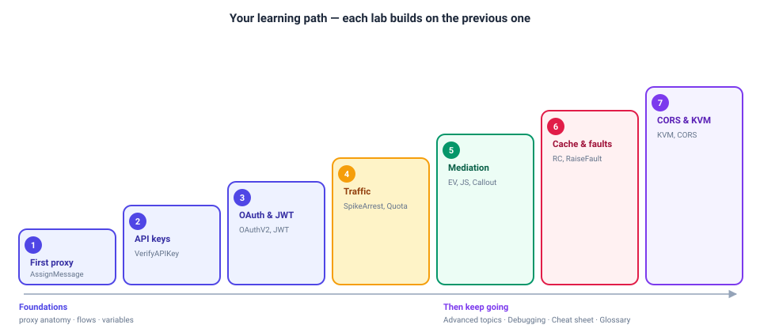
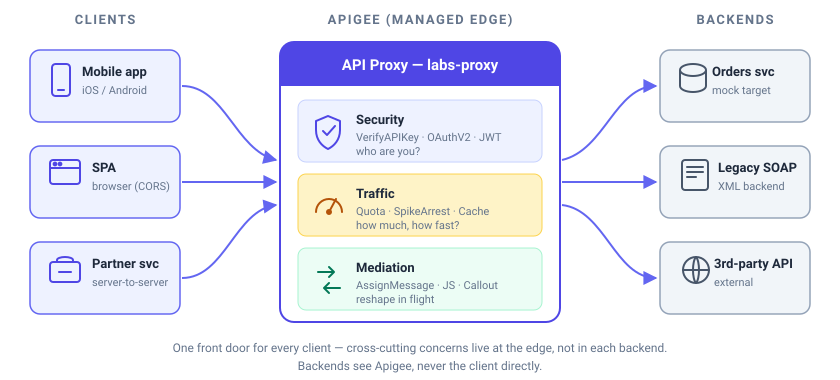

# Apigee Hands-On

A practical, deploy-and-curl introduction to **Apigee** — Google Cloud's API
management platform. Every lab ships as a real API proxy bundle you can deploy
to an Apigee evaluation org in minutes and exercise with `curl`.

!!! tip "Learning by doing"
    Reading about policies is not the same as watching a `VerifyAPIKey` reject
    a request with a 401. Each lab ends with commands that produce visible
    output — run them, break things on purpose, and use the **Trace** tool to
    watch execution step through your flows.

## How to use this guide

Every page follows the same learning loop, so you know what to expect:

1. **Objectives and prerequisites** at the top — know what you're aiming for.
2. **Predict** boxes before commands — guess first, then run. Wrong guesses
   teach more than right ones.
3. **Line-by-line annotations** — hover the **+** markers in code blocks to
   see what each line does and *why it is there*.
4. **Experiments** that break things on purpose.
5. **Check yourself** questions at the end — answer from memory before
   opening them. Revisit them a few days later.

Suggested order: [Core Concepts](concepts.md) → [Getting Started](getting-started.md)
→ [Proxy Anatomy](proxy-anatomy.md) → [Bundle Walkthrough](walkthrough.md) →
Labs 1–7 → [Debugging](debugging.md) → [Advanced Topics](advanced.md).

## Where Apigee sits

Apigee is a **reverse proxy and API management layer** that fronts your
backend services. Clients call Apigee; Apigee applies policies (security,
traffic shaping, mediation) and forwards to your target.

The backend never sees the client directly — which is what makes Apigee the
right place to centralize cross-cutting concerns instead of re-implementing
them in every service.

## What you'll build

Across the labs you'll assemble one proxy — `labs-proxy` — that front-ends a
public mock target ([`mocktarget.apigee.net`](https://mocktarget.apigee.net))
and progressively adds:

| # | Lab | Policies exercised | You leave able to... |
|---|---|---|---|
| 1 | [First proxy](labs/first-proxy.md) | `AssignMessage` | Deploy a proxy bundle and trace a request end-to-end |
| 2 | [API key security](labs/api-keys.md) | `VerifyAPIKey` | Create products/apps, issue keys, reject anonymous calls |
| 3 | [OAuth & JWT](labs/oauth-jwt.md) | `OAuthV2`, `GenerateJWT`, `VerifyJWT` | Issue access tokens and verify signed JWTs at the edge |
| 4 | [Traffic management](labs/traffic-management.md) | `SpikeArrest`, `Quota` | Rate-limit per app and absorb traffic bursts |
| 5 | [Mediation](labs/mediation.md) | `ExtractVariables`, `JavaScript`, `ServiceCallout` | Reshape requests/responses and call out to other services |
| 6 | [Caching & faults](labs/caching-faults.md) | `ResponseCache`, `RaiseFault`, `FaultRules` | Cache GETs and return consistent error payloads |
| 7 | [CORS & KVM](labs/cors-kvm.md) | `AssignMessage`, `KeyValueMapOperations` | Handle browser preflights and externalize per-env config |

The complete, deployable bundle lives in `examples/labs-proxy/` in
this repository — deploy it once, then each lab exercises a different part of
it with `curl` and **Trace**.

## Prerequisites

- An **Apigee evaluation org** (free, 60 days) — see
  [Getting Started](getting-started.md) to provision one.
- `curl`, `jq`, and [`apigeecli`](https://github.com/apigee/apigeecli)
  installed locally.
- ~15 minutes per lab.

!!! warning "No local emulator"
    Apigee X does not run locally. The eval org is the hands-on path — the
    labs assume you have one provisioned and reachable via `apigeecli`.

## Reference material

- [Core concepts](concepts.md) — org/env/proxy/product vocabulary, policy
  skeleton, variables, conditions.
- [Bundle walkthrough](walkthrough.md) — every line of the real bundle,
  annotated.
- [Debugging](debugging.md) — a repeatable method plus a failure catalogue.
- [Advanced topics](advanced.md) — shared flows, threat protection, TLS,
  logging, analytics, hardening and production checklists.
- **Deep dives:** [OAuth grants & scopes](deep-dives/oauth-grants.md),
  [cache policies](deep-dives/cache-policies.md),
  [access control & routing](deep-dives/access-routing.md),
  [OpenAPI-first](deep-dives/openapi-first.md),
  [testing](deep-dives/testing.md),
  [platform & operations](deep-dives/platform-ops.md),
  [OWASP API Top 10](deep-dives/owasp.md).
- [Cheat sheet](cheatsheet.md) and [Glossary](glossary.md).
- [Proxy anatomy](proxy-anatomy.md) — how bundles, endpoints, and flows fit
  together. Read this before Lab 1, or skim it and come back when confused.
- [Policy cookbook](policy-cookbook.md) — copy-paste XML for the policies
  you'll use most.
- [Deploy & CI/CD](deploy-cicd.md) — promotion across environments and
  deploying proxies from a pipeline.
