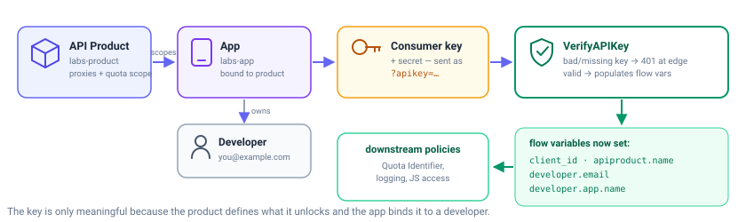

# Lab 2 — API Key Security

**Goal:** gate the `/orders` flow behind `VerifyAPIKey`, create a real
API product / developer / app, and watch anonymous requests get rejected.
~20 min.

## What you'll learn

- The product → developer → app → credential chain
- How `VerifyAPIKey` enriches the request with app metadata
- Why you should strip the key before it reaches the backend

!!! abstract "Before you start"
    You need a deployed `labs-proxy` ([Lab 1](first-proxy.md)). Be ready to
    state, from memory, what `proxy.pathsuffix` is.

## The chain



An API key is only meaningful because a **product** defines what it unlocks
(which proxies/paths) and an **app** binds a credential to a developer.

## Provision the chain

```bash
export TOKEN=$(gcloud auth print-access-token)

# 1. Product — scopes access to the labs-proxy
apigeecli products create -o "$APIGEE_ORG" -t "$TOKEN" \
  -n labs-product \ # (1)!
  --displayname "Labs Product" \
  --envs "$APIGEE_ENV" \ # (2)!
  --proxies labs-proxy \ # (3)!
  --approval auto \ # (4)!
  --quota 10000 --interval 1 --unit month # (5)!

# 2. Developer
apigeecli developers create -o "$APIGEE_ORG" -t "$TOKEN" \
  -n labs -f Lab -l User --user labsuser --email you@example.com # (6)!

# 3. App bound to the product → prints consumerKey + consumerSecret
apigeecli apps create -o "$APIGEE_ORG" -t "$TOKEN" \
  -n labs-app --email you@example.com \ # (7)!
  --prods labs-product # (8)!
```

1. Machine name of the product; this is what apps reference.
2. Product is valid only in these environments. A key for a product that
   isn't enabled in the env you call is rejected.
3. Which **deployed proxies** the product unlocks. Omit it and nothing is
   covered. (You can also restrict by path with operation groups.)
4. `auto` = keys are approved immediately; `manual` = an admin must approve
   each one.
5. Informational/billing-oriented quota **on the product** — 10,000 calls a
   month. The `Quota` policy in the proxy is what *enforces* limits at
   runtime (Lab 4).
6. Developers are people/teams; the email is their identity. It surfaces as
   `developer.email` in the flow.
7. Which developer owns the app. App and developer are separate objects so
   one developer can have many apps.
8. Attach the app to the product — this link is what makes its key work for
   `labs-proxy`. Output includes `consumerKey` (the API key) and
   `consumerSecret` (used in Lab 3).

Save the key:

```bash
export APIKEY=<consumerKey from previous output>
```

## The policy

```xml title="policies/VA-CheckAPIKey.xml"
<VerifyAPIKey async="false" continueOnError="false" enabled="true" name="VA-CheckAPIKey"> <!-- (1)! -->
  <DisplayName>VA-CheckAPIKey</DisplayName>
  <APIKey ref="request.queryparam.apikey"/> <!-- (2)! -->
</VerifyAPIKey>
```

1. `continueOnError="false"` is the security-critical bit: if the check
   fails the flow **must** abort. Setting this to `true` on an auth policy
   turns it into a decoration, not a gate.
2. *Where to find the key*: the **variable reference** (`ref`) is read at
   runtime. `request.queryparam.apikey` = `?apikey=...`. Swap in
   `request.header.x-apikey` to read a header. A missing value faults with
   `FailedToResolveAPIKey`; a present-but-unknown one with `InvalidApiKey`.

It sits in the `get-orders` conditional flow — `/hello` stays open, `/orders`
is protected:

```xml
<Flow name="get-orders">
  <Condition>(proxy.pathsuffix MatchesPath "/orders") and (request.verb = "GET")</Condition>
  <Request>
    <Step><Name>VA-CheckAPIKey</Name></Step> <!-- (1)! -->
    <Step><Name>Quota-PerApp</Name></Step> <!-- (2)! -->
    <Step><Name>AM-StripKey</Name></Step> <!-- (3)! -->
  </Request>
  ...
</Flow>
```

1. Gate: unauthenticated callers stop here.
2. Needs `verifyapikey.VA-CheckAPIKey.client_id`, produced by the line above.
3. Cleanup *after* we've read what we need from the query string, *before*
   the target request is built.

`AM-StripKey` removes the credential so it never reaches your backend
(or your backend's logs):

```xml title="policies/AM-StripKey.xml"
<AssignMessage async="false" continueOnError="false" enabled="true" name="AM-StripKey">
  <DisplayName>AM-StripKey</DisplayName>
  <Remove> <!-- (1)! -->
    <QueryParams>
      <QueryParam name="apikey"/> <!-- (2)! -->
    </QueryParams>
  </Remove>
  <AssignTo createNew="false" type="request">request</AssignTo> <!-- (3)! -->
</AssignMessage>
```

1. `<Remove>` deletes parts of a message (counterpart of `<Set>`/`<Add>`).
2. Which query parameter to delete — by name. Nothing happens if it isn't
   there.
3. Edit the **request** object. This is what gets forwarded to the target, so
   the key never reaches the backend, its logs, or proxies after Apigee.

## Exercise it

```bash
# No key → rejected at the edge, backend never sees it
curl -i "https://$APIGEE_HOST/labs/orders"
```

```http
HTTP/2 401
{"error": {"code": "UNAUTHORIZED", "message": "valid credentials required", "fault": "FailedToResolveAPIKey"}}
```

That tidy body is produced by the bundle's `FaultRule` + `AM-Error401`
(Lab 6). Without them Apigee would return its default fault:
`{"fault":{"faultstring":"Failed to resolve API Key variable request.queryparam.apikey","detail":{"errorcode":"steps.oauth.v2.FailedToResolveAPIKey"}}}`.

```bash
# With key → passes through to mocktarget
curl -i "https://$APIGEE_HOST/labs/orders?apikey=$APIKEY"
```

```http
HTTP/2 200
{
  "message": "orders list",
  "app": "labs-app",
  "developer": "you@example.com",
  "cache": "miss (backend)",
  ...
}
```

That `app`/`developer` block is added by `JS-ShapeResponse` reading
variables `VerifyAPIKey` populated:

| Variable | Value |
|---|---|
| `verifyapikey.VA-CheckAPIKey.client_id` | the consumer key |
| `apiproduct.name` | `labs-product` |
| `developer.email` | `you@example.com` |
| `developer.app.name` | `labs-app` |

Check them in **Trace** — expand the `VA-CheckAPIKey` step and watch the
variables appear.

## Experiments

1. **Header instead of query param.** Change the `ref` to
   `request.header.x-apikey`, redeploy, and test with
   `curl -H "x-apikey: $APIKEY"`. Which do you prefer, and why? (Headers keep
   keys out of URL logs.)
2. **Revocation.** `apigeecli apps delete -o $APIGEE_ORG -t "$TOKEN" -n labs-app --email you@example.com`
   → the same key now 401s. Recreate the app afterwards.
3. **Wrong product.** Create an app *without* `--prods labs-product` and
   confirm its key is rejected — the key must resolve to a product that
   covers this proxy.
4. Comment out `AM-StripKey`, redeploy, and watch the key arrive at
   mocktarget in Trace's "Request sent to target" view — a concrete
   demonstration of why stripping matters.

## Check yourself

??? question "1. A key is valid but the proxy returns 401 `InvalidApiKeyForGivenResource`. What's wrong, and where do you fix it?"
    The app's product doesn't include `labs-proxy` (or this environment). Fix
    the **product's** proxy/env list or attach the app to the right product — no
    proxy change needed.

??? question "2. Why must `AM-StripKey` come *after* `VA-CheckAPIKey`?"
    `VerifyAPIKey` reads the key from the query string. Strip it first and
    there is nothing to read — you'd get `FailedToResolveAPIKey` for every
    request, valid key or not.

??? question "3. Name two reasons to prefer a header over a query parameter for the key."
    URLs are recorded in access logs, browser history and `Referer` headers;
    headers generally aren't. Headers also keep the key out of shared links
    and copy-pasted URLs.

??? question "4. What does `continueOnError=\"true\"` on `VA-CheckAPIKey` do to your security?"
    A failed verification no longer aborts the flow — anonymous requests would
    proceed to the backend. Never set it on gate policies.

## Next

[Lab 3 — OAuth & JWT](oauth-jwt.md): upgrade from static keys to short-lived
tokens at the edge.
