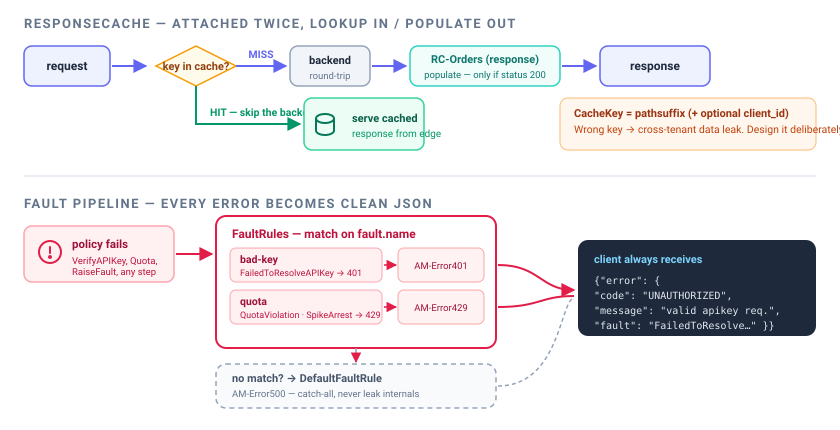

# Lab 6 — Caching & Faults

**Goal:** serve repeat `GET /orders` responses from `ResponseCache`, and
normalize every error into a clean JSON payload via `FaultRules`. ~20 min.

## What you'll learn

- `ResponseCache` lookup/populate semantics
- Cache keys and why `client_id` belongs (or doesn't) in the key
- The fault pipeline: `RaiseFault` → `FaultRules` → `DefaultFaultRule`
- Why error responses need their own CORS headers

!!! abstract "Before you start"
    Re-read [Core Concepts → Errors](../concepts.md#7-errors-in-one-paragraph).
    In this lab you'll see every sentence of it happen.



## ResponseCache

```xml title="policies/RC-Orders.xml"
<ResponseCache async="false" continueOnError="false" enabled="true" name="RC-Orders">
  <DisplayName>RC-Orders</DisplayName>
  <CacheKey>
    <Prefix/> <!-- (1)! -->
    <KeyFragment ref="proxy.pathsuffix"/> <!-- (2)! -->
  </CacheKey>
  <ExpirySettings>
    <TimeoutInSec>60</TimeoutInSec> <!-- (3)! -->
  </ExpirySettings>
  <SkipCacheLookup>request.header.x-no-cache Exists</SkipCacheLookup> <!-- (4)! -->
  <SkipCachePopulation>response.status.code != 200</SkipCachePopulation> <!-- (5)! -->
</ResponseCache>
```

1. Optional namespace string placed in front of the key. Empty here; set one
   (e.g. `orders-v1`) to avoid collisions when several policies share a cache.
2. The key is built from fragments joined together. Here: just the path
   suffix, so `/orders` is one cache entry — **shared by every caller**.
3. Time-to-live: after 60 s the entry expires and the next call is a miss.
4. A *condition* evaluated on lookup: if true, skip the cache read (forces a
   backend call). The `x-no-cache` header is the lab's escape hatch.
5. A *condition* evaluated on populate: only store 200s. Without it a
   transient 500 would be cached and replayed for the full TTL.

Attachment is a **pair** — lookup on the way in, populate on the way out:

```xml
<Flow name="get-orders">
  <Request>
    <Step><Name>VA-CheckAPIKey</Name></Step>
    <Step><Name>Quota-PerApp</Name></Step>
    <Step><Name>AM-StripKey</Name></Step>
    <Step><Name>RC-Orders</Name></Step>     <!-- (1)! -->
  </Request>
  <Response>
    <Step><Name>JS-ShapeResponse</Name></Step>
    <Step><Name>RC-Orders</Name></Step>     <!-- (2)! -->
  </Response>
</Flow>
```

1. **Lookup.** On a hit the target call is skipped and the response flow
   begins immediately, carrying the cached body.
2. **Populate.** The same policy name in the response flow stores the
   response — *after* `JS-ShapeResponse`, so what is cached is the already
   shaped envelope.

!!! tip "Cache hits skip the backend"
    In **Trace** you'll see the request phase end early and no target
    round-trip. That's your proof the cache works.

## Exercise it

!!! question "Predict"
    Call `/orders` with `x-no-cache: 1` (miss), then twice more without the
    header within 60 s. Which call(s) show `"hit (edge)"`? Does the *quota
    counter* go up on hits?

    ??? success "Answer"
        Calls 2 and 3 are hits. The quota counter **does** increase on hits —
        `Quota-PerApp` runs before the cache lookup.

```bash
# First call — miss, hits the backend
curl -s "https://$APIGEE_HOST/labs/orders?apikey=$APIKEY" \
  -H "x-no-cache: 1" | jq .cache

# Second call — hit, served at the edge
curl -s "https://$APIGEE_HOST/labs/orders?apikey=$APIKEY" | jq .cache
```

```json
"hit (edge)"
```

(The bundle's JS stamps the `cache` field from
`responsecache.RC-Orders.cachehit`.)

Compare latencies:

```bash
curl -s -o /dev/null -w "miss: %{time_total}s\n" \
  "https://$APIGEE_HOST/labs/orders?apikey=$APIKEY" -H "x-no-cache: 1"
curl -s -o /dev/null -w "hit:  %{time_total}s\n" \
  "https://$APIGEE_HOST/labs/orders?apikey=$APIKEY"
```

Edge hits shave the target round-trip entirely.

!!! warning "Key design is a security decision"
    The key here is just `pathsuffix` — every app shares the cached body. If
    responses are per-user, add `<KeyFragment
    ref="verifyapikey.VA-CheckAPIKey.client_id"/>` — or better, never cache
    personalized data. Cache poisoning across tenants is a real bug class.
    Here the cached body even contains the first caller's `app` and
    `developer` — a leak you can see for yourself by calling with a second
    app's key.

## Fault pipeline


Deliberately break things and normalize the output. This is the bundle's
actual fault section, condensed:

```xml
<FaultRules> <!-- (1)! -->
  <FaultRule name="auth-faults">
    <Step><Name>AM-Error401</Name></Step> <!-- (2)! -->
    <Condition>(fault.name = "FailedToResolveAPIKey") or
               (fault.name = "InvalidApiKey") or
               (fault.name Matches "*Token*")</Condition> <!-- (3)! -->
  </FaultRule>
  <FaultRule name="throttled">
    <Step><Name>AM-Error429</Name></Step>
    <Condition>(fault.name = "QuotaViolation") or
               (fault.name = "SpikeArrestViolation")</Condition>
  </FaultRule>
</FaultRules>
<DefaultFaultRule name="fallback">
  <Step><Name>AM-Error500</Name></Step> <!-- (4)! -->
  <Condition>fault.name != "RaiseFault"</Condition> <!-- (5)! -->
</DefaultFaultRule>
```

1. Evaluated top to bottom **only when something faulted**; first rule with a
   true condition runs and the rest are skipped.
2. The *response builder*: a normal policy (an `AssignMessage`) that sets
   body and status.
3. Match on `fault.name`. Look it up in Trace (or the
   [fault table](../policy-cookbook.md#fault-names-worth-a-faultrule)).
   Wildcards cover families of names.
4. Catch-all so clients never see Apigee's default fault payload.
5. Don't overwrite faults you raised on purpose (`RaiseFault` already
   builds a precise response).

```xml title="policies/AM-Error401.xml"
<AssignMessage async="false" continueOnError="false" enabled="true" name="AM-Error401">
  <DisplayName>AM-Error401</DisplayName>
  <Set>
    <Headers>
      <Header name="Access-Control-Allow-Origin">{kvm.cors.origin}</Header> <!-- (1)! -->
    </Headers>
    <Payload contentType="application/json">
      {"error": {"code": "UNAUTHORIZED", "message": "valid credentials required", "fault": "{fault.name}"}} <!-- (2)! -->
    </Payload>
    <StatusCode>401</StatusCode>
  </Set>
  <IgnoreUnresolvedVariables>true</IgnoreUnresolvedVariables> <!-- (3)! -->
  <AssignTo createNew="false" type="response">response</AssignTo>
</AssignMessage>
```

1. The PostFlow (`AM-CORS-Headers`) **doesn't run on faults**, so the error
   policy must add the CORS header itself — otherwise browsers show an
   opaque "CORS error" instead of your 401.
2. `{fault.name}` is only available while fault handling runs. Echoing it
   helps clients and logs; consider omitting internals in production.
3. On an error path a *second* failure (say the KVM wasn't loaded because the
   spike arrest faulted first) would hide the first. Be lenient here.

And `RaiseFault` to trigger one yourself — the bundle rejects `POST /orders`
bodies that lack `customerId`:

```xml title="policies/RF-MissingCustomer.xml"
<RaiseFault async="false" continueOnError="false" enabled="true" name="RF-MissingCustomer">
  <DisplayName>RF-MissingCustomer</DisplayName>
  <FaultResponse> <!-- (1)! -->
    <Set>
      <Payload contentType="application/json">
        {"error": {"code": "BAD_REQUEST", "message": "customerId is required"}}
      </Payload>
      <StatusCode>400</StatusCode> <!-- (2)! -->
    </Set>
  </FaultResponse>
  <IgnoreUnresolvedVariables>true</IgnoreUnresolvedVariables>
</RaiseFault>
```

1. The response to send. It has the same `Set` vocabulary as
   `AssignMessage`.
2. A 4xx because the *client* erred. RaiseFault is how you turn a validation
   failure (not a system failure) into a precise response.

## Exercise it

```bash
# Trigger the RaiseFault
curl -s -X POST "https://$APIGEE_HOST/labs/orders?apikey=$APIKEY" \
  -H 'content-type: application/json' -d '{"item":"widget"}' | jq
```

```json
{"error": {"code": "BAD_REQUEST", "message": "customerId is required"}}
```

```bash
# Anonymous → your normalized 401 (not Apigee's default fault)
curl -s "https://$APIGEE_HOST/labs/orders" | jq
```

```json
{"error": {"code": "UNAUTHORIZED", "message": "valid credentials required", "fault": "FailedToResolveAPIKey"}}
```

## Experiments

1. Drop the `x-no-cache` bypass header, call twice in Trace — confirm the
   target step disappears on the hit.
2. Set `TimeoutInSec` to 5 and watch the hit flip back to a miss between
   calls.
3. Remove `<SkipCachePopulation>response.status.code != 200</...>` — what
   class of bug does that invite? (Error responses cached for the TTL.)
4. Add the `<KeyFragment ref="verifyapikey.VA-CheckAPIKey.client_id"/>`
   from the warning above, redeploy, call with two apps and compare `app`.
5. Delete the `Condition` from `DefaultFaultRule`, redeploy, and re-run the
   `RaiseFault` curl. What status do you get now and why?
6. Add a FaultRule matching `ExecutionFailed` that degrades `SC-FetchIP`
   failures instead of failing the request (hint: `continueOnError` on the
   callout is the simpler alternative — compare them).

## Check yourself

??? question "1. Why is the same policy name listed twice in the `get-orders` flow?"
    One attachment performs the cache **lookup** (request phase), the other the
    **populate** (response phase). It's one policy file, two attachment points.

??? question "2. A cached response contains `\"app\": \"labs-app\"`. Another tenant calls and receives it. What two fixes?"
    Add `client_id` to the cache key, or don't cache personalised responses
    (shape them *after* the cache with a response-phase policy that runs on both
    hits and misses).

??? question "3. Why do the error policies set `Access-Control-Allow-Origin` themselves?"
    Because the PostFlow that normally adds it is skipped when a fault occurs.

??? question "4. Order the evaluation: DefaultFaultRule, FaultRule #2, FaultRule #1."
    #1, then #2 (first match wins), and the DefaultFaultRule only if neither
    matched.

??? question "5. When would you choose `RaiseFault` over just letting a policy fail?"
    For *your own* validation rules (bad body, business-rule violations) where
    you want a precise status/message rather than a policy's built-in fault.

## Next

[Lab 7 — CORS & KVM](cors-kvm.md): browser-safe APIs and per-environment
configuration without redeploys.
