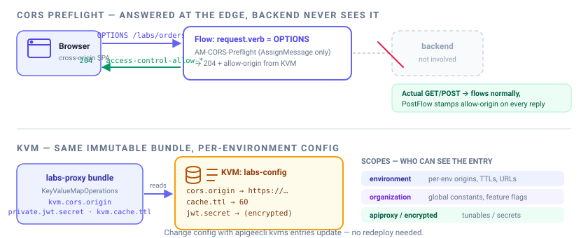
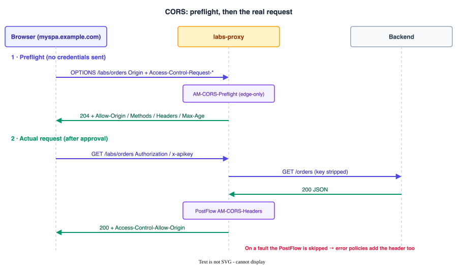
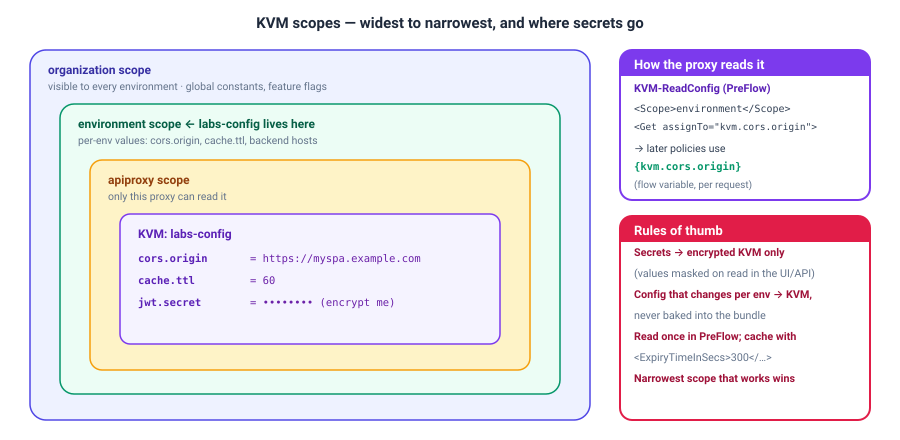

# Lab 7 — CORS & KVM

**Goal:** answer browser `OPTIONS` preflights at the edge, and externalize
environment-specific config into a Key-Value Map so the same bundle promotes
cleanly across environments. ~20 min.

## What you'll learn

- How browsers decide to send a preflight, and what the answer must contain
- Handling `OPTIONS` with an `AssignMessage`-only flow
- `KeyValueMapOperations` for per-env config (and its cache!)
- The pattern that makes one bundle deployable to dev/stage/prod

!!! abstract "Before you start"
    This lab's policies already ran in every earlier lab: `KVM-ReadConfig`
    is in the PreFlow and `AM-CORS-Headers` in the PostFlow. Now you meet
    them properly.



## Part A — CORS

**Why it exists:** a script on `https://myspa.example.com` is forbidden by
the browser from reading a response from `https://api...` unless the API
says "that origin is allowed". For "non-simple" requests (custom headers like
`Authorization`, methods like `PUT`, JSON bodies) the browser first sends an
`OPTIONS` **preflight** asking permission. No `Access-Control-*` headers
back, no real request.



The proxy should short-circuit the preflight — never reach the backend:

```xml
<Flow name="cors-preflight">
  <Condition>(request.verb = "OPTIONS")</Condition> <!-- (1)! -->
  <Request>
    <Step><Name>AM-CORS-Preflight</Name></Step> <!-- (2)! -->
  </Request>
  <Response/>
</Flow>
```

1. Any path, any `OPTIONS`. It is the **first** flow, so it wins before
   path-specific flows (and before `VerifyAPIKey`, which would otherwise
   reject preflights — browsers never attach credentials to them).
2. Builds the whole answer; the `edge-only` RouteRule ensures no backend call.

```xml title="policies/AM-CORS-Preflight.xml"
<AssignMessage async="false" continueOnError="false" enabled="true" name="AM-CORS-Preflight">
  <DisplayName>AM-CORS-Preflight</DisplayName>
  <Set>
    <Headers>
      <Header name="Access-Control-Allow-Origin">{kvm.cors.origin}</Header> <!-- (1)! -->
      <Header name="Access-Control-Allow-Methods">GET, POST, OPTIONS</Header> <!-- (2)! -->
      <Header name="Access-Control-Allow-Headers">authorization, content-type, x-apikey, x-no-cache</Header> <!-- (3)! -->
      <Header name="Access-Control-Max-Age">3600</Header> <!-- (4)! -->
    </Headers>
    <StatusCode>204</StatusCode> <!-- (5)! -->
  </Set>
  <IgnoreUnresolvedVariables>true</IgnoreUnresolvedVariables>
  <AssignTo createNew="false" type="response">response</AssignTo>
</AssignMessage>
```

1. Which origin may call. The value comes from the KVM, so it differs per
   environment. (This lab returns the configured origin as-is; to support
   several origins, see experiment 2.)
2. Methods the browser may use for the real request.
3. Request headers the browser may send. If the real request uses a header
   not listed here, the browser blocks it — add `x-no-cache` here because the
   lab's cache demo sends it from a browser.
4. Let the browser cache this preflight answer for an hour (browsers cap this
   at their own maximum) — fewer preflights.
5. `204 No Content`: success, empty body.

Actual responses also need `Access-Control-Allow-Origin` — `AM-CORS-Headers`
in the PostFlow response stamps it on every successful reply, and the three
error policies stamp it on failures:

```xml title="policies/AM-CORS-Headers.xml"
<AssignMessage async="false" continueOnError="false" enabled="true" name="AM-CORS-Headers">
  <Set>
    <Headers>
      <Header name="Access-Control-Allow-Origin">{kvm.cors.origin}</Header> <!-- (1)! -->
    </Headers>
  </Set>
  <IgnoreUnresolvedVariables>true</IgnoreUnresolvedVariables>
  <AssignTo createNew="false" type="response">response</AssignTo> <!-- (2)! -->
</AssignMessage>
```

1. Only this one header — the other `Allow-*` headers matter for preflights
   only.
2. Edit the final response in place.

## Exercise it

```bash
curl -i -X OPTIONS "https://$APIGEE_HOST/labs/orders" \
  -H "Origin: https://myspa.example.com" \
  -H "Access-Control-Request-Method: GET"
```

```http
HTTP/2 204
access-control-allow-origin: https://myspa.example.com
access-control-allow-methods: GET, POST, OPTIONS
access-control-max-age: 3600
```

!!! warning "`*` with credentials is forbidden"
    `Access-Control-Allow-Origin: *` can't coexist with
    `Access-Control-Allow-Credentials: true`. Use a specific origin from an
    allowlist (KVM) and, if you support several, echo back the *request's*
    `Origin` only when it's on the list — and add `Vary: Origin`.

## Part B — KVM



The bundle reads config once per request from the `labs-config` KVM:

```xml title="policies/KVM-ReadConfig.xml"
<KeyValueMapOperations async="false" continueOnError="false" enabled="true" name="KVM-ReadConfig" mapIdentifier="labs-config"> <!-- (1)! -->
  <Scope>environment</Scope> <!-- (2)! -->
  <Get assignTo="kvm.cors.origin"> <!-- (3)! -->
    <Key><Parameter>cors.origin</Parameter></Key> <!-- (4)! -->
  </Get>
  <Get assignTo="private.jwt.secret"> <!-- (5)! -->
    <Key><Parameter>jwt.secret</Parameter></Key>
  </Get>
  <Get assignTo="kvm.cache.ttl">
    <Key><Parameter>cache.ttl</Parameter></Key>
  </Get>
  <ExpiryTimeInSecs>300</ExpiryTimeInSecs> <!-- (6)! -->
</KeyValueMapOperations>
```

1. `mapIdentifier` = the KVM's name. Created by `deploy.sh`.
2. Which tier to look in: `environment` here. Other values: `organization`,
   `apiproxy`.
3. `assignTo` = the flow variable that receives the value. After this line
   `{kvm.cors.origin}` works in any later policy.
4. The entry (key) to fetch. A KVM is a flat map of key → value.
5. Writing to a `private.`-prefixed variable keeps the secret masked in
   Trace — and is required by the JWT policies (Lab 3).
6. **Important:** values read are cached on the runtime for 300 s. Changing a
   KVM entry may take **up to five minutes** to be seen — plan demos around
   it (or lower this value while experimenting).

Seed it (`deploy.sh` does this; manual version):

```bash
export TOKEN=$(gcloud auth print-access-token)

apigeecli kvms create -o "$APIGEE_ORG" -e "$APIGEE_ENV" -t "$TOKEN" -n labs-config

apigeecli kvms entries create -o "$APIGEE_ORG" -e "$APIGEE_ENV" -t "$TOKEN" \
  -m labs-config -k cors.origin -v "https://myspa.example.com"
apigeecli kvms entries create -o "$APIGEE_ORG" -e "$APIGEE_ENV" -t "$TOKEN" \
  -m labs-config -k cache.ttl -v "60"
```

Now *change behavior without redeploying*:

```bash
apigeecli kvms entries update -o "$APIGEE_ORG" -e "$APIGEE_ENV" -t "$TOKEN" \
  -m labs-config -k cors.origin -v "https://staging.myspa.example.com"
```

Re-run the OPTIONS curl (give it up to the 300 s expiry) — the allow-origin
header changed, zero redeploys. That's the promotion story: same immutable
revision everywhere, config lives in the environment.

| Scope | Visible to | Use for |
|---|---|---|
| `environment` | proxies in that env | per-env config (origins, TTLs, URLs) |
| `organization` | every env | global constants, feature flags |
| `apiproxy` | this proxy only | proxy-specific tunables |

**Encryption is a property of the *map*, not a scope.** Create the KVM with
`--encrypted` and values are stored encrypted and masked when read via the
API/UI. Put secrets (JWT keys, credentials) there.

## Experiments

1. Point `cache.ttl` into `RC-Orders`'s `TimeoutInSec` via
   `<TimeoutInSec ref="kvm.cache.ttl"/>` — tune caching per env.
2. Store a comma-separated allowlist in `cors.origins` and, in a JS policy,
   echo the `Origin` header only if present in the list (and add
   `Vary: Origin`).
3. Encrypted KVM: `apigeecli kvms create ... --encrypted`, copy
   `jwt.secret` into it and point `KVM-ReadConfig` at it — JWT minting works
   identically.
4. Lower `ExpiryTimeInSecs` to `10`, update a value and time how long the
   change takes to show up.
5. Add `KVM-ReadConfig` to the PostFlow of an error path — what happens to
   `kvm.*` vars when the request faults *before* the PreFlow policy ran?
   (Variables are per-request state; fault handlers can't rely on unset vars.)

## Check yourself

??? question "1. Why must the preflight flow come before any flow that verifies a key?"
    Browsers don't send credentials on preflights, so a key check would
    reject every preflight with a 401 and the real request would never be sent.

??? question "2. You changed a KVM entry and the old value is still served. Why?"
    `KVM-ReadConfig` caches reads for `ExpiryTimeInSecs` (300 s). Wait it out,
    or lower the expiry.

??? question "3. Where does a value belong if it differs between stage and prod: bundle, KVM or target server?"
    Never the bundle. A KVM for settings/secrets; a target server for backend
    host/port.

??? question "4. Why is `Access-Control-Allow-Origin: *` unsafe with cookies/credentials?"
    Browsers reject the combination, and allowing every origin to read
    authenticated responses defeats the same-origin protection. Use an explicit
    allowlist.

## Where to go next

You've built a proxy that does what production Apigee proxies do: security,
quota, mediation, caching, fault handling, env config. Natural follow-ons:

- [Debugging & Troubleshooting](../debugging.md) — a repeatable method for
  when it doesn't work
- [Advanced Topics](../advanced.md) — shared flows, threat protection, logging,
  analytics, hardening
- [Cheat Sheet](../cheatsheet.md) and [Glossary](../glossary.md)
- [Policy cookbook](../policy-cookbook.md) — templates for the other
  policies you'll reach for
- [Deploy & CI/CD](../deploy-cicd.md) — promote this revision through
  environments from a pipeline
