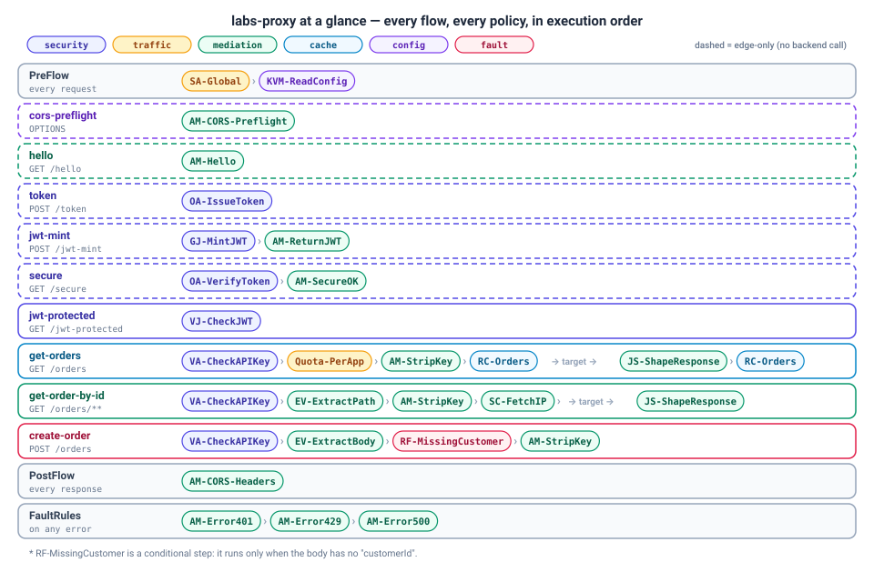

# Lab 1 — First Proxy

**Goal:** deploy the `labs-proxy` bundle, hit it with `curl`, and trace the
request in the Apigee UI. ~15 min.

## What you'll learn

- How a bundle maps to a deployed revision
- What `BasePath` + `pathsuffix` mean on the wire
- How a flow **condition** selects which policies run
- How to read the **Trace** (Debug) tool

!!! abstract "Before you start"
    Skim [Proxy Anatomy](../proxy-anatomy.md). You should be able to say what
    PreFlow, conditional Flow and RouteRule mean. If not, that's fine — this
    lab makes them concrete.

## The moving parts

The bundle's front door (`apiproxy/proxies/default.xml`), reduced to what
this lab needs:

```xml
<HTTPProxyConnection>
  <BasePath>/labs</BasePath> <!-- (1)! -->
  <VirtualHost>default</VirtualHost> <!-- (2)! -->
</HTTPProxyConnection>
<RouteRule name="default"> <!-- (3)! -->
  <TargetEndpoint>default</TargetEndpoint> <!-- (4)! -->
</RouteRule>
```

1. The public URL prefix. A request to `https://$APIGEE_HOST/labs/hello`
   is claimed by this proxy; `/hello` becomes `proxy.pathsuffix`.
2. Always `default` in Apigee X — the hostname actually comes from the
   environment group.
3. "Where should the request go next?" Rules are checked in order; this one
   has no condition, so it matches everything not caught by an earlier rule.
4. Hand the request to `targets/default.xml`.

And the backend (`apiproxy/targets/default.xml`):

```xml
<TargetEndpoint name="default"> <!-- (1)! -->
  <HTTPTargetConnection>
    <URL>https://mocktarget.apigee.net</URL> <!-- (2)! -->
  </HTTPTargetConnection>
</TargetEndpoint>
```

1. Must match the `<TargetEndpoint>` name in the RouteRule above.
2. Apigee appends the remaining path and query: `/labs/foo?x=1` →
   `https://mocktarget.apigee.net/foo?x=1`.

So `GET https://$APIGEE_HOST/labs/foo` → `GET https://mocktarget.apigee.net/foo`.
The mock target echoes what it received — perfect for observing what Apigee
added or removed.



## Deploy

```bash
export TOKEN=$(gcloud auth print-access-token)

cd examples/labs-proxy
./deploy.sh
# or directly:
# apigeecli apis create bundle -o "$APIGEE_ORG" -e "$APIGEE_ENV" \
#   --proxy-folder apiproxy -n labs-proxy -t "$TOKEN" --ovr
```

Check it's deployed:

```bash
apigeecli apis listdeploy -o "$APIGEE_ORG" -n labs-proxy -t "$TOKEN"
```

You should see `labs-proxy` with a revision number deployed to your
environment.

## Predict, then run

!!! question "Predict"
    The proxy has a `/hello` flow that **only** runs `AM-Hello` in the
    response, and `/hello` is on the edge-only RouteRule list. What do you
    expect: (a) the mock target's JSON, (b) a JSON message produced by Apigee
    itself, or (c) a 404?

    ??? success "Answer"
        (b). No backend call is made at all.

```bash
curl -i "https://$APIGEE_HOST/labs/hello"
```

```http
HTTP/2 200
content-type: application/json

{"message": "hello from apigee", "path": "/hello"}
```

That JSON comes from an `AssignMessage` policy in the response flow — the
request never reaches the backend for `/hello`. Look at the `hello`
conditional flow:

```xml
<Flow name="hello">
  <Condition>(proxy.pathsuffix MatchesPath "/hello") and (request.verb = "GET")</Condition> <!-- (1)! -->
  <Request/> <!-- (2)! -->
  <Response>
    <Step><Name>AM-Hello</Name></Step> <!-- (3)! -->
  </Response>
</Flow>
```

1. The **guard**. Both parts must be true: the path *after* `/labs` is
   exactly `/hello`, **and** the HTTP method is `GET`. Anything else skips this
   flow.
2. Nothing to do in the request phase, so the element is empty.
3. Run the policy whose file is `policies/AM-Hello.xml`. The text between
   `<Name>` tags must equal that policy's `name` attribute.

```xml title="policies/AM-Hello.xml"
<AssignMessage async="false" continueOnError="false" enabled="true" name="AM-Hello"> <!-- (1)! -->
  <DisplayName>AM-Hello</DisplayName>
  <Set> <!-- (2)! -->
    <Payload contentType="application/json"> <!-- (3)! -->
      {"message": "hello from apigee", "path": "{proxy.pathsuffix}"} <!-- (4)! -->
    </Payload>
    <StatusCode>200</StatusCode> <!-- (5)! -->
  </Set>
  <IgnoreUnresolvedVariables>true</IgnoreUnresolvedVariables> <!-- (6)! -->
  <AssignTo createNew="false" type="response">response</AssignTo> <!-- (7)! -->
</AssignMessage>
```

1. `AssignMessage` = "create or edit a message". Attribute `name` is the
   policy's identity; `continueOnError="false"` means a failure here aborts
   into fault handling; `enabled="true"` can be flipped to switch it off.
2. `<Set>` overwrites parts of the target message. Siblings you'll meet:
   `<Add>` (append), `<Copy>`, `<Remove>`.
3. The body, and the `Content-Type` header to send with it.
4. `{proxy.pathsuffix}` is replaced at runtime by the flow variable's value
   (`/hello`). Anything in `{ }` that is a valid variable name is looked up;
   JSON braces/quotes don't qualify, so they pass through untouched. (If a
   payload gets ambiguous, set `variablePrefix="@" variableSuffix="#"` on
   `<Payload>` and write `@proxy.pathsuffix#` instead.)
5. HTTP status of the response.
6. If `{proxy.pathsuffix}` couldn't be resolved, use empty text instead of
   failing the policy.
7. Which message to edit: the `response` object, and `createNew="false"`
   means "use the existing one rather than creating a fresh message".

## Trace it

1. Apigee console → **API Proxies → labs-proxy → Debug** tab (called
   *Trace* in older docs).
2. Start a session (pick the revision and environment), then run the `curl`
   again.
3. Click the transaction. In the step list find, in order: `SA-Global`,
   `KVM-ReadConfig` (PreFlow) → `AM-Hello` (flow response). Click `AM-Hello`
   and look at the variables panel: `proxy.pathsuffix = "/hello"` — the exact
   variable the `Condition` matched on.

!!! note "Where's the target call?"
    There isn't one: the `edge-only` RouteRule matched first and has no
    target. Contrast with `curl "https://$APIGEE_HOST/labs/anything"`, whose
    Trace *does* show a "Request sent to target" and the mock target's reply.

## Experiments

1. `curl "https://$APIGEE_HOST/labs/hello?x=1"` — does it still match?
   (`MatchesPath` looks at the path only; query strings don't affect it.)
2. `curl -X POST "https://$APIGEE_HOST/labs/hello"` → falls through to the
   target (verb mismatch). Compare the response.
3. `curl "https://$APIGEE_HOST/labs/hello/"` — trailing slash. Does
   `MatchesPath "/hello"` match? Check in Trace before you answer.
4. Change the `BasePath` to `/labs2`, redeploy, and confirm `/labs/hello`
   now fails while `/labs2/hello` works.
5. Set `enabled="false"` on `AM-Hello` and redeploy. What does `/hello`
   return now, and *why is it not a fault*?

## Check yourself

??? question "1. What are `proxy.basepath` and `proxy.pathsuffix` for `GET /labs/orders/42?x=1`?"
    `/labs` and `/orders/42` — the query string is separate
    (`request.queryparam.x`).

??? question "2. Why is `AM-Hello` attached to the Response while nothing runs in the Request?"
    On an edge-only route there's no backend, so the proxy builds the reply
    itself; the response phase is where a reply is shaped, and putting it
    there keeps "build the answer" in the conventional place.

??? question "3. What would happen if the policy file were named `AM-Hi.xml` but `<Name>AM-Hello</Name>` stayed in the flow?"
    Import/deploy fails or the step can't resolve a policy — names must match
    across file, `name` attribute and `<Step>`.

??? question "4. Experiment 5: why isn't a disabled policy a fault?"
    `enabled="false"` makes the policy a no-op; Apigee skips it without error,
    so whatever response exists at that point is what the client gets. Check
    it in Trace — and notice that a *silently skipped* policy is a classic
    "why did nothing happen?" cause.

## Next

[Lab 2 — API Key Security](api-keys.md): lock down `/orders` with
`VerifyAPIKey` and a real developer app.
