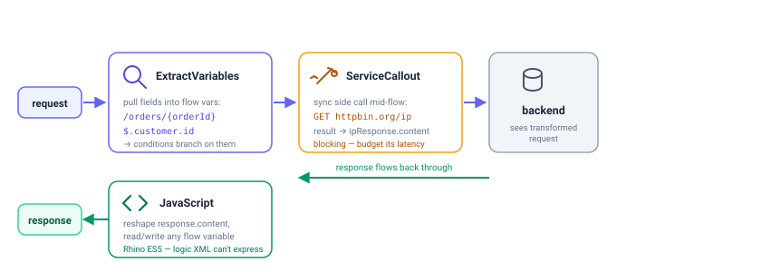

# Lab 5 — Mediation

**Goal:** transform requests and responses in flight — extract values, call a
side service, and reshape the body with JavaScript. ~25 min.

## What you'll learn

- `ExtractVariables` for pulling data out of paths and payloads
- `ServiceCallout` for synchronous side calls (enrichment, lookup)
- `JavaScript` policies for logic XML can't express
- `JSONtoXML`/`XMLtoJSON` for protocol translation

!!! abstract "Before you start"
    Revisit [Core Concepts → Flow variables](../concepts.md#4-flow-variables-the-shared-notebook).
    Mediation is almost entirely "write a variable here, read it there".



## 1. ExtractVariables — pull fields into flow variables

```xml title="policies/EV-ExtractPath.xml"
<ExtractVariables async="false" continueOnError="false" enabled="true" name="EV-ExtractPath">
  <DisplayName>EV-ExtractPath</DisplayName>
  <Source>request</Source> <!-- (1)! -->
  <URIPath>
    <Pattern ignoreCase="true">/orders/{orderId}</Pattern> <!-- (2)! -->
  </URIPath>
  <IgnoreUnresolvedVariables>true</IgnoreUnresolvedVariables> <!-- (3)! -->
</ExtractVariables>
```

1. *What to read from*: the whole `request` message. Could also be
   `response` or a message variable such as `ipResponse`.
2. A template matched against the **path suffix**. `{orderId}` is a
   placeholder: whatever sits in that segment is captured. `ignoreCase`
   makes `/ORDERS/42` match too.
3. If the pattern doesn't match (e.g. `/orders/` with no id), don't fault —
   the variable is just left unset. Your next policy must cope with that.

`GET /labs/orders/42` → variable `urirequest.orderId = 42` (URIPath captures
are named `urirequest.<placeholder>` unless you set `<VariablePrefix>`).
Conditions and other policies can now branch on it — e.g., route orders
≥ 10000 to a v2 backend.

For JSON payloads (used by `POST /orders`):

```xml title="policies/EV-ExtractBody.xml"
<ExtractVariables async="false" continueOnError="false" enabled="true" name="EV-ExtractBody">
  <Source>request</Source>
  <JSONPayload>
    <Variable name="customerId"> <!-- (1)! -->
      <JSONPath>$.customerId</JSONPath> <!-- (2)! -->
    </Variable>
  </JSONPayload>
  <VariablePrefix>extracted</VariablePrefix> <!-- (3)! -->
  <IgnoreUnresolvedVariables>true</IgnoreUnresolvedVariables>
</ExtractVariables>
```

1. Name of the variable to create (before the prefix).
2. JSONPath into the body: `$` is the root, so `$.customerId` = top-level
   field `customerId`. Nested: `$.customer.id`; arrays: `$.items[0].sku`.
3. Final variable = `extracted.customerId`. Prefixes keep your variables from
   colliding with Apigee's.

## 2. ServiceCallout — synchronous side request

```xml title="policies/SC-FetchIP.xml"
<ServiceCallout async="false" continueOnError="false" enabled="true" name="SC-FetchIP">
  <DisplayName>SC-FetchIP</DisplayName>
  <Request clearPayload="true" variable="ipRequest"> <!-- (1)! -->
    <Set>
      <Verb>GET</Verb> <!-- (2)! -->
    </Set>
  </Request>
  <Response>ipResponse</Response> <!-- (3)! -->
  <Timeout>5000</Timeout> <!-- (4)! -->
  <HTTPTargetConnection>
    <URL>https://httpbin.org/ip</URL> <!-- (5)! -->
    <Properties>
      <Property name="success.codes">2xx</Property> <!-- (6)! -->
    </Properties>
  </HTTPTargetConnection>
</ServiceCallout>
```

1. Builds a **new** request message held in the variable `ipRequest`
   (`clearPayload="true"` empties any body so a `GET` isn't sent with one).
   It does *not* touch the client's real request.
2. Method for the side call.
3. Store the reply in the variable `ipResponse` — kept apart from the
   proxy's own `response`. Read the body at `ipResponse.content`.
4. Give up after 5 s (milliseconds). Without a timeout a slow callout holds
   the client's request open.
5. The side service. (In real proxies point this at an internal service or
   target server.)
6. Treat anything other than 2xx as a failure → `ExecutionFailed` fault.

The reply lands in `ipResponse.content` — `JS-ShapeResponse` parses `$.origin`
and stamps it onto the response as `enrichedFrom`. Classic uses: token
introspection at an IdP, feature flags, per-request config lookups.

!!! warning "Callouts are blocking"
    A `ServiceCallout` holds the request open. Budget its latency into your
    SLA, set `success.codes` and a `Timeout` deliberately, and pair with
    `ResponseCache` when the data is cacheable (Lab 6).

## 3. JavaScript — the escape hatch

```xml title="policies/JS-ShapeResponse.xml"
<Javascript async="false" continueOnError="false" enabled="true" name="JS-ShapeResponse" timeLimit="200"> <!-- (1)! -->
  <DisplayName>JS-ShapeResponse</DisplayName>
  <ResourceURL>jsc://shapeResponse.js</ResourceURL> <!-- (2)! -->
</Javascript>
```

1. `timeLimit="200"` — the script is killed after **200 ms**. Keep scripts
   short; an infinite loop would otherwise tie up the request.
2. `jsc://` = "JavaScript resource in `resources/jsc/`". Other prefixes:
   `java://`, `py://`, `node://`.

The script's **line-by-line explanation** lives in the
[Bundle Walkthrough](../walkthrough.md#4-shaperesponsejs-the-javascript) —
read it now, then come back. The essentials:

| Call | Purpose |
|---|---|
| `context.getVariable(name)` / `setVariable` | read/write flow vars |
| `context.proxyRequest` / `targetResponse` | structured message access |
| `print(msg)` | writes to Trace's output panel — your `console.log` |
| `httpClient.send(req)` | async HTTP from JS (prefer `ServiceCallout`) |

!!! note "Rhino, not Node"
    The JS engine is Mozilla Rhino — ES5-ish, no `fetch`, no npm. HTTP calls
    belong in `ServiceCallout`; heavy logic belongs in a real service behind
    Apigee.

## Exercise it

!!! question "Predict"
    `GET /labs/orders/42?apikey=...` runs `VA-CheckAPIKey`, `EV-ExtractPath`,
    `AM-StripKey`, `SC-FetchIP`, then the target, then `JS-ShapeResponse`.
    Which fields in the final body come from (a) Apigee variables, (b) the
    callout, (c) the backend?

    ??? success "Answer"
        (a) `app`, `developer`, `orderId`, `quota`, `message`; (b) `enrichedFrom`
        (httpbin's `origin`); (c) everything under `upstream`.

```bash
# GET /orders/42 — path extracted, callout enrichment, JS envelope
curl -s "https://$APIGEE_HOST/labs/orders/42?apikey=$APIKEY" | jq
```

```json
{
  "message": "order 42",
  "app": "labs-app",
  "developer": "you@example.com",
  "orderId": "42",
  "quota": {"allowed": null, "used": null, "available": null},
  "enrichedFrom": "203.0.113.7",
  "upstream": {...},
  "cache": "miss (backend)"
}
```

(`quota` is `null` on this path: `/orders/{id}` doesn't run
`Quota-PerApp`, so the `ratelimit.Quota-PerApp.*` variables were never set —
a nice demonstration that policy variables exist only after the policy runs.)

```bash
# List — response wrapped by JS, quota injected
curl -s "https://$APIGEE_HOST/labs/orders?apikey=$APIKEY" | jq '{message, app, quota}'
```

In **Trace**, click `JS-ShapeResponse` → the `print()` output appears in the
panel. Add `print(JSON.stringify(upstream))` and redeploy to inspect payloads.

## 4. Bonus — JSON↔XML

Not in the shipped bundle — add it as an exercise:

```xml title="policies/J2X-OrderRequest.xml"
<JSONtoXML name="J2X-OrderRequest">
  <Source>request</Source> <!-- (1)! -->
  <OutputVariable>request</OutputVariable> <!-- (2)! -->
  <Options>
    <Null>NULL</Null> <!-- (3)! -->
    <TreatAsArray>
      <Path unwrap="true">item</Path> <!-- (4)! -->
    </TreatAsArray>
  </Options>
</JSONtoXML>
```

1. Convert the JSON body of the request...
2. ...and overwrite the request with the XML result (also updates
   `Content-Type`).
3. How to render JSON `null` in XML.
4. Elements named `item` are always emitted as repeated elements even when
   the JSON has a single object; `unwrap` removes the extra wrapper element.

Attach to a `POST /orders` flow pointing at a SOAP/XML backend — the classic
"REST front, legacy back" pattern. `XMLtoJSON` does the reverse on responses.

## Experiments

1. In `shapeResponse.js`, set `response.status.code = 201` — the response
   flow can rewrite status codes downstream of the backend.
2. Point `SC-FetchIP` at an unreachable host → fault `ExecutionFailed` →
   see how the error surfaces (and think about where a FaultRule would
   degrade gracefully).
3. Chain mediation: `EV-ExtractPath` → condition a second `AssignMessage`
   that stamps an `X-Order-ID: {urirequest.orderId}` header on the *target
   request* — watch it arrive at mocktarget via Trace.
4. Set `continueOnError="true"` on `SC-FetchIP` and break its URL again.
   What does `enrichedFrom` show now, and what's the trade-off?
5. Lower `timeLimit` on `JS-ShapeResponse` to `1` (ms) → which fault appears?

## Check yourself

??? question "1. `ExtractVariables` for `/orders/{orderId}` ran, but `urirequest.orderId` is empty. Name two reasons."
    The request path didn't match the pattern (e.g. `/orders` or
    `/order/42`), or a `VariablePrefix` is set so the variable has a different
    name. With `IgnoreUnresolvedVariables=true` a non-match is silent.

??? question "2. Where do the values for `ipResponse.*` come from, and why not just use `response.*`?"
    From `SC-FetchIP`'s `<Response>ipResponse</Response>`. The proxy's own
    `response` belongs to the main transaction (the backend's reply); the
    callout's reply must be kept separate.

??? question "3. When is JavaScript the wrong tool?"
    When a declarative policy already does it (`AssignMessage`,
    `ExtractVariables`), when you need network calls (`ServiceCallout`) or
    heavy computation, or when it would hide security logic in script instead
    of an auditable policy.

??? question "4. A callout adds 800 ms to every call and its data changes hourly. What do you do?"
    Cache it: `ResponseCache` around the callout (or a `PopulateCache`/
    `LookupCache` pair) with a TTL near the data's volatility.

## Next

[Lab 6 — Caching & Faults](caching-faults.md): cut latency and fail with
consistent, client-friendly errors.
