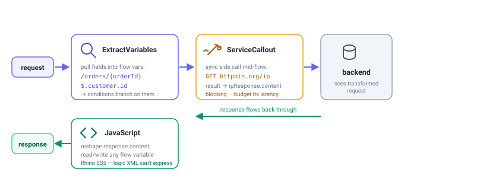

# Lab 5 — Mediation

**Goal:** transform requests and responses in flight — extract values, call a
side service, and reshape the body with JavaScript. ~25 min.

## What you'll learn

- `ExtractVariables` for pulling data out of payloads
- `ServiceCallout` for synchronous side calls (enrichment, lookup)
- `JavaScript` policies for logic XML can't express
- `JSONtoXML`/`XMLtoJSON` for protocol translation



## 1. ExtractVariables — pull fields into flow variables

```xml title="policies/EV-ExtractPath.xml"
<ExtractVariables name="EV-ExtractPath">
  <Source>request</Source>
  <URIPath>
    <Pattern ignoreCase="true">/orders/{orderId}</Pattern>
  </URIPath>
</ExtractVariables>
```

`GET /labs/orders/42` → variable `urirequest.orderId = 42` (named
`urirequest.{groupName}` for URIPath patterns). Conditions and other policies
can now branch on it — e.g., route orders ≥ 10000 to a v2 backend.

For JSON payloads:

```xml
<ExtractVariables name="EV-ExtractBody">
  <JSONPayload>
    <Variable name="customerId">
      <JSONPath>$.customer.id</JSONPath>
    </Variable>
  </JSONPayload>
</ExtractVariables>
```

## 2. ServiceCallout — synchronous side request

```xml title="policies/SC-FetchIP.xml"
<ServiceCallout name="SC-FetchIP">
  <Request clearPayload="true" variable="ipRequest">
    <Set>
      <Verb>GET</Verb>
    </Set>
  </Request>
  <Response>ipResponse</Response>
  <HTTPTargetConnection>
    <URL>https://httpbin.org/ip</URL>
    <Properties>
      <Property name="success.codes">2xx</Property>
    </Properties>
  </HTTPTargetConnection>
</ServiceCallout>
```

The reply lands in `ipResponse.content` — extract `$.origin` and stamp it
onto the downstream response. Classic uses: token introspection at an IdP,
feature flags, per-request config lookups.

!!! warning "Callouts are blocking"
    A `ServiceCallout` holds the request open. Budget its latency into your
    SLA, set `success.codes` deliberately, and pair with `ResponseCache` when
    the data is cacheable (Lab 6).

## 3. JavaScript — the escape hatch

```xml title="policies/JS-ShapeResponse.xml"
<Javascript name="JS-ShapeResponse">
  <ResourceURL>jsc://shapeResponse.js</ResourceURL>
</Javascript>
```

```javascript title="resources/jsc/shapeResponse.js"
// Runs in the response flow for /orders
var ctx = context;                       // Apigee's JS context object
var app = ctx.getVariable("developer.app.name") || "anonymous";
var dev = ctx.getVariable("developer.email") || "n/a";

var quota = {
  allowed: ctx.getVariable("quota.Quota-PerApp.allowed"),
  used:    ctx.getVariable("quota.Quota-PerApp.used")
};

// Read the target's payload, wrap it in an envelope
var upstream = {};
try { upstream = JSON.parse(ctx.getVariable("response.content")); }
catch (e) { upstream = { raw: ctx.getVariable("response.content") }; }

ctx.setVariable("response.content", JSON.stringify({
  message: "orders list",
  app: app,
  developer: dev,
  quota: quota,
  upstream: upstream
}));
ctx.setVariable("response.header.content-type", "application/json");
```

Key APIs:

| Call | Purpose |
|---|---|
| `context.getVariable(name)` / `setVariable` | read/write flow vars |
| `context.proxyRequest` / `targetResponse` | structured message access |
| `print(msg)` | writes to Trace's output panel — your `console.log` |

!!! note "Rhino, not Node"
    The JS engine is Mozilla Rhino — ES5-ish, no `fetch`, no npm. HTTP calls
    belong in `ServiceCallout` or `httpClient` (Apigee's object); heavy logic
    belongs in a real service behind Apigee.

## Exercise it

```bash
# GET /orders — response wrapped by JS, quota injected
curl -s "https://$APIGEE_HOST/labs/orders?apikey=$APIKEY" | jq
```

```json
{
  "message": "orders list",
  "app": "labs-app",
  "developer": "you@example.com",
  "quota": {"allowed": 10, "used": 4},
  "upstream": {...}
}
```

```bash
# Path extraction — /orders/{id}
curl -s "https://$APIGEE_HOST/labs/orders/42?apikey=$APIKEY" | jq '.orderId'
# → "42"
```

In **Trace**, click `JS-ShapeResponse` → the `print()` output appears in the
panel. Add `print(JSON.stringify(upstream))` and redeploy to inspect payloads.

## 4. Bonus — JSON↔XML

```xml title="policies/J2X-OrderRequest.xml"
<JSONtoXML name="J2X-OrderRequest">
  <Source>request</Source>
  <OutputVariable>request</OutputVariable>
  <Options>
    <Null>NULL</Null>
    <TreatAsArray>
      <Value unwrap="true">item</Value>
    </TreatAsArray>
  </Options>
</JSONtoXML>
```

Attach to a `POST /orders` flow pointing at a SOAP/XML backend — the classic
"REST front, legacy back" pattern. `XMLtoJSON` does the reverse on responses.

## Experiments

1. In `shapeResponse.js`, set `response.status.code = 201` — the response
   flow can rewrite status codes downstream of the backend.
2. Point `SC-FetchIP` at an unreachable host → fault `ServiceCallout` →
   see how the error surfaces (and think about where a FaultRule would
   degrade gracefully).
3. Chain mediation: `EV-ExtractPath` → condition a second `AssignMessage`
   that stamps `X-Order-ID` header on the *target request* — watch it arrive
   at mocktarget via Trace.

## Next

[Lab 6 — Caching & Faults](caching-faults.md): cut latency and fail with
consistent, client-friendly errors.
