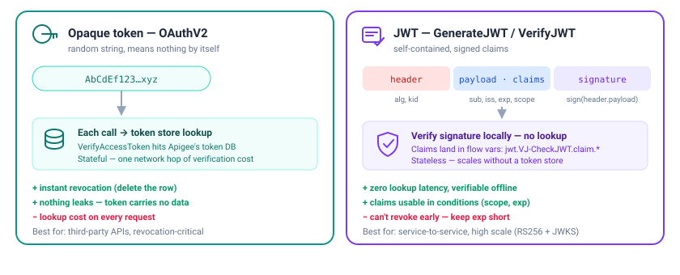
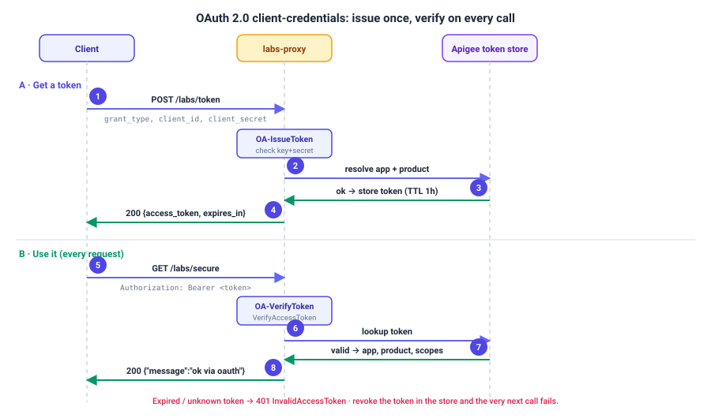
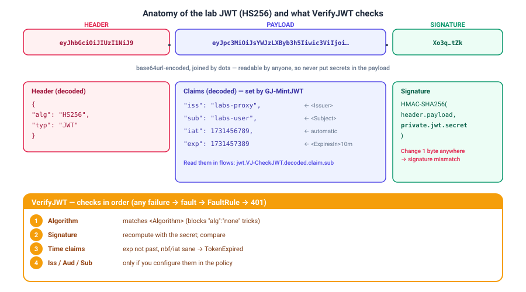

# Lab 3 — OAuth & JWT

**Goal:** issue OAuth access tokens with `OAuthV2` and verify signed JWTs
with `VerifyJWT` — real authentication schemes, enforced at the edge.
~25 min.

## What you'll learn

- `OAuthV2` as token issuer (GenerateAccessToken) *and* verifier
  (VerifyAccessToken)
- `GenerateJWT`/`VerifyJWT` for self-contained tokens
- What is inside a JWT and what `VerifyJWT` actually checks
- When opaque tokens vs. JWTs are the right tool

!!! abstract "Before you start"
    You need the app from [Lab 2](api-keys.md). Its **consumer key** is the
    OAuth `client_id`; its **consumer secret** is the `client_secret`.



## Part A — Client credentials flow



The bundle exposes `/labs/token`, handled entirely at the edge — no backend
involved:

```xml
<Flow name="token">
  <Condition>(proxy.pathsuffix MatchesPath "/token") and (request.verb = "POST")</Condition> <!-- (1)! -->
  <Request>
    <Step><Name>OA-IssueToken</Name></Step> <!-- (2)! -->
  </Request>
  <Response/>
</Flow>
```

1. OAuth token endpoints are `POST` by spec — `GET /token` deliberately
   doesn't match.
2. One policy does everything: validates the credentials, mints the token
   *and* writes the HTTP response (see `GenerateResponse` below).

```xml title="policies/OA-IssueToken.xml"
<OAuthV2 async="false" continueOnError="false" enabled="true" name="OA-IssueToken">
  <DisplayName>OA-IssueToken</DisplayName>
  <Operation>GenerateAccessToken</Operation> <!-- (1)! -->
  <GrantType>client_credentials</GrantType> <!-- (2)! -->
  <ExpiresIn>3600000</ExpiresIn> <!-- (3)! -->
  <SupportedGrantTypes> <!-- (4)! -->
    <GrantType>client_credentials</GrantType>
  </SupportedGrantTypes>
  <GenerateResponse enabled="true"/> <!-- (5)! -->
</OAuthV2>
```

1. The policy has several *operations* (`VerifyAccessToken`,
   `RefreshAccessToken`, `GenerateAuthorizationCode`, ...). This one issues
   an access token.
2. Where to find the requested grant type — by default Apigee reads the
   `grant_type` form parameter; this element pins/overrides it.
3. Lifetime in **milliseconds**: 3,600,000 ms = 1 hour. (A classic
   mistake is writing `3600` and getting tokens that live 3.6 seconds.)
4. Whitelist: reject any grant type not listed here, even if the client
   asks for it.
5. Let the policy build the JSON response (`access_token`, `expires_in`, ...)
   and stop the flow — so no extra `AssignMessage` is needed.

`OAuthV2` reads `client_id`/`client_secret` from the request body — the same
pair as Lab 2's app (it also accepts HTTP Basic auth).

### Get a token

```bash
export CLIENT_ID=$APIKEY                      # consumer key
export CLIENT_SECRET=<consumerSecret>         # from apigeecli apps create

curl -s -X POST "https://$APIGEE_HOST/labs/token" \
  -d "grant_type=client_credentials&client_id=$CLIENT_ID&client_secret=$CLIENT_SECRET" | jq
```

```json
{
  "issued_at": "1731456789000",
  "application_name": "labs-app",
  "scope": "",
  "status": "approved",
  "api_product_list": "[labs-product]",
  "expires_in": "3599",
  "developer.email": "you@example.com",
  "access_token": "AbCdEf...",
  "token_type": "BearerToken"
}
```

Read it field by field: `application_name`/`developer.email`/`api_product_list`
prove Apigee resolved your key→app→product chain; `expires_in` counts down
from `ExpiresIn`; `token_type` tells clients to send it as `Authorization:
Bearer`.

### Verify it

```xml title="policies/OA-VerifyToken.xml"
<OAuthV2 async="false" continueOnError="false" enabled="true" name="OA-VerifyToken">
  <DisplayName>OA-VerifyToken</DisplayName>
  <Operation>VerifyAccessToken</Operation> <!-- (1)! -->
</OAuthV2>
```

1. With no other config the policy reads `Authorization: Bearer <token>`,
   looks the token up, and on success populates variables like
   `oauthv2accesstoken.OA-VerifyToken.*`, `developer.app.name`,
   `apiproduct.name`. On failure: `InvalidAccessToken` or
   `access_token_expired`.

The bundle's `secure` flow uses this instead of `VerifyAPIKey`:

```bash
export TOKEN_OA=$(curl -s -X POST "https://$APIGEE_HOST/labs/token" \
  -d "grant_type=client_credentials&client_id=$CLIENT_ID&client_secret=$CLIENT_SECRET" | jq -r .access_token)

curl -i "https://$APIGEE_HOST/labs/secure" -H "Authorization: Bearer $TOKEN_OA"
```

```http
HTTP/2 200
{"message": "ok via oauth", "app": "labs-app"}
```

Invalid/expired token → `401` with the bundle's normalized error body. Because
the token is **opaque**, Apigee looks it up in its token store on every call
— stateful verification, instant revocation.

## Part B — JWT



JWTs flip the tradeoff: **self-contained**, verified with a signature — no
lookup. For the lab we issue JWTs with `GenerateJWT` (HS256) so you can mint
and verify without standing up an IdP:

```xml title="policies/GJ-MintJWT.xml"
<GenerateJWT async="false" continueOnError="false" enabled="true" name="GJ-MintJWT">
  <DisplayName>GJ-MintJWT</DisplayName>
  <Algorithm>HS256</Algorithm> <!-- (1)! -->
  <SecretKey>
    <Value ref="private.jwt.secret"/> <!-- (2)! -->
  </SecretKey>
  <ExpiresIn>10m</ExpiresIn> <!-- (3)! -->
  <Issuer>labs-proxy</Issuer> <!-- (4)! -->
  <Subject>labs-user</Subject> <!-- (5)! -->
  <OutputVariable>generated_jwt</OutputVariable> <!-- (6)! -->
</GenerateJWT>
```

1. HMAC with SHA-256: *symmetric* — signer and verifier share one secret.
2. Secret read from a variable, never hard-coded. Two Apigee rules apply:
   the variable name **must start with `private.`** (so Trace masks it), and
   an HS256 key must be **at least 32 bytes** (the lab value is longer for
   this reason). The `KVM-ReadConfig` policy writes it:
   `<Get assignTo="private.jwt.secret">`.
3. Becomes the `exp` claim. Note the **unit suffix** (`10m`) — unlike
   `OAuthV2`, which wants raw milliseconds.
4. Becomes the `iss` claim — who minted it.
5. Becomes the `sub` claim — who it's about. Use a variable
   (`<Subject ref="developer.email"/>`) when it should vary.
6. Where to put the finished token. `AM-ReturnJWT` then wraps it as
   `{"token": "..."}`.

The shared secret comes from a KVM (Lab 7 covers KVMs in detail). `deploy.sh`
already seeds it; to do it manually:

```bash
apigeecli kvms create -o "$APIGEE_ORG" -e "$APIGEE_ENV" -t "$TOKEN" -n labs-config
apigeecli kvms entries create -o "$APIGEE_ORG" -e "$APIGEE_ENV" -t "$TOKEN" \
  -m labs-config -k jwt.secret -v "lab-secret-do-not-use-in-prod-0123456789"
```

### Mint a JWT

```bash
export JWT=$(curl -s -X POST "https://$APIGEE_HOST/labs/jwt-mint" | jq -r .token)
echo "$JWT" | cut -d. -f2 | base64 -d 2>/dev/null | jq     # peek at the payload
```

```json
{"iss": "labs-proxy", "sub": "labs-user", "iat": 1731456789, "exp": 1731457389}
```

Anyone can do that `base64 -d` — a JWT is **signed, not encrypted**.

### Verify the JWT

```xml title="policies/VJ-CheckJWT.xml"
<VerifyJWT async="false" continueOnError="false" enabled="true" name="VJ-CheckJWT">
  <DisplayName>VJ-CheckJWT</DisplayName>
  <Algorithm>HS256</Algorithm> <!-- (1)! -->
  <Source>request.header.authorization</Source> <!-- (2)! -->
  <SecretKey>
    <Value ref="private.jwt.secret"/> <!-- (3)! -->
  </SecretKey>
</VerifyJWT>
```

1. **Pin the algorithm.** If the verifier trusted whatever `alg` the token
   header claims, an attacker could pick `none` or switch RS256↔HS256
   (algorithm-confusion attacks). Fixing it in the policy closes that door.
2. Where the token is. `VerifyJWT` accepts the standard `Bearer ` prefix on
   this header and strips it for you.
3. Same secret as the minting side — otherwise the recomputed signature won't
   match.

```bash
curl -i "https://$APIGEE_HOST/labs/jwt-protected" \
  -H "Authorization: Bearer $JWT"
```

In **Trace**, expand `VJ-CheckJWT`: `jwt.VJ-CheckJWT.decoded.claim.sub`,
`.iss`, `.exp` are all populated — use them in conditions
(`<Condition>jwt.VJ-CheckJWT.decoded.claim.sub = "labs-user"</Condition>`).

!!! warning "HS256 is a lab convenience"
    Shared-secret JWTs mean the proxy *and* every verifier hold the same key,
    so any verifier can also mint tokens. Real deployments use RS256/ES256
    with a public JWKS — `VerifyJWT` supports
    `<PublicKey><JWKS uri="..."/></PublicKey>` so key rotation is free.

## Which should I use?

| Question | Opaque (`OAuthV2`) | JWT (`VerifyJWT`) |
|---|---|---|
| Revoke instantly? | yes (delete from store) | no — valid until `exp` |
| Per-call cost | store lookup | CPU for one signature check |
| Token size | small random string | hundreds of bytes (claims inside) |
| Carries claims? | via store lookup | in the token itself |
| Who can verify? | only Apigee | anyone with the key/JWKS |
| Good for | first-party apps, revocation needs | service-to-service, IdP-issued tokens |

## Experiments

1. Expire the JWT (`ExpiresIn` → `10s`), wait, re-verify →
   `TokenExpired`. Which FaultRule from the bundle turns it into a clean 401?
   (Hint: look at the `*Token*` wildcard.)
2. Tamper with one character of the JWT signature → `InvalidSignature`.
3. Shorten the secret in the KVM to 10 characters → what error appears on
   mint? (`InsufficientKeyLength`.) Restore it afterwards.
4. Compare Trace timings: `OA-VerifyToken` (store lookup) vs `VJ-CheckJWT`
   (signature only). At scale this is the JWT argument.
5. Decode the JWT payload at [jwt.io](https://jwt.io) (pasting a lab token is
   safe) and match each claim to the `GenerateJWT` XML.

## Check yourself

??? question "1. A user's laptop is stolen with a valid JWT (exp in 50 min). What can you do, and how is that different for an opaque token?"
    JWT: nothing at the proxy unless you add a deny-list check (it's valid until
    `exp`) — so keep `exp` short. Opaque: revoke the token in Apigee and the
    next call fails.

??? question "2. Why is `<ExpiresIn>3600000</ExpiresIn>` in OAuth but `<ExpiresIn>10m</ExpiresIn>` in GenerateJWT?"
    Different policies, different units: `OAuthV2` takes milliseconds;
    `GenerateJWT` takes a number with a unit suffix (`s`, `m`, `h`, `d`).

??? question "3. Why hard-pin `<Algorithm>` in VerifyJWT?"
    To prevent algorithm-confusion/`alg: none` attacks — the verifier, not the
    token, decides which algorithm is acceptable.

??? question "4. What's the difference between `client_secret` (OAuth) and `jwt.secret` (JWT)?"
    `client_secret` authenticates an *app* to the token endpoint and lives on
    the app. `jwt.secret` is a *signing key* the proxy uses to create/verify
    tokens and lives in a (preferably encrypted) KVM.

## Next

[Lab 4 — Traffic Management](traffic-management.md): make sure one noisy
client can't take down everyone else.
