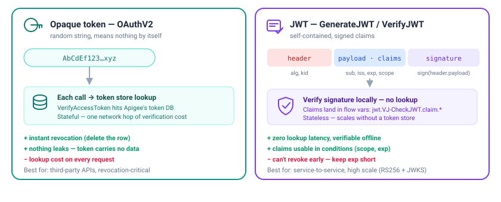

# Lab 3 — OAuth & JWT

**Goal:** issue OAuth access tokens with `OAuthV2` and verify signed JWTs
with `VerifyJWT` — real authentication schemes, enforced at the edge.
~25 min.

## What you'll learn

- `OAuthV2` as token issuer (GenerateAccessToken) *and* verifier
  (VerifyAccessToken)
- `GenerateJWT`/`VerifyJWT` for self-contained tokens
- When opaque tokens vs. JWTs are the right tool



## Part A — Client credentials flow

The bundle exposes `/labs/token`, handled entirely at the edge — no backend
involved:

```xml
<Flow name="token">
  <Condition>(proxy.pathsuffix MatchesPath "/token") and (request.verb = "POST")</Condition>
  <Request>
    <Step><Name>OA-IssueToken</Name></Step>
  </Request>
  <Response/>
</Flow>
```

```xml title="policies/OA-IssueToken.xml"
<OAuthV2 name="OA-IssueToken">
  <Operation>GenerateAccessToken</Operation>
  <GrantType>client_credentials</GrantType>
  <ExpiresIn>3600000</ExpiresIn>   <!-- 1 hour, ms -->
  <SupportedGrantTypes>
    <GrantType>client_credentials</GrantType>
  </SupportedGrantTypes>
</OAuthV2>
```

`OAuthV2` reads `client_id`/`client_secret` from the request — the same
pair from Lab 2's app.

### Get a token

```bash
export CLIENT_ID=$APIKEY                      # consumer key
export CLIENT_SECRET=<consumerSecret>         # from apigeecli apps create

curl -s -X POST "https://$APIGEE_HOST/labs/token" \
  -d "grant_type=client_credentials&client_id=$CLIENT_ID&client_secret=$CLIENT_SECRET" | jq
```

```json
{
  "issued_at": "1731456789000",
  "application_name": "labs-app",
  "scope": "",
  "status": "approved",
  "api_product_list": "[labs-product]",
  "expires_in": "3599",
  "developer.email": "you@example.com",
  "access_token": "AbCdEf...",
  "token_type": "BearerToken"
}
```

### Verify it

```xml title="policies/OA-VerifyToken.xml"
<OAuthV2 name="OA-VerifyToken">
  <Operation>VerifyAccessToken</Operation>
</OAuthV2>
```

The bundle's `secure` flow uses this instead of `VerifyAPIKey`:

```bash
export TOKEN_OA=$(curl -s -X POST "https://$APIGEE_HOST/labs/token" \
  -d "grant_type=client_credentials&client_id=$CLIENT_ID&client_secret=$CLIENT_SECRET" | jq -r .access_token)

curl -i "https://$APIGEE_HOST/labs/secure" -H "Authorization: Bearer $TOKEN_OA"
```

```http
HTTP/2 200
{"message":"ok via oauth","app":"labs-app"}
```

Invalid/expired token → `401` with `InvalidAccessToken`. Because the token is
**opaque**, Apigee looks it up in its token store on every call — stateful
verification, instant revocation.

## Part B — JWT

JWTs flip the tradeoff: **self-contained**, verified with a signature — no
lookup. For the lab we issue JWTs with `GenerateJWT` (HS256) so you can mint
and verify without standing up an IdP:

```xml title="policies/GJ-MintJWT.xml"
<GenerateJWT name="GJ-MintJWT">
  <Algorithm>HS256</Algorithm>
  <SecretKey>
    <Value ref="kvm.jwt.secret"/>
  </SecretKey>
  <ExpiresIn>10m</ExpiresIn>
  <Issuer>labs-proxy</Issuer>
  <Subject ref="developer.email"/>
  <OutputVariable>generated_jwt</OutputVariable>
</GenerateJWT>
```

The shared secret comes from a KVM (Lab 7 covers KVMs in detail). Seed it:

```bash
apigeecli kvms create -o "$APIGEE_ORG" -e "$APIGEE_ENV" -t "$TOKEN" -n labs-config
apigeecli kvms entries create -o "$APIGEE_ORG" -e "$APIGEE_ENV" -t "$TOKEN" \
  -m labs-config -k jwt.secret -v "lab-secret-do-not-use-in-prod"
```

### Verify the JWT

```xml title="policies/VJ-CheckJWT.xml"
<VerifyJWT name="VJ-CheckJWT">
  <Algorithm>HS256</Algorithm>
  <Source>request.header.authorization</Source>
  <SecretKey>
    <Value ref="kvm.jwt.secret"/>
  </SecretKey>
</VerifyJWT>
```

```bash
# mint one via the bundle's /jwt-mint flow (POST), then:
curl -i "https://$APIGEE_HOST/labs/jwt-protected" \
  -H "Authorization: Bearer $JWT"
```

In **Trace**, expand `VJ-CheckJWT`: `jwt.VJ-CheckJWT.decoded.claim.sub`,
`.iss`, `.exp` are all populated — use them in conditions
(`<Condition>jwt.VJ-CheckJWT.claim.scope Includes "orders:read"</Condition>`).

!!! warning "HS256 is a lab convenience"
    Shared-secret JWTs mean the proxy *and* every verifier hold the same key.
    Real deployments use RS256/ES256 with a public JWKS — `VerifyJWT` supports
    `<PublicKey><JWKS ref="..."/></PublicKey>` so key rotation is free.

## Experiments

1. Expire the JWT (`ExpiresIn` → `10s`), wait, re-verify →
   `jwt.JWT.TokenExpired`. Match it with a FaultRule that returns a clean 401.
2. Tamper with one character of the JWT signature → `InvalidSignature`.
3. Compare Trace timings: `OA-VerifyToken` (store lookup) vs `VJ-CheckJWT`
   (signature only). At scale this is the JWT argument.
4. Decode the JWT payload at [jwt.io](https://jwt.io) (paste is safe — it's a
   lab token) and match claims to the `GenerateJWT` XML.

## Next

[Lab 4 — Traffic Management](traffic-management.md): make sure one noisy
client can't take down everyone else.
