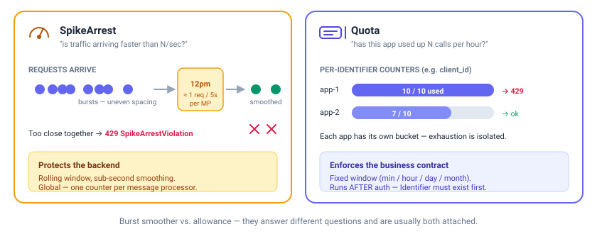

# Lab 4 — Traffic Management

**Goal:** add `SpikeArrest` and `Quota`, then *watch them fire* with a small
load loop. ~20 min.

## What you'll learn

- SpikeArrest ≠ Quota — burst smoothing vs. allowance
- Per-app quota using `VerifyAPIKey`'s `client_id` identifier
- Reading quota counters from flow variables
- Why policy **order** and policy **placement** decide what gets counted

!!! abstract "Before you start"
    You need a valid `$APIKEY` (Lab 2). Keep Trace open — both policies
    expose counters you can inspect after each call.

## The distinction that trips everyone up

| Policy | Question it answers | Window | Identifier |
|---|---|---|---|
| `SpikeArrest` | "Is traffic arriving faster than X/sec?" | Rolling, sub-second smoothing | global (per message processor) |
| `Quota` | "Has this app exceeded N calls per hour?" | Fixed window (min/hour/day/week/month) | per `Identifier` (e.g. `client_id`) |

SpikeArrest protects the **backend**; Quota enforces the **business contract**.



## The policies

```xml title="policies/SA-Global.xml"
<SpikeArrest async="false" continueOnError="false" enabled="true" name="SA-Global">
  <DisplayName>SA-Global</DisplayName>
  <Rate>12pm</Rate> <!-- (1)! -->
  <UseEffectiveCount>true</UseEffectiveCount> <!-- (2)! -->
</SpikeArrest>
```

1. `12pm` = 12 **per minute**. SpikeArrest doesn't count to 12 and then
   reset; it *smooths*: 12/min becomes "one request every 5 seconds". A
   second request 1 s after the first is rejected even though the minute
   isn't "used up". Units: `ps` (per second) or `pm` (per minute).
2. Apigee runs several message processors (MPs). With `true`, the rate is
   **divided among MPs** so the *total* across the cluster approximates the
   configured rate instead of each MP allowing the full rate.

Runs in the PreFlow — it applies to **every** request, including `/hello` and
`/token`.

```xml title="policies/Quota-PerApp.xml"
<Quota async="false" continueOnError="false" enabled="true" name="Quota-PerApp">
  <DisplayName>Quota-PerApp</DisplayName>
  <Allow count="10"/> <!-- (1)! -->
  <Interval>1</Interval> <!-- (2)! -->
  <TimeUnit>minute</TimeUnit> <!-- (3)! -->
  <Identifier ref="verifyapikey.VA-CheckAPIKey.client_id"/> <!-- (4)! -->
  <Distributed>true</Distributed> <!-- (5)! -->
  <Synchronous>true</Synchronous> <!-- (6)! -->
</Quota>
```

1. The allowance: 10 calls...
2. ...per 1...
3. ...minute. (`Interval` × `TimeUnit` = window size. `second`, `minute`,
   `hour`, `day`, `week`, `month` are valid.)
4. **Who is being counted.** One counter *per distinct value* of this
   variable — i.e. per app key. Remove the element and every caller shares one
   counter.
5. Share the counter across all MPs. `false` gives each MP its own counter,
   so the effective limit becomes `count × number of MPs`.
6. Update the shared counter *before* answering. `false` is faster but lets a
   burst overshoot the limit briefly (counters sync asynchronously).

Runs only in the `get-orders` flow, **after** `VA-CheckAPIKey` — the
`Identifier` variable doesn't exist until the key is validated. Order matters:
authentication → identify → count.

!!! info "Where the counts are exposed"
    After `Quota` runs, these variables exist (named after the policy!):

    | Variable | Meaning |
    |---|---|
    | `ratelimit.Quota-PerApp.allowed.count` | the `Allow` count (10) |
    | `ratelimit.Quota-PerApp.used.count` | calls counted so far |
    | `ratelimit.Quota-PerApp.available.count` | calls left |
    | `ratelimit.Quota-PerApp.exceed.count` | 1 once exceeded |
    | `ratelimit.Quota-PerApp.expiry.time` | when the window resets (UTC ms) |

## Exercise it

### Spike arrest

!!! question "Predict"
    8 requests in a tight loop against a `12pm` limit (one per ~5 s). How
    many `200`s do you expect?

    ??? success "Answer"
        About **one** — the first. The next ones arrive milliseconds later,
        far inside the 5-second smoothing interval.

```bash
for i in $(seq 1 8); do
  curl -s -o /dev/null -w "%{http_code} " "https://$APIGEE_HOST/labs/hello"
done; echo
```

```
200 429 429 429 429 429 429 429
```

!!! note "Why might yours differ?"
    Calls land on different message processors, and with
    `UseEffectiveCount` the budget is split between them, so you may see an
    occasional extra `200`. The shape — a trickle of 200s among many 429s — is
    what matters.

Wait ~5 s and call again: `200`. That's smoothing, not a fixed window.

### Per-app quota

`SA-Global` is global, so a tight loop against `/orders` would be rejected by
**SpikeArrest** long before the quota is reached. Raise it for this
exercise (then restore it afterwards):

```xml
<Rate>600pm</Rate>   <!-- in policies/SA-Global.xml: 10 per second -->
```

Redeploy (`./deploy.sh`), then:

```bash
for i in $(seq 1 12); do
  curl -s -o /dev/null -w "%{http_code} " \
    "https://$APIGEE_HOST/labs/orders?apikey=$APIKEY"
done; echo
```

```
200 200 200 200 200 200 200 200 200 200 429 429
```

Ten 200s, then 429s until the minute window resets. The fault, as the
bundle's `AM-Error429` presents it:

```json
{"error": {"code": "THROTTLED", "message": "rate limit exceeded, back off and retry", "fault": "QuotaViolation"}}
```

!!! tip "Cache hits still count"
    `RC-Orders` runs *after* `Quota-PerApp` in the flow, so a request served
    from the cache **still consumes quota**. If you want cache hits to be
    free, move the cache lookup above the quota step (Lab 6 discusses the
    security trade-off).

### Read the counters

The bundle's `JS-ShapeResponse` copies the `ratelimit.*` variables into the
response body so you can see the accounting (on a cache miss):

```json
{
  "quota": {
    "allowed": 10,
    "used": 7,
    "available": 3
  }
}
```

In a real API return them as headers instead, with an `AssignMessage` in the
response flow:

```xml
<Header name="X-RateLimit-Limit">{ratelimit.Quota-PerApp.allowed.count}</Header>
<Header name="X-RateLimit-Remaining">{ratelimit.Quota-PerApp.available.count}</Header>
```

## Experiments

1. **Two apps, one quota each.** Create a second app (`labs-app-2`) on the
   same product. Exhaust app 1's quota, then call with app 2's key — still
   200s. Per-`Identifier` isolation in action.
2. **Global quota.** Remove `<Identifier>` — now both apps share the same
   10/min counter. When is that the right choice? (Public unauthenticated
   endpoints.)
3. **Precise spike demo.** `Rate` → `1ps` and hammer with a loop of 20 —
   you get roughly one 200 per second.
4. **Quota on the product.** The `labs-product` created in Lab 2 has
   `--quota 10000 --interval 1 --unit month`. That product-level quota is
   *metadata*; it is the `Quota` **policy** that enforces at runtime — unless
   you reference the product's quota inside the policy
   (`<Allow countRef="verifyapikey.VA-CheckAPIKey.apiproduct.developer.quota.limit"/>`),
   which is how production proxies use one policy with per-product limits.
5. **Ordering bug.** Swap `Quota-PerApp` above `VA-CheckAPIKey` in the
   `get-orders` flow. What does the first request return, and why?

## Troubleshooting

| Symptom | Cause |
|---|---|
| Quota 429 on first call | `Identifier` resolves empty → all traffic counted as one bucket. Check the variable in Trace |
| `/orders` loop shows 429 from the *first* few calls | That's `SA-Global`, not Quota — look at `fault.name` in the response (`SpikeArrestViolation`) |
| SpikeArrest never fires | Rate too high for your loop; or requests hit different MPs — use a lower `Rate` |
| `client_id` empty in flow | `Quota-PerApp` placed **before** `VA-CheckAPIKey` in the flow |
| `quota.*` / `ratelimit.*` variables empty | You're reading them before the policy has run, or using the wrong policy name in the variable |

## Check yourself

??? question "1. Your backend falls over at 50 req/s but each customer is contractually allowed 1 million/month. Which policy for which problem?"
    `SpikeArrest` (e.g. `50ps`) for the backend-protection problem; `Quota` with
    a per-app `Identifier` for the contract.

??? question "2. What does `<Identifier>` do, and what happens with no `Identifier` at all?"
    It selects the counter bucket (one counter per distinct value). Without it
    every caller shares one counter.

??? question "3. `12pm` — does the 12th request in a minute succeed if all 12 arrive within the first second?"
    No. 12pm is smoothed to one per 5 s; most of those calls are rejected.
    SpikeArrest limits *rate*, not *count per window*.

??? question "4. Does a cached response consume Quota in this bundle? Why?"
    Yes — `RC-Orders` is positioned after `Quota-PerApp`, and policies run in
    order, so the counter increments before the cache lookup.

??? question "5. Name the variable that tells you how many calls are left, and why does its name contain `Quota-PerApp`?"
    `ratelimit.Quota-PerApp.available.count` — policy-produced variables embed
    the **policy's `name`**, so two Quota policies don't clobber each other.

## Next

[Lab 5 — Mediation](mediation.md): reshape payloads, call a side service, and
enrich responses with JavaScript.
