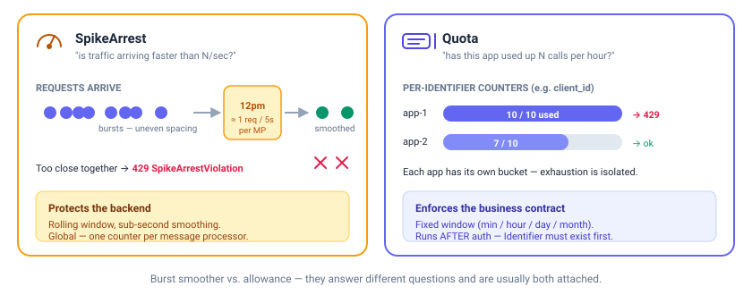

# Lab 4 — Traffic Management

**Goal:** add `SpikeArrest` and `Quota`, then *watch them fire* with a small
load loop. ~20 min.

## What you'll learn

- SpikeArrest ≠ Quota — burst smoothing vs. allowance
- Per-app quota using `VerifyAPIKey`'s `client_id` identifier
- Reading quota counters from flow variables

## The distinction that trips everyone up

| Policy | Question it answers | Window | Identifier |
|---|---|---|---|
| `SpikeArrest` | "Is traffic arriving faster than X/sec?" | Rolling, sub-second smoothing | global (per message processor) |
| `Quota` | "Has this app exceeded N calls per hour?" | Fixed window (min/hour/day/week/month) | per `Identifier` (e.g. `client_id`) |

SpikeArrest protects the **backend**; Quota enforces the **business contract**.



## The policies

```xml title="policies/SA-Global.xml"
<SpikeArrest name="SA-Global">
  <Rate>12pm</Rate>   <!-- 12 per minute ≈ one request per 5 seconds -->
  <UseEffectiveCount>true</UseEffectiveCount>
</SpikeArrest>
```

Runs in the PreFlow — it applies to **every** request, including `/hello`.

```xml title="policies/Quota-PerApp.xml"
<Quota name="Quota-PerApp">
  <Allow count="10"/>
  <Interval>1</Interval>
  <TimeUnit>minute</TimeUnit>
  <Identifier ref="verifyapikey.VA-CheckAPIKey.client_id"/>
  <Distributed>true</Distributed>
  <Synchronous>true</Synchronous>
</Quota>
```

Runs only in the `get-orders` flow, **after** `VA-CheckAPIKey` — the
`Identifier` variable doesn't exist until the key is validated. Order matters:
authentication → identify → count.

## Exercise it

### Spike arrest

Fire requests fast; the 5-second-per-request budget gets consumed:

```bash
for i in $(seq 1 8); do
  curl -s -o /dev/null -w "%{http_code} " "https://$APIGEE_HOST/labs/hello"
done; echo
```

```
200 200 429 200 429 429 200 429
```

!!! note "Why the mixed pattern?"
    `12pm` smooths to one request per 5s *per message processor*. Requests
    closer together than the smoothed rate are rejected with 429 — the exact
    pattern varies because runtime nodes each hold their own counter and
    `UseEffectiveCount` coordinates across them.

### Per-app quota

```bash
for i in $(seq 1 12); do
  curl -s -o /dev/null -w "%{http_code} " \
    "https://$APIGEE_HOST/labs/orders?apikey=$APIKEY"
done; echo
```

```
200 200 200 200 200 200 200 200 200 200 429 429
```

Ten 200s, then 429s until the minute window resets. The fault:

```json
{"fault":{"faultstring":"Quota violation : Quota : exceeded quota limit","detail":{"errorcode":"policies.ratelimit.QuotaViolation"}}}
```

### Read the counters

Quota exposes variables mid-request — the bundle's `JS-ShapeResponse` injects
them into the response body so you can see the accounting:

```json
{
  "quota": {
    "allowed": 10,
    "used": 7,
    "available": 3
  }
}
```

Set `<AsynchronousConfiguration>`/headers in a real proxy to return
`X-RateLimit-*` headers to clients.

## Experiments

1. **Two apps, one quota each.** Create a second app (`labs-app-2`) on the
   same product. Exhaust app 1's quota, then call with app 2's key — still
   200s. Per-`Identifier` isolation in action.
2. **Global quota.** Remove `<Identifier>` — now both apps share the same
   10/min counter. When is that the right choice? (Public unauthenticated
   endpoints.)
3. **Precise spike demo.** `Rate` → `1ps` and hammer with a loop of 20 —
   you get exactly one 200 per second.
4. **Quota on the product.** The `labs-product` created in Lab 2 has
   `--quota 10000 --interval 1 --unit month`. Change a *product's* quota and
   observe that product-level limits override nothing — the `Quota` policy is
   what enforces; product quotas drive monetization/reporting.

## Troubleshooting

| Symptom | Cause |
|---|---|
| Quota 429 on first call | `Identifier` resolves empty → all traffic counted as one bucket. Check the variable in Trace |
| SpikeArrest never fires | Rate too high for your loop; or requests hit different MPs — use lower `Rate` |
| `client_id` empty in flow | `Quota-PerApp` placed **before** `VA-CheckAPIKey` in the flow |

## Next

[Lab 5 — Mediation](mediation.md): reshape payloads, call a side service, and
enrich responses with JavaScript.
