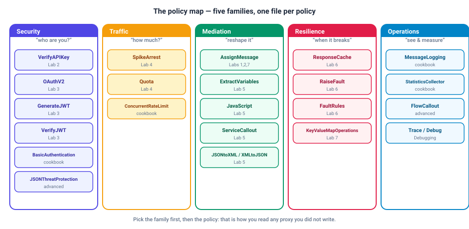

# Policy Cookbook

Copy-paste templates for the policies you'll reach for most. File names
follow the `XX-Purpose.xml` convention — the `<Step><Name>` must match the
file's `<name>` attribute.

!!! tip "Every policy is a file"
    Save each block under `apiproxy/policies/<Name>.xml`, then attach with
    `<Step><Name>&lt;Name&gt;</Name></Step>` in the flow where it should run.



!!! abstract "How to read a policy"
    Every recipe below has the same skeleton — see
    [Core Concepts → Anatomy of one policy file](concepts.md#3-anatomy-of-one-policy-file).
    Ask three questions of each: **what does it need** (variables in),
    **what does it produce** (variables/message out), and **how does it fail**
    (`fault.name`).

## Security

=== "VerifyAPIKey"

    ```xml
    <VerifyAPIKey name="VA-Check">
      <APIKey ref="request.header.x-apikey"/>
    </VerifyAPIKey>
    ```

    Sets `verifyapikey.VA-Check.client_id`, `developer.email`,
    `apiproduct.name`. Faults: `FailedToResolveAPIKey`, `InvalidApiKey`,
    `InvalidApiKeyForGivenResource`.

=== "OAuthV2 — issue"

    ```xml
    <OAuthV2 name="OA-Issue">
      <Operation>GenerateAccessToken</Operation>
      <GrantType>client_credentials</GrantType>
      <ExpiresIn>3600000</ExpiresIn>
      <SupportedGrantTypes>
        <GrantType>client_credentials</GrantType>
      </SupportedGrantTypes>
    </OAuthV2>
    ```

=== "OAuthV2 — verify"

    ```xml
    <OAuthV2 name="OA-Verify">
      <Operation>VerifyAccessToken</Operation>
    </OAuthV2>
    ```

    Reads `Authorization: Bearer <token>`. Sets `accesstoken.client_id`,
    `accesstoken.scope`, `apiproduct.name`.

=== "VerifyJWT (JWKS)"

    ```xml
    <VerifyJWT name="VJ-Check">
      <Algorithm>RS256</Algorithm>
      <Source>request.header.authorization</Source>
      <PublicKey>
        <JWKS uri="https://idp.example.com/.well-known/jwks.json"/>
      </PublicKey>
      <Issuer>https://idp.example.com</Issuer>
      <Audience>my-api</Audience>
    </VerifyJWT>
    ```

    Claims land in `jwt.VJ-Check.decoded.claim.*` and
    `jwt.VJ-Check.claim.*`.

=== "BasicAuthentication"

    ```xml
    <BasicAuthentication name="BA-Check">
      <Operation>Decode</Operation>
      <IgnoreUnresolvedVariables>false</IgnoreUnresolvedVariables>
      <User ref="request.header.username"/>
      <Password ref="request.header.password"/>
      <AssignTo createNew="false">request.authorization</AssignTo>
      <Source>request.header.authorization</Source>
    </BasicAuthentication>
    ```

    Decode only — pair with a `ServiceCallout` or `AccessEntity` to actually
    validate. TLS is non-negotiable: Basic Auth sends credentials
    effectively in plaintext.

## Traffic management

=== "SpikeArrest"

    ```xml
    <SpikeArrest name="SA-Global">
      <Rate>600pm</Rate>
      <UseEffectiveCount>true</UseEffectiveCount>
    </SpikeArrest>
    ```

=== "Quota"

    ```xml
    <Quota name="Quota-PerApp">
      <Allow count="1000"/>
      <Interval>1</Interval>
      <TimeUnit>hour</TimeUnit>
      <Identifier ref="verifyapikey.VA-Check.client_id"/>
      <Distributed>true</Distributed>
      <Synchronous>true</Synchronous>
    </Quota>
    ```

=== "ConcurrentRateLimit"

    ```xml
    <ConcurrentRateLimit name="CRL-Target">
      <AllowConnections count="50" ttl="2"/>
      <TargetEndpoint name="default"/>
    </ConcurrentRateLimit>
    ```

    Caps *in-flight* connections to a fragile backend — complements, not a
    substitute for, Quota.

## Mediation

=== "AssignMessage — set"

    ```xml
    <AssignMessage name="AM-SetBody">
      <Set>
        <Payload contentType="application/json">
          {"id": "{request.header.x-request-id}", "ts": "{system.timestamp}"}
        </Payload>
        <StatusCode>200</StatusCode>
      </Set>
      <AssignTo createNew="false" type="response">response</AssignTo>
    </AssignMessage>
    ```

=== "AssignMessage — copy/add/remove"

    ```xml
    <AssignMessage name="AM-Munge">
      <Copy>
        <Headers><Header name="x-tenant"/></Headers>
      </Copy>
      <Add>
        <Headers><Header name="x-gateway">apigee</Header></Headers>
      </Add>
      <Remove>
        <QueryParams><QueryParam name="apikey"/></QueryParams>
      </Remove>
      <AssignTo createNew="false">request</AssignTo>
    </AssignMessage>
    ```

=== "ExtractVariables"

    ```xml
    <ExtractVariables name="EV-Extract">
      <Source>request</Source>
      <JSONPayload>
        <Variable name="customerId">
          <JSONPath>$.customer.id</JSONPath>
        </Variable>
      </JSONPayload>
      <URIPath>
        <Pattern>/orders/{orderId}</Pattern>
      </URIPath>
    </ExtractVariables>
    ```

=== "JavaScript"

    ```xml
    <Javascript name="JS-Logic">
      <ResourceURL>jsc://logic.js</ResourceURL>
    </Javascript>
    ```

=== "ServiceCallout"

    ```xml
    <ServiceCallout name="SC-Lookup">
      <Request clearPayload="true" variable="lookupReq"/>
      <Response>lookupResp</Response>
      <HTTPTargetConnection>
        <URL>https://config.internal/flags</URL>
        <Properties>
          <Property name="success.codes">2xx</Property>
        </Properties>
      </HTTPTargetConnection>
    </ServiceCallout>
    ```

=== "JSONtoXML / XMLtoJSON"

    ```xml
    <JSONtoXML name="J2X">
      <Source>request</Source>
      <OutputVariable>request</OutputVariable>
    </JSONtoXML>
    <!-- XMLtoJSON mirrors the same shape -->
    ```

## Resilience & operations

=== "ResponseCache"

    ```xml
    <ResponseCache name="RC">
      <CacheKey>
        <Prefix/>
        <KeyFragment ref="proxy.pathsuffix"/>
      </CacheKey>
      <ExpirySettings><TimeoutInSec>300</TimeoutInSec></ExpirySettings>
      <SkipCacheLookup>request.header.x-no-cache Exists</SkipCacheLookup>
      <SkipCachePopulation>response.status.code != 200</SkipCachePopulation>
    </ResponseCache>
    ```

=== "RaiseFault"

    ```xml
    <RaiseFault name="RF-Validation">
      <FaultResponse>
        <Set>
          <Payload contentType="application/json">
            {"error":{"code":"BAD_REQUEST","message":"invalid payload"}}
          </Payload>
          <StatusCode>400</StatusCode>
        </Set>
      </FaultResponse>
      <IgnoreUnresolvedVariables>true</IgnoreUnresolvedVariables>
    </RaiseFault>
    ```

=== "KeyValueMapOperations"

    ```xml
    <KeyValueMapOperations name="KVM-Cfg" mapIdentifier="config">
      <Scope>environment</Scope>
      <Get assignTo="kvm.backend.url">
        <Key><Parameter>backend.url</Parameter></Key>
      </Get>
    </KeyValueMapOperations>
    ```

=== "MessageLogging (syslog)"

    ```xml
    <MessageLogging name="ML-Log">
      <Syslog>
        <Message>{"proxy":"{apiproxy.name}","app":"{developer.app.name}","status":{response.status.code}}</Message>
        <Host>logs.internal.example.com</Host>
        <Port>514</Port>
        <Protocol>TCP</Protocol>
      </Syslog>
    </MessageLogging>
    ```

=== "StatisticsCollector"

    ```xml
    <StatisticsCollector name="SC-Stats">
      <Statistics>
        <Statistic name="order_value" ref="response.header.x-order-total" type="double">0</Statistic>
      </Statistics>
    </StatisticsCollector>
    ```

    Feeds custom analytics dimensions in Apigee's reports.

=== "JSONThreatProtection"

    ```xml
    <JSONThreatProtection name="JTP-Check">
      <ArrayElementCount>20</ArrayElementCount>
      <ContainerDepth>5</ContainerDepth>
      <StringValueLength>500</StringValueLength>
      <Source>request</Source>
    </JSONThreatProtection>
    ```

    Rejects oversized/deeply-nested bodies before they're parsed. More in
    [Advanced Topics](advanced.md#2-input-validation-and-threat-protection).

=== "FlowCallout"

    ```xml
    <FlowCallout name="FC-Common">
      <SharedFlowBundle>common-security</SharedFlowBundle>
    </FlowCallout>
    ```

    Invokes a reusable shared flow inline.

## Fault names worth a FaultRule

| `fault.name` | Raised by | Typical status |
|---|---|---|
| `FailedToResolveAPIKey`, `InvalidApiKey` | VerifyAPIKey | 401 |
| `InvalidAccessToken` | OAuthV2 Verify | 401 |
| `InvalidSignature`, `TokenExpired` | VerifyJWT | 401 |
| `QuotaViolation`, `SpikeArrestViolation` | Quota, SpikeArrest | 429 |
| `RaiseFault` (your own) | RaiseFault | whatever you set |
| `ExecutionFailed` | ServiceCallout, JavaScript | 500/502 |
| `InsufficientKeyLength` | GenerateJWT / VerifyJWT (HS key < 32 bytes) | 401 |
| `ErrorResponseCode` | TargetEndpoint, when the backend returns a non-success code | backend's code |
