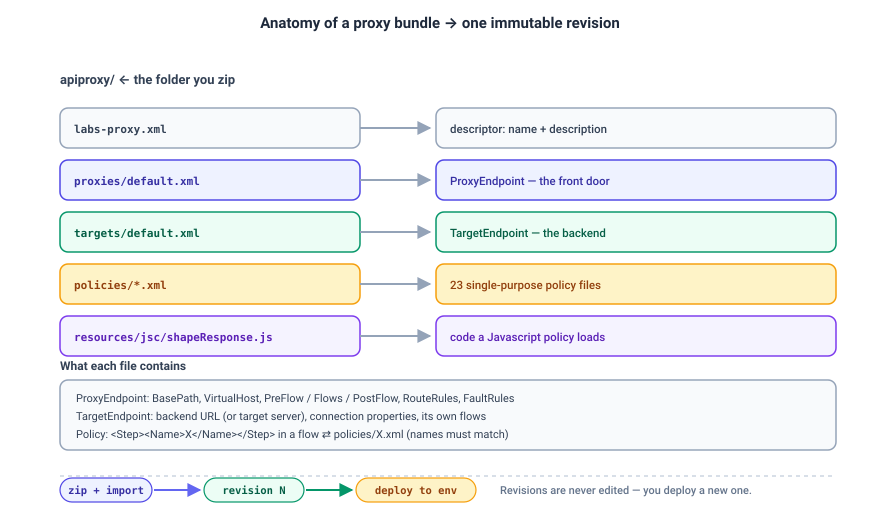
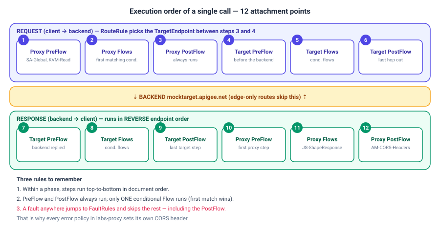
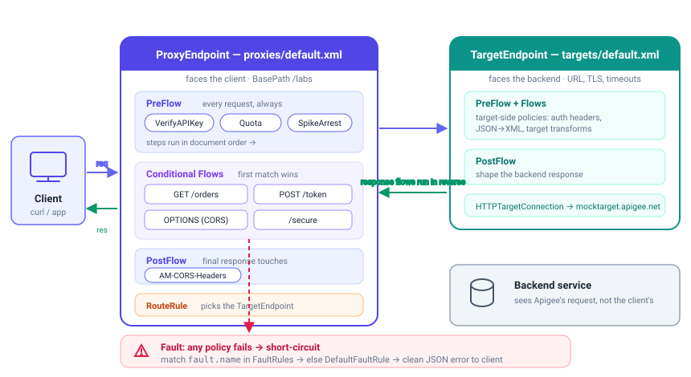
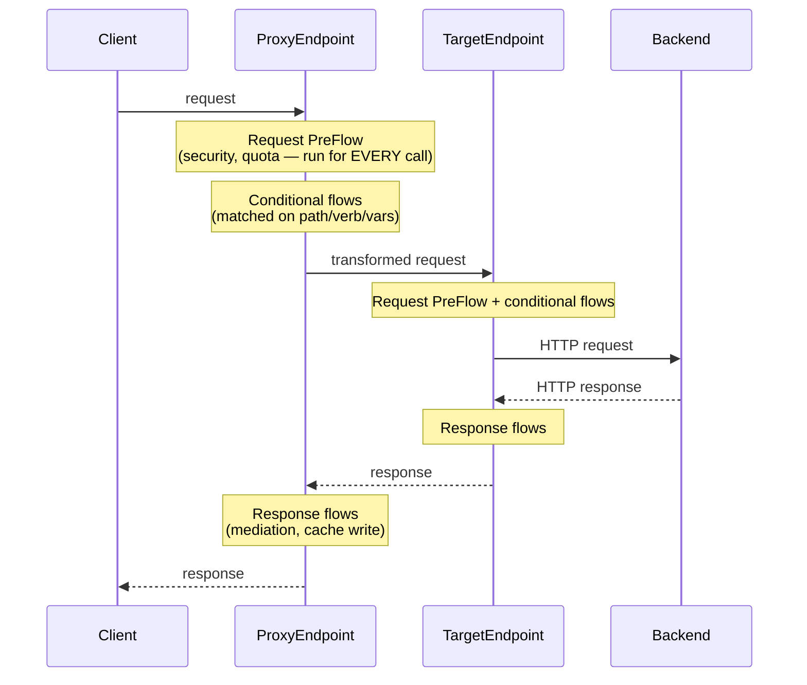

# Proxy Anatomy

Everything in Apigee hands-on work reduces to three ideas: **bundles**,
**endpoints**, and **flows**. Get these right and every policy doc makes sense.

!!! abstract "By the end of this page you can..."
    - Name every file in a bundle and say what it does.
    - Say, for any policy, *when* it will run relative to every other policy.
    - Explain why a fault skips the PostFlow.
    - Read a ProxyEndpoint top to bottom and predict which flow handles a URL.

    New to the vocabulary? Skim [Core Concepts](concepts.md) first.

## The bundle

An API proxy is a directory of XML (plus optional JS/Python/Java resources)
called a **bundle**. `apigeecli` zips and uploads it; Apigee stores it as an
immutable **revision**.



```
labs-proxy/
└── apiproxy/
    ├── proxies/
    │   └── default.xml          # ProxyEndpoint — the "front door"
    ├── targets/
    │   └── default.xml          # TargetEndpoint — the "backend"
    ├── policies/
    │   ├── AM-SetHello.xml      # one file per policy instance
    │   ├── VerifyAPIKey-Check.xml
    │   └── ...
    └── resources/
        └── jsc/
            └── shapeResponse.js # code called by JavaScript policies
```

!!! info "Policy file names"
    The file name in `policies/` **must** match the `<Policy name="...">`
    referenced in a flow `<Step>`. `AM-SetHello.xml` ↔ `<Step><Name>AM-SetHello</Name>`.

## Two endpoints

| Endpoint | File | Faces | Defines |
|---|---|---|---|
| **ProxyEndpoint** | `proxies/default.xml` | The client | Base path, virtual host, request/response flows |
| **TargetEndpoint** | `targets/default.xml` | The backend | Target URL, connection/SSL config, request/response flows |

Clients hit the ProxyEndpoint's `BasePath` (`/labs`); the TargetEndpoint
forwards to the backend `URL` (`mocktarget.apigee.net`).

## Flows — where policies execute

Each endpoint has a request pipeline and a response pipeline, divided into
**PreFlow**, **PostFlow**, and conditional **Flow** blocks. Policies attach as
`<Step>`s and execute **in document order**.



| Block | Runs when | Typical contents |
|---|---|---|
| **PreFlow** | always, first | rate limiting, auth that covers every path, config loading |
| **Flow** (conditional) | only the **first** one whose `<Condition>` is true | path/verb specific policies |
| **PostFlow** | always, last | response decoration (CORS headers, logging) |
| **PostClientFlow** (response only) | after the response is sent | message logging — can't change the response |

!!! note "Why the response phase runs in reverse"
    The response travels back through the same two endpoints it came
    through, **target first, proxy last**. Anything you attach to the
    *proxy* response therefore sees the final, target-processed message —
    which is why mediation (reshaping) lives there.





```xml
<!-- simplified teaching excerpt of a ProxyEndpoint -->
<ProxyEndpoint name="default"> <!-- (1)! -->
  <PreFlow name="PreFlow"> <!-- (2)! -->
    <Request>
      <Step><Name>VerifyAPIKey-Check</Name></Step> <!-- (3)! -->
      <Step><Name>Quota-PerApp</Name></Step> <!-- (4)! -->
    </Request>
    <Response/>
  </PreFlow>

  <Flows> <!-- (5)! -->
    <Flow name="get-orders">
      <Condition>(proxy.pathsuffix MatchesPath "/orders") and (request.verb = "GET")</Condition> <!-- (6)! -->
      <Request/>
      <Response>
        <Step><Name>JS-ShapeResponse</Name></Step> <!-- (7)! -->
      </Response>
    </Flow>
  </Flows>

  <PostFlow name="PostFlow"> <!-- (8)! -->
    <Request/><Response/>
  </PostFlow>

  <HTTPProxyConnection>
    <BasePath>/labs</BasePath> <!-- (9)! -->
    <VirtualHost>default</VirtualHost> <!-- (10)! -->
  </HTTPProxyConnection>
  <RouteRule name="default"> <!-- (11)! -->
    <TargetEndpoint>default</TargetEndpoint> <!-- (12)! -->
  </RouteRule>
</ProxyEndpoint>
```

1. The container for everything the client-facing side does. `name` is just
   an identifier.
2. PreFlow: unconditional, always first. No `<Condition>` allowed here.
3. First policy to run for **every** request — authenticate before spending
   anything else.
4. Second: Quota. Listed after the key check because it needs the identity
   the key check produces. Steps run in document order, so the order *is* the
   logic.
5. Container for conditional flows. Evaluated top to bottom after PreFlow;
   first true condition wins.
6. Two conditions joined with `and`. `proxy.pathsuffix` is what comes *after*
   `/labs`; `request.verb` is the HTTP method.
7. Attached in the **Response** half: runs on the way back to the client,
   after the target replied, so `response.content` is the backend's body.
8. PostFlow: always runs last in this endpoint, whichever flow matched. Empty
   here — present so the structure is explicit.
9. The URL prefix that selects this proxy. Together with the environment
   group hostname it forms the public URL.
10. Legacy name for "the listener this proxy attaches to" — in Apigee X the
    hostname comes from the environment group, so it is always `default`.
11. Routing decision made after the proxy request flow completes. Rules are
    checked in order; an unconditioned rule is the fallback and must be last.
12. Names the TargetEndpoint file to hand the request to. Omit it and the
    rule means "no backend" (used by edge-only endpoints in the labs).

Key details:

- **`proxy.pathsuffix`** is the path *after* the `BasePath` — for
  `/labs/orders` the pathsuffix is `/orders`.
- **First matching conditional flow wins** — order your `<Flow>` blocks
  deliberately. A `<Flow>` with no `<Condition>` matches everything.
- **`RouteRule`** decides which TargetEndpoint receives the request; you can
  add conditions here to route `/v1` and `/v2` to different backends.

## Flow variables

Apigee maintains a per-transaction variable bag. Policies read and write
these; conditions evaluate them. You'll use these constantly:

| Variable | Contains | Set by |
|---|---|---|
| `request.verb`, `request.uri` | HTTP method, full URI | runtime |
| `proxy.pathsuffix`, `proxy.basepath` | path relative to / full base path | runtime |
| `response.status.code`, `response.content` | backend's reply | runtime |
| `verifyapikey.{policy}.client_id` | the validated app's key | `VerifyAPIKey` |
| `developer.email`, `apiproduct.name` | app metadata | `VerifyAPIKey`/`OAuthV2` |
| `ratelimit.{policy}.allowed.count` / `.used.count` | quota counters | `Quota` |
| `fault.name`, `error.status.code` | error context | fault handling |

Inside policy XML, `{variable}` interpolates a value:
`<Value>{"app": "{developer.email}"}</Value>`.

!!! tip "Discover variables in Trace"
    The Trace tool shows every variable's value after each step. When a
    condition doesn't fire, compare the actual variable values against your
    `<Condition>` — it's almost always a pathsuffix or verb mismatch.

## Fault handling

Any policy can fail → the flow short-circuits into **FaultRules** (on the
same endpoint), then **DefaultFaultRule** if nothing matches. Faults carry
`fault.name` (e.g. `FailedToResolveAPIKey`) you match on:

```xml
<FaultRules>
  <FaultRule name="bad-key">
    <Step><Name>AM-Error-401</Name></Step>
    <Condition>(fault.name = "FailedToResolveAPIKey")</Condition>
  </FaultRule>
</FaultRules>
<DefaultFaultRule name="default-fault">
  <Step><Name>AM-Error-Generic</Name></Step>
</DefaultFaultRule>
```

Lab 6 exercises this deliberately — you'll break the key check on purpose and
watch the fault pipeline produce a clean JSON error.

!!! warning "Fault facts that bite"
    - FaultRules are evaluated **top to bottom, first match wins**; the
      `DefaultFaultRule` runs only if none did (unless `AlwaysEnforce`).
    - The normal **PostFlow is skipped** on a fault — decorate error
      responses (e.g. CORS headers) inside the fault policies.
    - A step with `continueOnError="true"` that fails does *not* trigger fault
      handling — useful for optional enrichment, dangerous for security.
    - FaultRules can live on the **TargetEndpoint** too; those catch backend
      errors (e.g. `ErrorResponseCode` for a 5xx from the target) before the
      proxy-level rules see them.

!!! question "Predict before you read on"
    With the excerpt above, a client sends `GET /labs/orders` with **no API
    key**. Which steps run? Is `JS-ShapeResponse` among them? Does the
    PostFlow run?

    ??? success "Answer"
        `VerifyAPIKey-Check` runs and **faults**. Quota, the conditional flow
        and JS never execute. The PostFlow is skipped as well — the request
        jumps straight to fault handling. See the next section.

## Revision model

Every deploy creates a new numbered **revision**; traffic moves to it
atomically. `--ovr` in `deploy.sh` redeploys in place — fine for labs. In
production you promote a *fixed* revision through environments
(see [Deploy & CI/CD](deploy-cicd.md)).

## Check yourself

??? question "1. Which file would you open to change the backend URL? Which to change the public path?"
    `targets/default.xml` (`<URL>`) for the backend; `proxies/default.xml`
    (`<BasePath>`) for the public path.

??? question "2. Two conditional flows both match a request. Which runs?"
    Only the **first** in document order. PreFlow and PostFlow still run.

??? question "3. On the response side, which runs first: the proxy's PreFlow or the target's PreFlow?"
    The **target's**. The response retraces the path: target phases, then
    proxy phases.

??? question "4. You rename a policy's `name` attribute but not the `<Step>`. What happens at import?"
    The import fails (or the step can't resolve a policy): step name, file
    name and `name` attribute must all agree.

??? question "5. Why is the PostFlow a poor place to enforce a security check?"
    It runs *after* the target was already called, and it is skipped on
    faults. Security belongs in the PreFlow (or an early conditional flow).

Ready for the full picture? Walk the real bundle in
[Bundle Walkthrough](walkthrough.md), then start
[Lab 1](labs/first-proxy.md).
