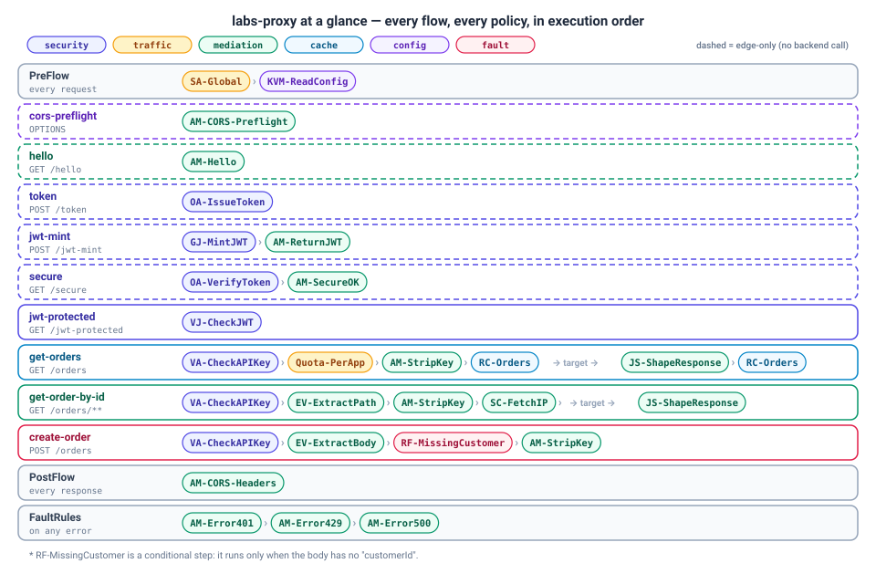
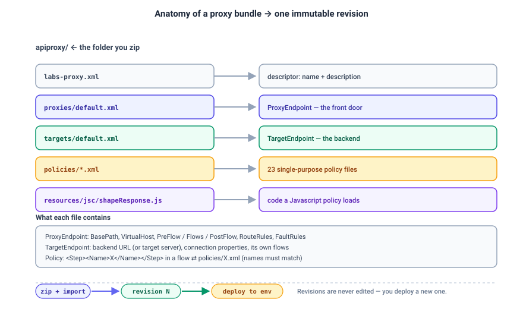

# Bundle Walkthrough — Line by Line

This page reads the **real files** in `examples/labs-proxy/` one line at a
time. Hover (or tap) the numbered **+** markers in each code block — each one
explains the line it sits on. Come back here whenever a lab references a
file and you want the full context.

!!! abstract "Learning approach"
    **Predict, then reveal.** Before you open any annotation, guess what the
    line does. The gap between your guess and the explanation is where the
    learning happens.

## The map





## 1. `labs-proxy.xml` — the descriptor

```xml
<?xml version="1.0" encoding="UTF-8" standalone="yes"?> <!-- (1)! -->
<APIProxy name="labs-proxy"> <!-- (2)! -->
  <Description>Hands-on labs proxy — see docs/apigee/ for the guided labs</Description> <!-- (3)! -->
</APIProxy>
```

1. Standard XML prolog. Every Apigee config file starts this way.
2. `name` is the proxy's identity in the org. It is what you pass to
   `apigeecli ... -n labs-proxy` and what products list under `--proxies`.
   Changing it creates a **different** proxy, not a new revision.
3. Free text shown in the console. Note this file does **not** list
   endpoints or policies — Apigee discovers those from the folders.

## 2. `proxies/default.xml` — the front door

The file is long, so it's split into the five regions you'll find in any
ProxyEndpoint: PreFlow, conditional Flows, PostFlow, fault handling, and
connection + routing.

### 2a. PreFlow — runs for every request

```xml
<ProxyEndpoint name="default"> <!-- (1)! -->
  <PreFlow name="PreFlow"> <!-- (2)! -->
    <Request> <!-- (3)! -->
      <Step><Name>SA-Global</Name></Step> <!-- (4)! -->
      <Step><Name>KVM-ReadConfig</Name></Step> <!-- (5)! -->
    </Request>
    <Response/> <!-- (6)! -->
  </PreFlow>
```

1. The endpoint's own name. A proxy may have several ProxyEndpoints (e.g.
   different base paths); `default` is the conventional single one.
2. PreFlow is the **mandatory first stop**: no conditions, no skipping. Put
   things here that must hold for *every* call — rate limiting, config
   loading, authentication that covers the whole API.
3. `<Request>` = the inbound half of this phase (client → proxy).
4. **Spike arrest first.** It's the cheapest check and protects everything
   after it. A flood is rejected before any key lookup, KVM read or backend
   call is paid for.
5. Loads `cors.origin`, `jwt.secret` and `cache.ttl` into flow variables.
   It has to run *before* any step that uses `{kvm.cors.origin}` or
   `private.jwt.secret` — which is why it lives in PreFlow, not in each flow.
6. Empty `<Response/>` — nothing to do on the way back out at this phase. The
   element is still written so the structure is explicit.

### 2b. Conditional flows — "one of these"

```xml
  <Flows>
    <Flow name="cors-preflight"> <!-- (1)! -->
      <Condition>(request.verb = "OPTIONS")</Condition> <!-- (2)! -->
      <Request>
        <Step><Name>AM-CORS-Preflight</Name></Step> <!-- (3)! -->
      </Request>
      <Response/>
    </Flow>

    <Flow name="hello">
      <Condition>(proxy.pathsuffix MatchesPath "/hello") and (request.verb = "GET")</Condition> <!-- (4)! -->
      <Request/>
      <Response>
        <Step><Name>AM-Hello</Name></Step> <!-- (5)! -->
      </Response>
    </Flow>
```

1. Flows are evaluated **top to bottom; the first whose condition is true
   wins** and the rest are skipped. So the order in this file is part of the
   behaviour. `cors-preflight` is first on purpose: a browser preflight to
   *any* path should be answered before path-specific flows are considered.
2. Matches on **verb only** — any path. Parentheses are optional here but
   keep conditions readable when you add `and`/`or` later.
3. Builds the `204` response with CORS headers. Because the next section's
   RouteRule sends `OPTIONS` to *no target* (edge-only), this *is* the
   response; the backend never hears about the preflight.
4. Both halves must be true: path suffix is exactly `/hello` (after the
   `/labs` base path) **and** it's a `GET`. A `POST /hello` matches no flow
   here and falls through to the target — that's Lab 1's experiment 2.
5. The step is in `<Response>` even though no backend is called: for
   edge-only routes the response phase is still where the reply is shaped.
   `AM-Hello` *sets* the response body and status.

```xml
    <Flow name="token">
      <Condition>(proxy.pathsuffix MatchesPath "/token") and (request.verb = "POST")</Condition>
      <Request>
        <Step><Name>OA-IssueToken</Name></Step> <!-- (1)! -->
      </Request>
      <Response/>
    </Flow>

    <Flow name="jwt-mint">
      <Condition>(proxy.pathsuffix MatchesPath "/jwt-mint") and (request.verb = "POST")</Condition>
      <Request>
        <Step><Name>GJ-MintJWT</Name></Step> <!-- (2)! -->
        <Step><Name>AM-ReturnJWT</Name></Step> <!-- (3)! -->
      </Request>
      <Response/>
    </Flow>

    <Flow name="jwt-protected">
      <Condition>(proxy.pathsuffix MatchesPath "/jwt-protected") and (request.verb = "GET")</Condition>
      <Request>
        <Step><Name>VJ-CheckJWT</Name></Step> <!-- (4)! -->
      </Request>
      <Response/>
    </Flow>

    <Flow name="secure">
      <Condition>(proxy.pathsuffix MatchesPath "/secure") and (request.verb = "GET")</Condition>
      <Request>
        <Step><Name>OA-VerifyToken</Name></Step> <!-- (5)! -->
        <Step><Name>AM-SecureOK</Name></Step> <!-- (6)! -->
      </Request>
      <Response/>
    </Flow>
```

1. `OAuthV2` with `GenerateAccessToken` **writes the HTTP response itself**
   (`<GenerateResponse enabled="true"/>`), which is why this flow needs no
   second step.
2. Signs a JWT and stores it in the variable `generated_jwt`. Nothing is
   returned to the client yet — it's just a variable.
3. Wraps that variable into `{"token": "..."}`. Splitting *create* and
   *return* keeps each policy single-purpose.
4. Verifies the incoming JWT and **then lets the request continue to the
   backend** (this path is *not* in the edge-only RouteRule, so it routes to
   the target). If verification fails, the flow aborts into FaultRules and
   the backend is never contacted.
5. Fails with `InvalidAccessToken` / `access_token_expired` etc. if the
   bearer token is bad; otherwise sets `developer.app.name` and friends.
6. Reads `{developer.app.name}` — only available because step 5 succeeded.
   **Order = dependency order.**

```xml
    <Flow name="get-orders">
      <Condition>(proxy.pathsuffix MatchesPath "/orders") and (request.verb = "GET")</Condition>
      <Request>
        <Step><Name>VA-CheckAPIKey</Name></Step> <!-- (1)! -->
        <Step><Name>Quota-PerApp</Name></Step> <!-- (2)! -->
        <Step><Name>AM-StripKey</Name></Step> <!-- (3)! -->
        <Step><Name>RC-Orders</Name></Step> <!-- (4)! -->
      </Request>
      <Response>
        <Step><Name>JS-ShapeResponse</Name></Step> <!-- (5)! -->
        <Step><Name>RC-Orders</Name></Step> <!-- (6)! -->
      </Response>
    </Flow>
```

1. **Authenticate** → produces `client_id`, developer, app, product.
2. **Count** → needs `client_id` from step 1 for its `Identifier`.
3. **Sanitize** → remove the `apikey` query param *before* anything leaves
   the proxy. It's after Quota because Quota only needs the variable, not the
   raw query param.
4. **Cache lookup.** It comes *after* auth and quota on purpose: an
   unauthenticated caller can never read a cached response, and cache hits
   still count against the quota. If you want hits to be "free", move this
   step above `Quota-PerApp` — and think hard about who can then read cached
   data.
5. Runs in the response phase for both misses *and* hits. It wraps the body
   and stamps quota/app info. (It has an explicit branch for hits — see the
   [JS walkthrough](#4-shaperesponsejs-the-javascript).)
6. **Same policy, second attachment** — now in `<Response>` it *populates*
   the cache. A hit skips the target and, because the policy's response-side
   attachment is skipped on a hit, nothing is re-stored.

```xml
    <Flow name="get-order-by-id">
      <Condition>(proxy.pathsuffix MatchesPath "/orders/**") and (request.verb = "GET")</Condition> <!-- (1)! -->
      <Request>
        <Step><Name>VA-CheckAPIKey</Name></Step>
        <Step><Name>EV-ExtractPath</Name></Step> <!-- (2)! -->
        <Step><Name>AM-StripKey</Name></Step>
        <Step><Name>SC-FetchIP</Name></Step> <!-- (3)! -->
      </Request>
      <Response>
        <Step><Name>JS-ShapeResponse</Name></Step>
      </Response>
    </Flow>

    <Flow name="create-order">
      <Condition>(proxy.pathsuffix MatchesPath "/orders") and (request.verb = "POST")</Condition> <!-- (4)! -->
      <Request>
        <Step><Name>VA-CheckAPIKey</Name></Step>
        <Step><Name>EV-ExtractBody</Name></Step> <!-- (5)! -->
        <Step>
          <Condition>!(request.content ~~ "(?s).*customerId.*")</Condition> <!-- (6)! -->
          <Name>RF-MissingCustomer</Name>
        </Step>
        <Step><Name>AM-StripKey</Name></Step>
      </Request>
      <Response/>
    </Flow>
  </Flows>
```

1. `/**` = any depth below `/orders/`. `/orders/42` and `/orders/42/items`
   both match; plain `/orders` does not (it belongs to `get-orders`).
2. Pulls `42` into `urirequest.orderId`.
3. A **blocking** side request to `httpbin.org/ip`. The result lands in
   `ipResponse.content`, which `JS-ShapeResponse` reads as `enrichedFrom`.
   Note there's no caching here — every call pays the callout latency.
4. Same path as `get-orders` but a different **verb**; both conditions
   must be true, so the two flows never collide.
5. Extracts `$.customerId` into `extracted.customerId`. With
   `IgnoreUnresolvedVariables=true` a missing field is *not* an error — which
   is exactly why the next step validates explicitly.
6. A **conditional step**: this single step runs only if the body *doesn't*
   contain `customerId`. `~~` is the Java-regex operator and `(?s)` lets `.`
   match newlines so multi-line JSON still works. When it runs,
   `RF-MissingCustomer` raises a 400 and the flow stops.

### 2c. PostFlow, faults, connection, routing

```xml
  <PostFlow name="PostFlow">
    <Request/>
    <Response>
      <Step><Name>AM-CORS-Headers</Name></Step> <!-- (1)! -->
    </Response>
  </PostFlow>

  <FaultRules> <!-- (2)! -->
    <FaultRule name="auth-faults">
      <Step><Name>AM-Error401</Name></Step>
      <Condition>(fault.name = "FailedToResolveAPIKey") or
                (fault.name = "InvalidApiKey") or
                (fault.name = "InvalidAccessToken") or
                (fault.name Matches "*Token*") or
                (fault.name Matches "*Signature*") or
                (fault.name Matches "*JWT*")</Condition> <!-- (3)! -->
    </FaultRule>
    <FaultRule name="throttled">
      <Step><Name>AM-Error429</Name></Step>
      <Condition>(fault.name = "QuotaViolation") or
                (fault.name = "SpikeArrestViolation")</Condition> <!-- (4)! -->
    </FaultRule>
  </FaultRules>
  <DefaultFaultRule name="fallback">
    <Step><Name>AM-Error500</Name></Step> <!-- (5)! -->
    <Condition>fault.name != "RaiseFault"</Condition> <!-- (6)! -->
  </DefaultFaultRule>
```

1. PostFlow runs **last in the proxy's response phase, for every
   successful call** — the right home for headers every response needs.
2. Only evaluated when something *faulted*. Rules are checked top to bottom
   and the first matching one runs.
3. Matches on `fault.name`. Several spellings are listed because the names
   differ by policy (`FailedToResolveAPIKey` from VerifyAPIKey,
   `InvalidAccessToken` from OAuthV2, `TokenExpired`/`InvalidSignature` from
   VerifyJWT). The wildcard lines catch variants you didn't enumerate.
4. Both traffic policies map to the same client-facing story: slow down and
   retry — HTTP 429.
5. The catch-all keeps clients from ever seeing Apigee's default fault
   format. It runs only if **no FaultRule above it executed**.
6. Exclusion for deliberate faults: `RF-MissingCustomer` is a `RaiseFault`
   that already builds a precise `400`. Without this condition the catch-all
   would run afterwards and overwrite that 400 with a generic 500.

!!! warning "Why not `AlwaysEnforce`?"
    `<AlwaysEnforce>true</AlwaysEnforce>` makes the default rule run **even
    when a FaultRule already handled the error**. With an unconditional
    `AM-Error500` that means every 401 and 429 would be overwritten with a
    500. Leave it off unless the default rule is meant to *add* something
    (e.g. a logging step) to every error.

```xml
  <HTTPProxyConnection>
    <BasePath>/labs</BasePath> <!-- (1)! -->
    <VirtualHost>default</VirtualHost> <!-- (2)! -->
  </HTTPProxyConnection>

  <RouteRule name="edge-only"> <!-- (3)! -->
    <Condition>(request.verb = "OPTIONS") or
               (proxy.pathsuffix MatchesPath "/hello") or
               (proxy.pathsuffix MatchesPath "/token") or
               (proxy.pathsuffix MatchesPath "/jwt-mint") or
               (proxy.pathsuffix MatchesPath "/secure")</Condition>
  </RouteRule>
  <RouteRule name="default"> <!-- (4)! -->
    <TargetEndpoint>default</TargetEndpoint>
  </RouteRule>
</ProxyEndpoint>
```

1. Every URL for this proxy begins with `/labs`. What follows is
   `proxy.pathsuffix`. Two proxies in one environment group can't share a
   base path.
2. In Apigee X the virtual host is effectively the environment group; the
   value is a legacy name kept for compatibility.
3. A RouteRule **with no `<TargetEndpoint>`** means "no backend" — Apigee
   skips the target entirely and builds the response from the proxy side.
   This is the mechanism behind every dashed row in the map above.
4. The unconditional rule **must be last**: rules are evaluated in order, so
   an unconditioned rule placed first would swallow every request.

## 3. `targets/default.xml` — the backend

```xml
<TargetEndpoint name="default"> <!-- (1)! -->
  <HTTPTargetConnection>
    <URL>https://mocktarget.apigee.net</URL> <!-- (2)! -->
    <Properties>
      <Property name="success.codes">2xx</Property> <!-- (3)! -->
    </Properties>
  </HTTPTargetConnection>
</TargetEndpoint>
```

1. The name referenced by `<RouteRule><TargetEndpoint>default</...>`.
2. Where the request is forwarded. The **path suffix and query string are
   appended automatically**: `/labs/orders?x=1` → `/orders?x=1`. (For
   per-env hosts use a `LoadBalancer`/target server — see
   [Deploy & CI/CD](deploy-cicd.md).)
3. Narrows "success" to 2xx. By default Apigee treats 1xx–3xx as success and
   4xx/5xx as failures that enter fault handling; with this property a 3xx
   from the backend is a failure too. Set it deliberately — e.g. `2xx,3xx` if
   your backend redirects.

## 4. `shapeResponse.js` — the JavaScript

```javascript
var ctx = context; // (1)!

var cacheHit = ctx.getVariable("responsecache.RC-Orders.cachehit"); // (2)!
var app      = ctx.getVariable("developer.app.name") || "anonymous"; // (3)!
var dev      = ctx.getVariable("developer.email") || "n/a";
var orderId  = ctx.getVariable("urirequest.orderId") || null; // (4)!

var origin = null;
try {
  origin = JSON.parse(ctx.getVariable("ipResponse.content") || "{}").origin || null; // (5)!
} catch (e) {}

var upstream = {};
try {
  upstream = JSON.parse(ctx.getVariable("response.content") || "{}"); // (6)!
} catch (e) {
  upstream = { raw: ctx.getVariable("response.content") };
}

var body;
if (cacheHit === true || cacheHit === "true") { // (7)!
  upstream.cache = "hit (edge)";
  body = upstream;
} else {
  body = {
    message: orderId ? "order " + orderId : "orders list",
    app: app,
    developer: dev,
    orderId: orderId,
    quota: {
      allowed:   ctx.getVariable("ratelimit.Quota-PerApp.allowed.count"), // (8)!
      used:      ctx.getVariable("ratelimit.Quota-PerApp.used.count"),
      available: ctx.getVariable("ratelimit.Quota-PerApp.available.count")
    },
    enrichedFrom: origin,
    upstream: upstream,
    cache: "miss (backend)"
  };
}

ctx.setVariable("response.content", JSON.stringify(body)); // (9)!
ctx.setVariable("response.header.content-type", "application/json");
print("JS-ShapeResponse cacheHit=" + cacheHit + " orderId=" + orderId); // (10)!
```

1. `context` is the global object Apigee injects into every JS policy — the
   bridge to flow variables. Aliasing it keeps lines short.
2. `<policy-type>.<policy-name>.<property>` again: the `ResponseCache` policy
   named `RC-Orders` publishes `cachehit`.
3. `|| "anonymous"` — flow variables you didn't set return `null`, so give
   every read a default. (On `/orders` these exist because `VA-CheckAPIKey`
   ran first.)
4. Only set when `EV-ExtractPath` ran, i.e. on `/orders/{id}`; elsewhere
   `null`.
5. `ipResponse` is the name given in `SC-FetchIP`'s `<Response>`. The `try`
   protects against the callout being absent (the plain `/orders` flow has no
   callout) or returning non-JSON.
6. At this point (response flow) `response.content` is the **backend's** body.
7. Cache hits arrive here with the body **already shaped** (it was stored
   after this policy ran), so we only annotate. Re-wrapping would nest the
   envelope inside itself on every hit. Note the two comparisons: depending on
   the runtime the variable can be a boolean or a string.
8. `Quota` publishes `ratelimit.<policy>.allowed.count`,
   `.used.count`, `.available.count`. (Older Apigee material shows
   `quota.*` — that is *not* a thing in Apigee X.)
9. Writing `response.content` replaces the body the client will see.
   Always `JSON.stringify` — it's a string variable.
10. Output appears in the Debug/Trace panel for this step. It's your only
    `console.log`.

## 5. `deploy.sh` — the glue

```bash
set -euo pipefail # (1)!

SCRIPT_DIR="$(cd "$(dirname "$0")" && pwd)" # (2)!
: "${APIGEE_ORG:?export APIGEE_ORG first}" # (3)!
APIGEE_ENV="${APIGEE_ENV:-eval}" # (4)!
TOKEN="${TOKEN:-$(gcloud auth print-access-token)}" # (5)!

apigeecli kvms create -o "$APIGEE_ORG" -e "$APIGEE_ENV" -n labs-config -t "$TOKEN" 2>/dev/null || true # (6)!

seed() {  # create-or-update a KVM entry
  apigeecli kvms entries create ... 2>/dev/null \
  || apigeecli kvms entries update ... >/dev/null # (7)!
}

seed cors.origin "https://myspa.example.com" # (8)!
seed jwt.secret  "lab-secret-do-not-use-in-prod-0123456789" # (9)!
seed cache.ttl   "60"

apigeecli apis create bundle -o "$APIGEE_ORG" -e "$APIGEE_ENV" \
  --proxy-folder "$SCRIPT_DIR/apiproxy" -n labs-proxy -t "$TOKEN" --ovr # (10)!
```

1. Strict mode: exit on any error (`-e`), on unset variables (`-u`), and on
   failures inside pipes (`pipefail`). A half-deployed proxy is worse than a
   loud failure.
2. Resolve the script's own directory so it works from any working
   directory.
3. `${VAR:?msg}` aborts with `msg` if `APIGEE_ORG` is unset — fail fast with a
   useful message instead of a confusing API error.
4. Default env `eval`, overridable: `APIGEE_ENV=dev ./deploy.sh`.
5. Use an exported `TOKEN` if present, else mint one from your gcloud login.
6. Create the KVM; `|| true` makes re-runs idempotent (it already exists).
7. "Upsert" idiom: try create, fall back to update.
8. Origin allowed by CORS (Lab 7).
9. The JWT HMAC key. **Apigee enforces a 32-byte minimum for HS256** —
   a shorter key makes `GenerateJWT`/`VerifyJWT` fail at runtime with
   `InsufficientKeyLength`, which is why this value is longer than a typical
   "lab secret".
10. Zip the folder, import it as a new revision, and deploy it with `--ovr`
    ("override"): replaces whatever revision is currently deployed.

## Check yourself

??? question "1. Reorder: `Quota-PerApp`, `VA-CheckAPIKey`, `AM-StripKey`. Which orders are valid and why?"
    `VA-CheckAPIKey` must precede `Quota-PerApp` (the identifier variable
    doesn't exist before it). `AM-StripKey` is independent of Quota and can be
    anywhere after authentication — but must be before the request leaves for
    the target.

??? question "2. You add a new flow `/orders/**` GET *above* `get-orders`. What breaks?"
    Nothing for `/orders` (exact match doesn't hit `/**`), but if your new flow
    used `MatchesPath "/**"` it would shadow everything below it. First
    match wins — pattern order is behaviour.

??? question "3. Why doesn't `/hello` hit mocktarget even though a default RouteRule exists?"
    The `edge-only` RouteRule is listed first and its condition matches, so
    it wins; it has no TargetEndpoint, so no backend call is made.

??? question "4. Predict: `GET /labs/orders` with a valid key, called twice in 10 s. What differs in the second response body?"
    `cache` becomes `"hit (edge)"`, and the `quota`/`app` fields from the
    first (shaped) response are the ones replayed — the quota counter is
    **not** recomputed in the cached body, though the hit still increments
    the real counter.
